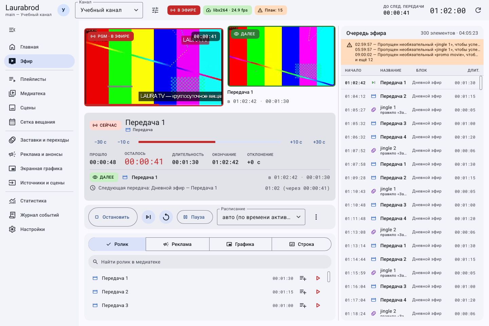

# Как провести обычную смену оператора

## До эфира

1. Проверьте канал и сервер в шапке и настройках.
2. Проверьте доступность материалов через **Медиатека → Проверить файлы**.
3. Убедитесь, что плейлисты, сетка, правила и графика сохранены.
4. Просмотрите [прогноз](guides/schedule-timing.md) на смену и устраните неожиданные пустоты и конфликты.
5. Проверьте [выходы](guides/outputs.md), [запись](guides/recording.md) и свободное место.

## Во время эфира

На **Главной** и **Эфире** следите за текущим материалом, очередью и состоянием кодировщика. Проверяйте приём у получателя: один локальный монитор не доказывает доставку. Для внеплановых действий используйте [ручное управление](guides/air-control.md), затем явно возвращайтесь к расписанию.

Перед любым действием проверьте выбранный канал. Пауза расписания не останавливает картинку и звук.

## После смены

Сохраните [отчёт](guides/statistics.md), разберите предупреждения [журнала](guides/logs.md), перед изменениями создайте [копию](guides/backup-restore.md). Для круглосуточного вещания не нажимайте «Остановить» просто из-за завершения своей смены. При встроенном движке не выходите из процесса, который должен продолжать эфир; при наличии трея скрывайте окно по [инструкции](guides/appearance.md).

[Главная](index.md) · [Все гайды](guides/index.md)
