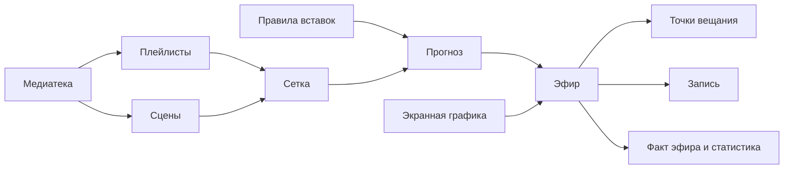

# Как материалы превращаются в эфир

Прогноз показывает намерение планировщика; факт эфира фиксирует выполненные показы. Ручное управление может изменить выполнение.

[Первый эфир](../guides/first-broadcast.md) · [Главная](../index.md)
