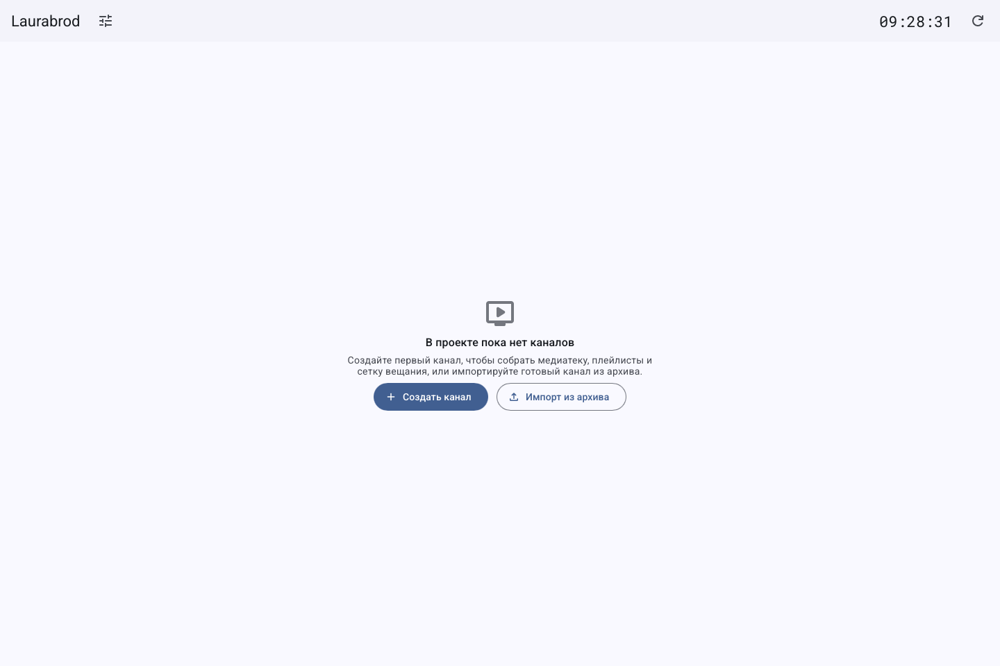
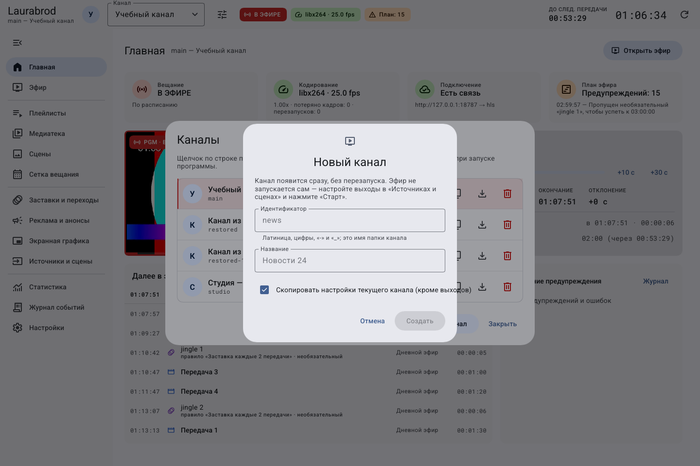
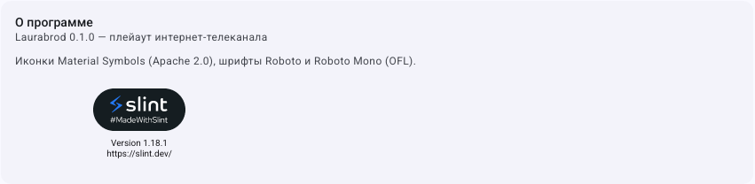

# Как впервые открыть программу и выбрать проект

Для первого знакомства: [объяснение основ](start-here.md) и [учебное занятие целиком](guides/first-channel-workshop.md).

Проект — каталог с конфигурацией и каналами. Запуск с ярлыка открывает текущий проект, если он обнаружен, затем последний запомненный; иначе используется папка `LauraBoard` в «Документах» с первоначальным проектом.

1. Откройте ярлык LauraBoard.
2. Дождитесь связи с движком. Если каналов нет, нажмите **Создать канал**; если открыт демонстрационный — ознакомьтесь с Главной и выберите дальнейшее действие.
3. Откройте **Настройки**, проверьте сервер и версию. Отдельной обязательной регистрации аккаунта в LauraBoard не обнаружено; удалённый сервер может требовать токен.
4. Создайте [свой канал](guides/create-channel.md) либо [импортируйте архив](guides/transfer-channel.md).
5. Пройдите [первый локальный эфир](guides/first-broadcast.md).

Стартовый кадр показывает доступные действия создания и импорта; это демонстрационное состояние, а не подтверждение очистки проекта.

В этой форме создаётся отдельный канал. Его название можно писать по-русски, идентификатор — латиницей.

Для явного открытия другого проекта используйте `lauraboard -p "<папка проекта>" gui`. Папка должна содержать действительный проект; создание из CLI — `init`. Запуск без аргументов из терминала показывает справку и отличается от запуска с ярлыка.

Если окно не открылось, см. [запуск и отрисовка](troubleshooting/startup.md). Если каналов не видно, проверьте сервер, проект и фильтры, прежде чем создавать их заново. Отдельного штатного диалога «Открыть проект» в изученном интерфейсе нет.

[Главная](index.md) · [Быстрый старт](getting-started.md)

