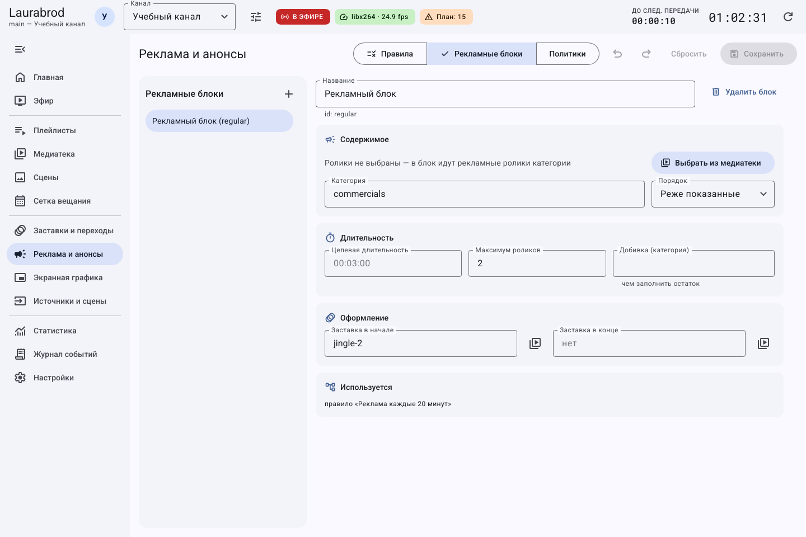
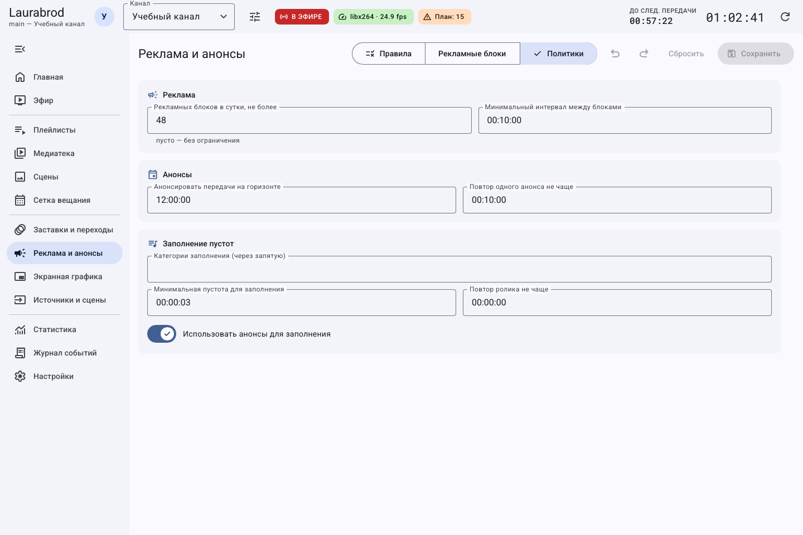

# Как настроить рекламу, анонсы и переходы

> Laurabrod 0.1.0. Снимки показывают реальный интерфейс; демонстрационные состояния подписаны отдельно. Способы и пределы проверки перечислены в [отчёте](../verification.md).

**Потребуется:** материалы типов **Реклама**, **Анонс** и при необходимости **Заставка** в медиатеке.

## Как создать рекламный блок

1. Откройте **Реклама и анонсы → Рекламные блоки**.
2. Нажмите **Новый рекламный блок** (`+`), задайте **Название**.
3. В **Содержимое → Выбрать из медиатеки** отметьте рекламные ролики. Кнопками **Выше**, **Ниже** расположите их в нужном порядке.
4. Вместо явного списка можно использовать **Категория**: пустой список означает подбор рекламных материалов категории.
5. Выберите **Порядок**: **Как в списке**, **Случайно** или **Реже показанные**.
6. При необходимости задайте **Целевая длительность**, **Максимум роликов**, **Добивка (категория)** и заставки начала и конца.
7. Нажмите **Сохранить**. Проверьте раздел **Используется**, чтобы понимать, какие правила и блоки ссылаются на рекламу.

Целевая длительность требует подходящих роликов и добивки. Не считайте число в поле гарантией точного набора при отсутствии подходящих материалов.

## Как запланировать рекламу

1. На вкладке **Правила** создайте [правило вставки](insertion-rules.md).
2. Например, выберите **Каждые N минут**, `20`, действие **Рекламный блок**, затем созданный блок.
3. Настройте условия, сохраните и нажмите **Проверить на плане**.
4. Если нужен фиксированный старт, добавьте в сетку блок с источником рекламного блока.

## Как ограничить показы и настроить анонсы

1. Откройте **Политики**.
2. В **Реклама** задайте **Рекламных блоков в сутки, не более** и **Минимальный интервал между блоками**. Ограничение относится к блокам; не путайте его с лимитом отдельного ролика.
3. В **Анонсы** задайте **Анонсировать передачи на горизонте** и **Повтор одного анонса не чаще**.
4. Создайте правило с действием **Анонсы**, числом анонсов и при необходимости категорией.
5. Для привязки анонса к передаче используйте поле `promo` элемента медиатеки в [конфигурации](../configuration.md): блок, категория или конкретный материал. Отдельного поля такой привязки в обычной форме свойств ролика нет.
6. Сохраните и проверьте прогноз. Анонс должен соответствовать реально предстоящей передаче.

Прокрутите вкладку до параметров заполнения, если они не видны в первом кадре.

## Как настроить переходы

1. Откройте **Заставки и переходы → Переходы**.
2. Укажите **Длительность затемнения, мс** и типы материалов, перед которыми нужен переход. Пустой выбор означает все типы.
3. Сохраните; просмотрите границу между двумя роликами в локальном эфире или записи.

## Как вставить рекламу вручную и проверить показы

На **Эфире** откройте быстрые действия рекламы, выберите **Рекламный блок** и нажмите **Следующим** либо **Сейчас**. **Сейчас** прерывает текущий материал. Факт показов проверяйте в [статистике](statistics.md).

Если блок пуст, проверьте включение материалов, тип и категорию, ограничения и доступность файлов. Перед удалением блока удалите или измените его использования. До сохранения доступны отмена и сброс.

---

[Все гайды](index.md) · [Решение проблем](../troubleshooting/index.md) · [Главная](../index.md)
