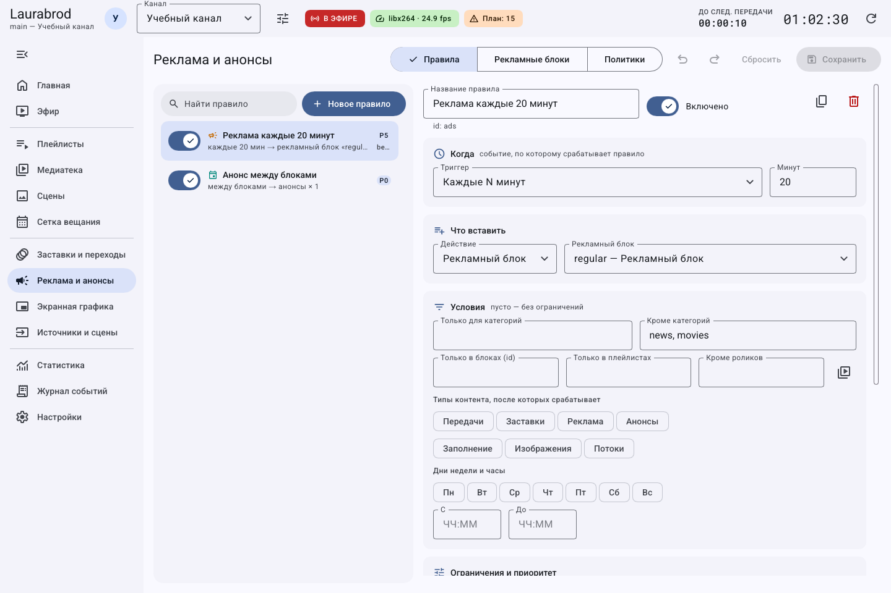
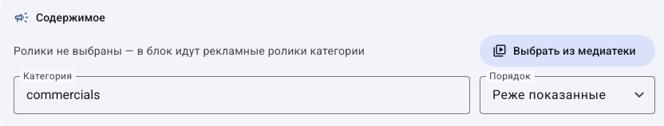
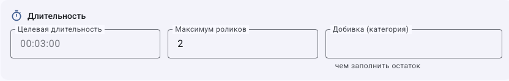
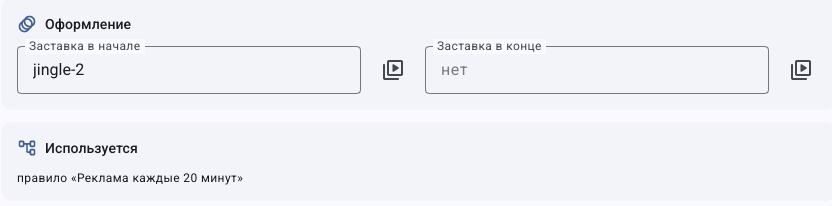

# Как подобрать рекламный блок и ограничить частоту показов

> LauraBoard 0.1.0. Поля сверены с кодом и реальным интерфейсом. Снимки показывают учебные данные; полный проход мышью не заявляется. [Проверки и ограничения](../verification.md).

**Задача:** рекламная пауза с предсказуемым составом и отдельной политикой повторов. Потребуются включённые ролики типа **Реклама**, а для добивки — подходящие материалы выбранной категории.

## Как собрать блок из списка или категории

1. Откройте **Реклама и анонсы → Рекламные блоки**, создайте блок и задайте название.
2. Для ручного состава в **Содержимое → Выбрать из медиатеки** отметьте ролики и расставьте их кнопками **Выше** и **Ниже**.
3. Для подбора по категории оставьте явный список пустым и задайте **Категория**. Заполненный список не следует считать добавлением всей категории к нему.
4. Выберите **Порядок**: **Как в списке**, **Случайно** либо **Реже показанные**. Последний вариант использует историю, а не гарантирует равное число показов при любых ограничениях.
5. Сохраните, назначьте блок действием правила или источником блока сетки. Само создание рекламного блока не планирует его показ.

## Как ограничить размер паузы и добавить оформление

1. В **Целевая длительность** задайте желаемый размер паузы, например `02:00`.
2. В **Максимум роликов** укажите предел количества. Проверьте, что имеющихся роликов достаточно для выбранного времени.
3. Для заполнения остатка задайте **Добивка (категория)** и подготовьте материалы подходящей длительности.
4. Выберите заставки начала и конца, если они нужны. Их время также учитывайте при просмотре результата.
5. Сохраните и выполните **Проверить на плане** у правила. Просмотрите итоговый состав и границу следующей передачи; цель по длительности не создаёт недостающие подходящие ролики.

## Как ограничить рекламу и повторы анонсов

1. Откройте **Политики** и задайте **Рекламных блоков в сутки, не более**, а также **Минимальный интервал между блоками**.
2. Не трактуйте суточный лимит блоков как ограничение отдельного ролика.
3. Для анонсов задайте **Анонсировать передачи на горизонте** и **Повтор одного анонса не чаще**.
4. Создайте правило с действием **Анонсы** и нужным количеством. Привязку анонса к передаче задают через `promo` в [конфигурации](../configuration.md), отдельной формы этой привязки здесь нет.
5. Проверьте прогноз, затем фактическую историю: запланированная вставка и реально прошедший показ — разные результаты.

## Как проверить пропуск рекламы и вернуть прежний режим

1. Если паузы нет, проверьте наличие включённых доступных роликов, категорию, правило и его условия.
2. Посмотрите лимиты суток и интервал; проверьте сохранённый прогноз и журнал. Не повышайте лимиты до выяснения причины.
3. На **Эфире** можно подать блок **Следующим**; **Сейчас** прерывает текущий материал.
4. Факт показов ищите в **Статистика**, отчёты сохраняйте штатными CSV-кнопками. После теста уберите тестовое правило либо выключите его и сохраните.

Отменяйте несохранённые изменения сбросом; сохранённые значения возвращайте вручную. Перед удалением блока проверьте **Используется** и измените ссылки. Связано: [рецепты вставок и приоритетов](rule-recipes.md), [статистика](statistics.md).

## Как читать содержимое, длительность и оформление отдельно

1. Сначала выберите явные ролики кнопкой **Выбрать из медиатеки** либо подготовьте пустой список с нужной категорией.
2. Затем задайте **Порядок**. Этот список не устанавливает часы запуска блока.

3. Укажите целевую длительность в формате времени, ограничьте количество при необходимости.
4. В **Добивка (категория)** укажите категорию доступных материалов для остатка; это не путь и не идентификатор рекламного блока.

5. Для оформления выберите заставки начала/конца. В **Используется** проверьте правила, которые уже ссылаются на блок.
6. Сохраните и проверьте план: изменения состава не создают новое правило запуска сами по себе.

[Все гайды](index.md) · [Неполадки](../troubleshooting/index.md) · [Главная](../index.md)
