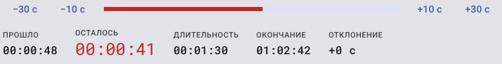
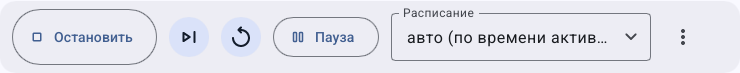
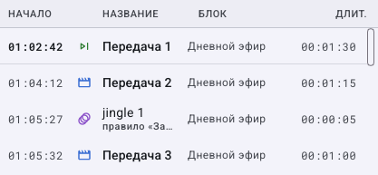

# Как управлять эфиром вручную и вернуться к расписанию

> LauraBoard 0.1.0. Снимки показывают реальный интерфейс; демонстрационные состояния подписаны отдельно. Способы и пределы проверки перечислены в [отчёте](../verification.md).

> Действия **Пропустить**, **Сначала**, перемотка и **Сейчас** меняют то, что видит зритель. Сначала отработайте их на учебном канале.

**Потребуется:** работающий канал и роль operator или admin.

## Как выбрать команду по намерению оператора

| Вы хотите | Действие | Что проверить сразу |
|---|---|---|
| Досмотреть текущий ролик, затем показать другой | **В очередь эфира** / **Следующим** | Текущий продолжает играть, нужная запись есть в ручной очереди |
| Прервать текущий ролик ради другого | **Показать сейчас…** / **Сейчас** | Название и изображение сменились на выбранные |
| Перезапустить текущий ролик | **Сначала** | Название то же, позиция вернулась к началу |
| Убрать текущий ролик | **Пропустить** | Начался следующий доступный материал |
| Временно управлять вручную | **Пауза расписания** | Изменился режим, а не обязательно картинка |
| Снова работать автоматически | **Вернуться к расписанию** | Активная сетка и её текущее время соответствуют ожиданию |
| Закончить вещание канала | **Остановить** | Подтверждено остановленное состояние |

Перед каждой командой прочитайте канал и текущий материал. После одной команды дождитесь изменения состояния: повторное нажатие **Пропустить** может убрать уже следующий ролик. При сетевой задержке не считайте отсутствие мгновенного обновления разрешением нажимать многократно.

Чтобы безопасно освоить эти различия, выполните [учебную смену](operator-workshop.md) на локальном выходе. Там отдельно показано, как проверить и очистить свою очередь и как завершить ручной режим.

## Как читать позицию, время и очередь на экране

| Показатель | Как читать |
|---|---|
| ПРОШЛО | Сколько уже воспроизведено текущего материала |
| ОСТАЛОСЬ | Сколько остаётся у текущего материала; это не обязательно остаток всего блока |
| ДЛИТЕЛЬНОСТЬ | Длительность текущего элемента |
| ОКОНЧАНИЕ | Ожидаемое время завершения по часам сервера |
| ОТКЛОНЕНИЕ | Отклонение от планового времени; при неожиданном значении проверьте ручные команды и прогноз |

У кнопок без текста наведите мышь на значок: треугольник со следующей чертой — пропуск, круговая стрелка — повтор с начала. Подпись паузы может быть короткой **Пауза**; её подсказка и состояние относятся к расписанию, а не к замораживанию видео.

В очереди читайте **Начало**, **Название**, **Блок** и **Длит.**. Служебные вставки могут стоять между основными передачами. Значок и пояснение помогают различить заставку и передачу. Очередь справа содержит план будущего эфира; её нельзя считать только списком вручную добавленных материалов.

После команды **Следующим** ищите свой материал в ручной подаче и проверяйте следующий показ; после **Сейчас** сразу проверяйте текущий. Если в прогнозе есть пустота, вернитесь к сетке и доступности источников, а не удаляйте случайные строки плейлиста.

## Как пропустить, повторить или перемотать ролик

1. Проверьте канал и название текущего материала.
2. **Пропустить** переходит к следующему элементу. **Сначала** начинает текущий заново.
3. Для перемотки перетащите полосу позиции либо используйте кнопки ±10 и ±30 секунд.
4. Проверьте новое положение и очередь. Для живого потока перемотка ограничена свойствами источника; не ожидайте поведения локального файла.

Вернуть пропущенный материал можно ручным показом или постановкой в очередь. Общей отмены эфирной команды нет.

## Как поставить материал следующим или показать сейчас

1. В быстрых действиях найдите материал; либо в медиатеке откройте его контекстное меню.
2. **В очередь эфира** ставит материал после текущего. **Показать сейчас…** прерывает текущий.
3. Проверьте очередь оператора. Для удаления всей ручной очереди используйте дополнительные действия → **Очистить очередь оператора**.
4. Если вставляете рекламу, выберите рекламный блок и **Следующим** или **Сейчас**.

## Как поставить расписание на паузу

1. Нажмите **Пауза расписания**. Это ручной режим управления, а не пауза звука и видео.
2. Управляйте материалами вручную и следите за очередью и резервным содержимым.
3. Для автоматической работы нажмите **Вернуться к расписанию**.
4. Проверьте активное расписание и новый прогноз. Он учитывает текущее время, поэтому не обязан продолжаться с прежней строки.

## Как переключить расписание и графику

Выберите **Расписание**, подтвердите переключение и проверьте состояние. В ручном режиме сначала вернитесь к расписанию. Для логотипов, плашек и строки используйте быстрые действия **Графика…** и **Бегущая строка…** — [подробнее](graphics-rules.md).

F11 разворачивает монитор; Esc возвращает из полноэкранного режима. **Остановить** прекращает вещание после подтверждения. Закрытие окна и выход из приложения описаны в [настройках](appearance.md): при встроенном движке явный выход останавливает канал.

---

[Все гайды](index.md) · [Решение проблем](../troubleshooting/index.md) · [Главная](../index.md)
