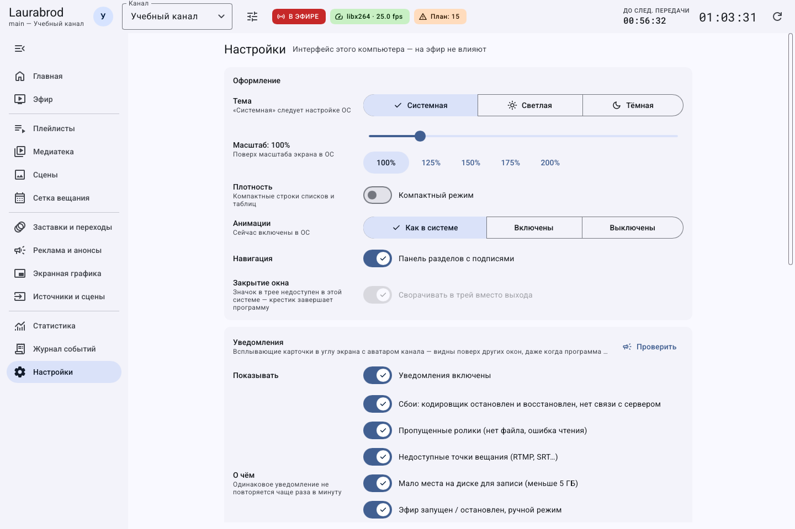

# Как настроить интерфейс, уведомления и закрытие окна

> LauraBoard 0.1.0. Снимки показывают реальный интерфейс; демонстрационные состояния подписаны отдельно. Способы и пределы проверки перечислены в [отчёте](../verification.md).

**Потребуется:** открытый GUI. Большинство настроек этого раздела сохраняется сразу на компьютере оператора, без кнопки общего сохранения и без перезапуска эфира.

Снимок получен встроенным средством без системного трея, поэтому переключатель трея на нём недоступен. Это не утверждение об отсутствии трея в обычной Windows-сессии.

## Как сделать интерфейс удобнее

1. Откройте **Настройки → Оформление**.
2. Выберите **Тема**: системная, светлая или тёмная.
3. Измените **Масштаб** от 80 до 200 %; он добавляется к масштабу ОС. Дождитесь применения после перемещения ползунка.
4. Включите **Компактный режим**, если нужны более плотные списки.
5. Выберите **Анимации**: как в системе, включены или выключены.
6. Включите **Панель разделов с подписями** или сверните её кнопкой меню. В узком окне панель может сворачиваться автоматически.
7. Ширину отдельных панелей меняйте разделителем. Программа запоминает компоновку и вид медиатеки.

## Как подобрать масштаб и вернуть удобный вид

1. Разверните окно программы. Если подписи всё ещё мелкие, откройте **Настройки → Оформление**.
2. Запомните текущий процент **Масштаб** и измените его немного, затем дождитесь применения.
3. Откройте медиатеку и одну длинную форму. Убедитесь, что текст читается, а кнопки доступны после прокрутки.
4. Если на экране помещается слишком мало, уменьшите масштаб или включите **Компактный режим**. Он уменьшает отступы, но не заменяет выбор читаемого размера текста.
5. Для возврата установите прежний процент; весь интерфейс сбрасывать не нужно.

Настройки применяются на компьютере оператора. Изменение темы не меняет цвет эфирной графики, а отключение анимаций окна не выключает анимации логотипа в эфире.

Перед тестом уведомления включите нужную группу сообщений и нажмите **Проверить**. Если не видно карточки, проверьте, не ограничены ли сообщения скрытым окном. Перед закрытием окна убедитесь, что трей действительно доступен: в среде без трея скрытие не гарантируется.

## Как настроить уведомления

1. Прокрутите до **Уведомления**, включите **Уведомления включены**.
2. Выберите сообщения о кодировщике и связи, пропущенных материалах, точках вещания, свободном месте и состоянии эфира.
3. При необходимости включите сообщения о каждой новой передаче или показ только при скрытом окне.
4. Нажмите **Проверить**. Карточка должна появиться в углу экрана; щелчок возвращает окно программы.

Карточки не заменяют серверный журнал и не означают, что внешний получатель получил эфир. Одинаковые уведомления ограничиваются по частоте.

## Как закрывать окно без остановки эфира

1. Проверьте, что значок в трее доступен.
2. В **Закрытие окна** включите **Сворачивать в трей вместо выхода**.
3. Закройте окно крестиком: оно скрывается, работающий процесс остаётся. Откройте окно щелчком по значку.
4. Явный **Выход** из меню трея завершает приложение. Если движок встроен в этот процесс, вещание останавливается. При подключении к отдельному серверу завершение клиента не завершает сервер.

Без доступного трея либо при выключенном сворачивании крестик завершает GUI. Не полагайтесь на общий текст о независимости интерфейса от эфира: важно, где запущен движок.

## Как сбросить настройки

Снимок выделяет блок кнопок; строка с частным путём профиля не включена в публикуемый фрагмент.

**Сбросить компоновку** возвращает размеры панелей, навигацию и вид медиатеки. **Сбросить все настройки…** после подтверждения возвращает настройки интерфейса по умолчанию, включая уведомления и собственные стили плашек. Перед этим сохраните [локальные настройки](../data-and-backup.md), если они нужны. Сетка и медиатека канала этим действием не сбрасываются.

Для возврата отдельного параметра установите прежнее значение. Сочетания клавиш — [справочник](../shortcuts.md).

---

[Все гайды](index.md) · [Решение проблем](../troubleshooting/index.md) · [Главная](../index.md)
