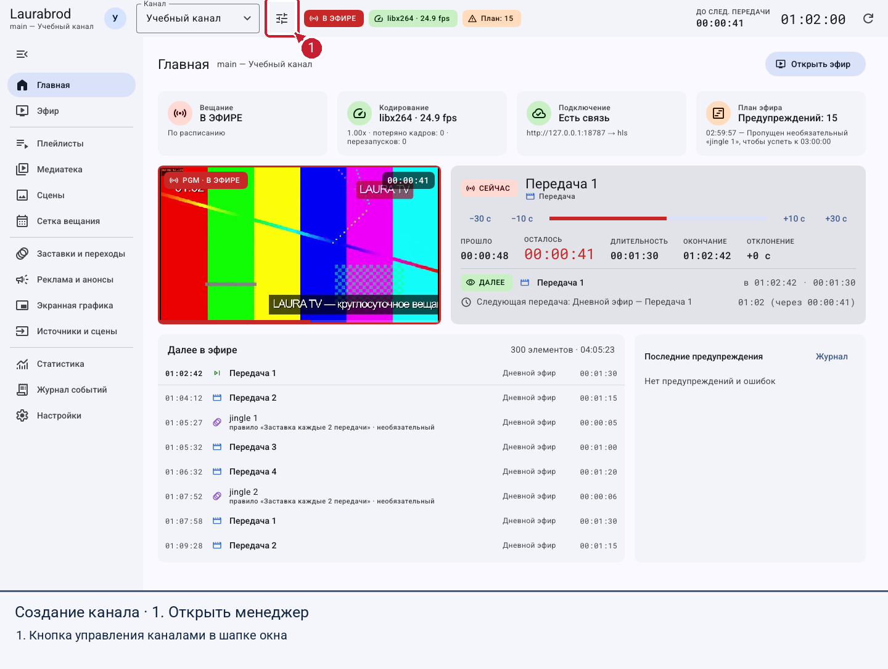
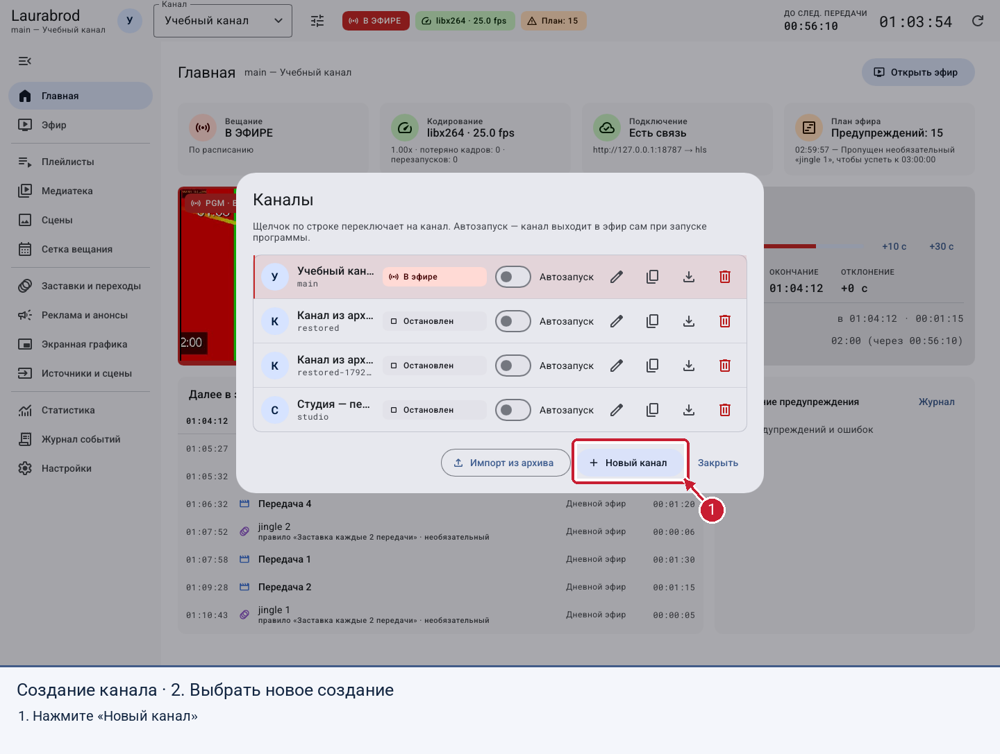
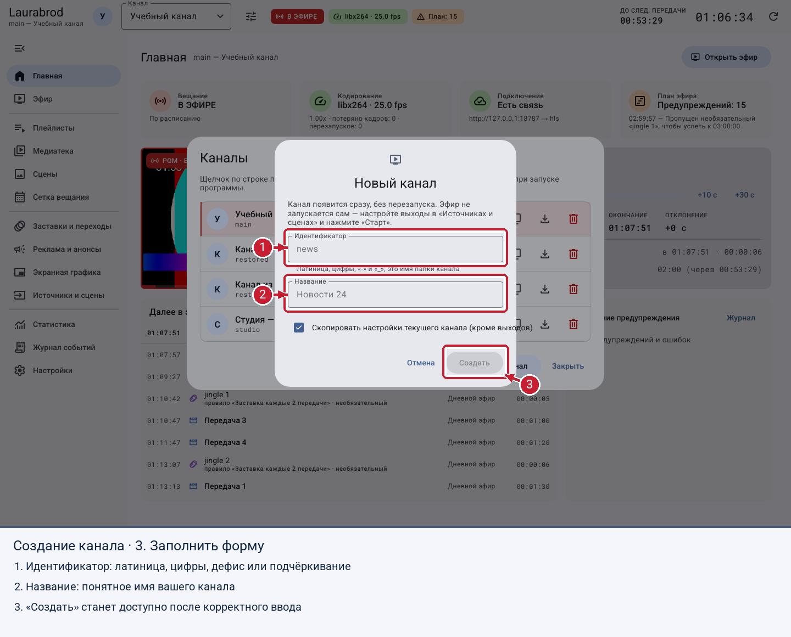

# Как создать свой канал

> Laurabrod 0.1.0. Снимки показывают реальный интерфейс; демонстрационные состояния подписаны отдельно. Способы и пределы проверки перечислены в [отчёте](../verification.md).

## Что получится

Отдельный канал со своей медиатекой, плейлистами, расписанием и графикой. Создание канала само по себе не запускает вещание.

**Потребуется:** работающая программа и права администратора при подключении к серверу. Идентификатор — короткое имя папки канала; используйте латиницу, цифры, `-` и `_`, например `studio`.

## Создать первый канал

1. Откройте программу. Если каналов нет, нажмите **Создать канал** на стартовом экране.
2. Если канал уже открыт, нажмите кнопку **Каналы** в шапке, затем **Новый канал**.
3. Введите **Идентификатор**: `studio`, **Название**: `Мой учебный канал`.
4. При наличии другого канала решите, нужен ли флажок **Скопировать настройки текущего канала (кроме выходов)**. Для чистого старта снимите его. Он переносит настройки, а не всю медиатеку.
5. Нажмите **Создать**. Дождитесь появления канала в шапке окна.

На снимке — настоящий диалог «Новый канал». Идентификатор не должен совпадать с существующим.

## По шагам на экране

Откройте менеджер кнопкой в шапке.

Выберите создание нового канала.

Заполните поля. Надписи `news` и `Новости 24` на исходном снимке — подсказки пустых полей, а не уже введённые значения.

## Проверить результат и подготовить эфир

1. Убедитесь, что в шапке выбран созданный канал.
2. Откройте **Медиатека**: для нового канала программа добавляет готовые фоны. Это не ваши передачи.
3. [Добавьте свои материалы](import-media.md), [создайте плейлист](playlists.md) и [расписание](schedule.md).
4. [Настройте точку вещания](outputs.md). После этого переходите к [первому эфиру](first-broadcast.md).

## Если не получается

- **Создать** недоступно: заполните идентификатор и исправьте подсказку под полем. Русские буквы и пробелы в нём не допускаются; в названии допускаются.
- Сообщение **Канал с таким идентификатором уже есть**: выберите другое короткое имя.
- Нет связи с сервером: создание недоступно до восстановления соединения. См. [подключение](connection.md).
- Закрыть форму без создания можно кнопкой **Отмена**. Созданный канал удаляется отдельно; сначала проверьте, нет ли в нём нужных данных.

Дальше: [управление каналами](manage-channels.md), [перенос канала](transfer-channel.md).

---

[Все гайды](index.md) · [Решение проблем](../troubleshooting/index.md) · [Главная](../index.md)
