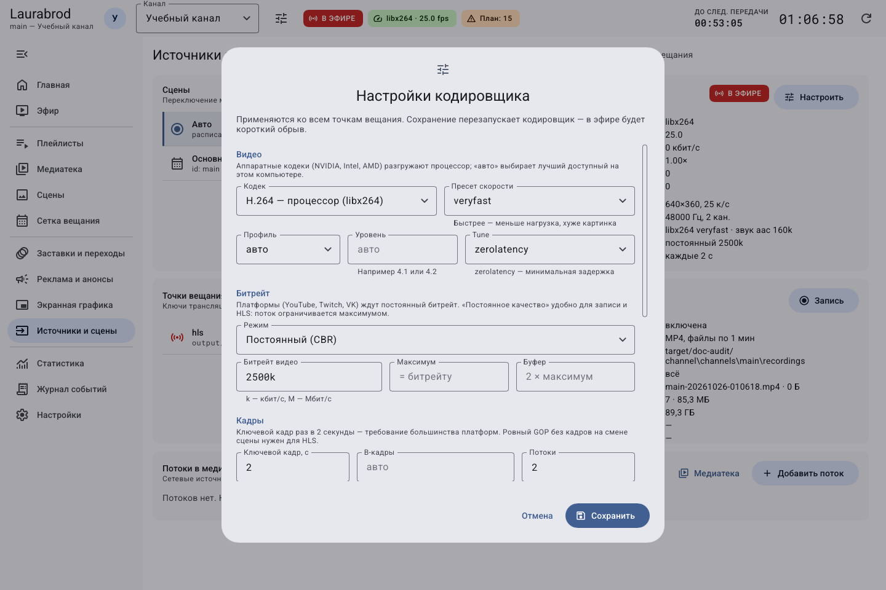
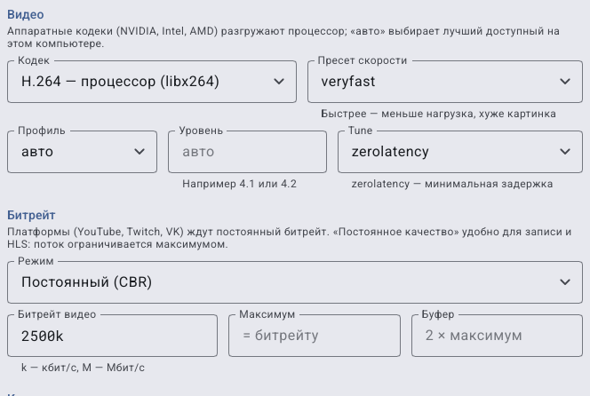
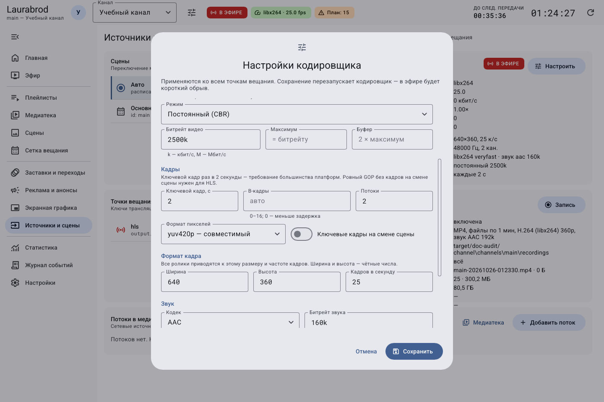
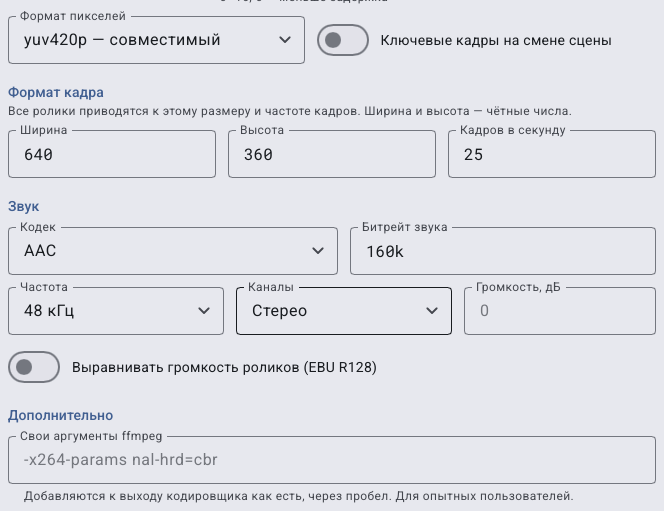

# Как настроить качество, формат кадра и кодировщик

> Laurabrod 0.1.0. Снимки показывают реальный интерфейс; демонстрационные состояния подписаны отдельно. Способы и пределы проверки перечислены в [отчёте](../verification.md).

> **Сохранение настроек кодировщика перезапускает его и вызывает короткий обрыв эфира.** Сначала запишите прежние значения и выберите время обслуживания.

**Потребуется:** роль admin. Кодировщик преобразует материалы в единый выходной видеопоток; параметры применяются ко всем точкам вещания канала.

1. Откройте **Источники и сцены → Выход кодировщика → Настроить**.
2. Выберите **Кодек**. Для воспроизводимой проверки без специальных драйверов используйте **H.264 — процессор (libx264)**. **Авто** проверяет доступные аппаратные варианты и может выбрать программный резерв.
3. Выберите **Пресет скорости**. Более медленная настройка обычно требует больше вычислений; совместимые варианты зависят от кодека.
4. В **Битрейт → Режим** выберите CBR, VBR или CRF по требованиям получателя.
5. Укажите параметры кадра и звука. Нажмите **Сохранить**, дождитесь восстановления кодировщика.
6. Проверьте локальный выход, приём на площадке и **Статистика → Система**.

Диалог прокручивается: параметры кадра, звука и дополнительные аргументы расположены ниже.

| Группа | Как использовать |
|---|---|
| Кодек | H.264/HEVC на процессоре либо NVIDIA, Intel, AMD, VAAPI; наличие пункта не доказывает работоспособность оборудования |
| CBR | Целевой постоянный битрейт для получателя с такими требованиями |
| VBR | Битрейт с заданным максимумом и буфером |
| CRF | Постоянное качество: меньшее значение даёт лучшее качество и обычно больший объём; диапазон поля 0–51 |
| Профиль, Уровень, Tune | Совместимость и особенности кодека; при отсутствии требований оставляйте подходящие исходные значения |
| Ключевой кадр, с | Интервал ключевых кадров; согласуйте с HLS или площадкой |
| B-кадры, Потоки, Формат пикселей | Дополнительное управление задержкой, загрузкой и совместимостью |
| Ширина, Высота, Кадров в секунду | Общий формат канала; проверьте нагрузку и пропорции |
| Звук | Кодек, битрейт, частота, моно/стерео/5.1, громкость и EBU R128 |
| Свои аргументы ffmpeg | Только при понимании параметров: неверная комбинация может остановить кодировщик |

## Длинный диалог по частям

Часть 1 — кодек, пресет, профиль, tune и управление битрейтом.

Часть 2 — продолжение после прокрутки: ключевые кадры, B-кадры, потоки и формат. Параметры верхней границы продолжают предыдущую часть.

Часть 3 — формат пикселей и кадра, звук, нормализация и дополнительные аргументы. Каждый нужный блок показан полностью хотя бы в одной части.

## Как изменить один параметр и понять результат

1. До открытия формы запишите прежний кодек, размер кадра, FPS, режим и значение битрейта, параметры звука. Удобно сохранить собственный снимок без ключей трансляции.
2. Решите, что исправляете: размер изображения, нагрузку процессора, совместимость получателя или звук. Меняйте одну связанную группу за раз.
3. Если нужен другой размер, измените **Ширина** и **Высота** вместе, сохраняя нужные пропорции. Например, `1280×720` — 16:9; нечётные размеры могут не пройти проверку кодека.
4. Если нужна меньшая нагрузка, не повышайте одновременно разрешение и FPS. Сначала проверьте текущую нагрузку в **Статистика → Система**.
5. При выборе CBR/VBR заполните активные поля битрейта; при CRF задайте качество. Не переносите число из поля CRF в битрейт: это разные величины.
6. Сохраните один раз и дождитесь перезапуска. Если форма сообщает ошибку, сначала исправьте поле, а не нажимайте сохранение повторно.
7. Просмотрите новый выход и прослушайте звук. При ухудшении верните записанные значения и снова сохраните.

**Битрейт** — сколько данных передаётся за секунду, **FPS** — сколько кадров показывается за секунду, **пресет** — настройка скорости работы кодировщика. Ни одно поле само по себе не гарантирует качество и устойчивость.

Для нового пользователя дополнительные аргументы FFmpeg лучше оставить прежними. Они предназначены для осознанной настройки и не нужны, чтобы создать первый канал.

## Как включить аппаратное кодирование

Выберите подходящий адаптеру кодек, сохраните и проверьте успешный запуск в журнале. Нужны поддерживаемое устройство, драйвер и сборка FFmpeg. При ошибке вернитесь к libx264 и прежним параметрам. Все аппаратные варианты в этой документации не считаются проверенными на текущем компьютере.

Отмена до сохранения — **Отмена**. После сохранения для возврата заново введите прежние значения; это снова перезапустит кодировщик. Настройки отдельного материала описаны в [гайде изображения и звука](media-display.md).

---

[Все гайды](index.md) · [Решение проблем](../troubleshooting/index.md) · [Главная](../index.md)
