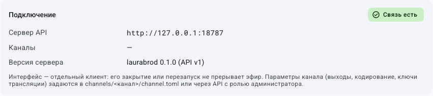

# Первый канал от начала до конца: учебное занятие

**Цель:** создать отдельный канал, добавить два видео, настроить порядок, запустить локальный эфир и проверить короткую запись. Во внешние сервисы эфир не отправляется. Подготовка не требует правил, рекламы и графики.

**Что подготовить:** установленную программу с работающей связью и FFmpeg/ffprobe, два коротких видео, папку с местом для копий и записи, проигрыватель с поддержкой HLS. При удалённом управлении файлы должны находиться на сервере. Если вы впервые видите термины, прочитайте [вводную страницу](../start-here.md).

Имена в этом занятии согласованы между шагами. На снимках может быть другой учебный набор — ориентируйтесь на названия кнопок и подписанные поля. Изображения настоящие; прохождение всего занятия мышью независимо не подтверждено. [Пределы проверки](../verification.md).

## Шаг 1. Убедитесь, что открыта нужная программа

1. Запустите LauraBoard с ярлыка.
2. Если открыт рабочий проект, сохраните чужие черновики через ответственного оператора; учебное занятие выполняйте в отдельном канале и без изменения выходов рабочих каналов.
3. Щёлкните **Настройки** слева.
4. Прокрутите до **Подключение** и убедитесь, что указано **Связь есть**. При **Нет связи** сначала [восстановите подключение](connection.md).
5. Если подключены к другому компьютеру, узнайте у администратора путь проекта и место двух учебных файлов. Это понадобится для открытия выхода.

**Можно идти дальше:** связь есть, понятно, на каком компьютере находится проект.

## Шаг 2. Создайте учебный канал

1. На пустом стартовом экране нажмите **Создать канал**. В уже открытом проекте нажмите **Каналы** в шапке, затем **Новый канал**.
2. Щёлкните **Идентификатор**, введите `training` латиницей без пробелов.
3. Щёлкните **Название**, введите `Учебный канал`.
4. Если виден флажок **Скопировать настройки текущего канала (кроме выходов)**, снимите его: здесь нужен независимый чистый пример.
5. Нажмите **Создать** один раз и дождитесь результата.
6. Прочитайте название выбранного канала в шапке. Должен быть выбран `Учебный канал`.
7. Откройте **Каналы**, найдите учебный канал и оставьте его **Автозапуск** выключенным. Закройте менеджер, чтобы перейти к медиатеке.

Если `training` уже занят, выберите `training2`; дальше используйте именно его. Идентификатор и отображаемое название — разные поля. Создание не запускает эфир. [Подробнее о создании](create-channel.md).

## Шаг 3. Добавьте первое видео

1. Щёлкните **Медиатека** слева.
2. Нажмите **Импорт**.
3. В **Файлы, папка или URL** укажите существующий полный путь к первому видео на компьютере вещания. Не вводите пример из снимка.
4. В **Тип** выберите **Передача**, чтобы назначение учебного материала было явным.
5. В **Категория** введите `lesson`. Это метка, а не путь к папке.
6. Включите **Копировать в хранилище канала**, если хотите использовать отдельную учебную копию. Убедитесь, что места достаточно.
7. Нажмите **Импортировать**. При запуске фонового задания дождитесь его успешного завершения.
8. Найдите добавленное видео в медиатеке. Если список отфильтрован, очистите поиск и вернитесь во **Вся медиатека**.

**Можно идти дальше:** запись есть в списке, её длительность больше нуля, файл не отмечен недоступным. Добавленные автоматически фоны не заменяют ваши два видео.

## Шаг 4. Добавьте второе видео и проверьте свойства

1. Повторите импорт для второго файла с теми же типом и категорией.
2. В списке щёлкните первое видео правой кнопкой мыши и выберите **Изменить свойства**.
3. В **Название** введите `Первый ролик`; оставьте **Используется в эфире** включённым.
4. Прокрутите форму к сведениям о файле и проверьте, что это нужный исходник.
5. Нажмите **Сохранить**.
6. Таким же способом назовите второе видео `Второй ролик` и сохраните.
7. Нажмите **Проверить файлы** и прочитайте результат. Если один файл недоступен, [исправьте путь или импорт](../troubleshooting/media.md) до создания расписания.

**Проверка:** в медиатеке находятся обе передачи с понятными разными названиями.

## Шаг 5. Соберите плейлист

1. Откройте **Плейлисты** слева.
2. Нажмите `+` рядом со списком плейлистов.
3. Введите **Идентификатор** `lesson`, **Название** `Учебный плейлист`, нажмите **Создать**. Если идентификатор занят, выберите `lesson2` и далее используйте созданный список.
4. Выберите созданный список слева.
5. Нажмите **Добавить** справа. В открывшейся панели найдите `Первый ролик` и нажмите его `+`.
6. Найдите `Второй ролик` и нажмите его `+`. Закройте панель добавления.
7. Проверьте, что строки идут в порядке «Первый», затем «Второй». Если нет, очистите поиск и фильтр внутри плейлиста и перетащите строку за рукоятку.
8. Включите **По кругу**, выключите **Случайный порядок**. Так короткая учебная подборка не закончится после одного прохода.
9. Нажмите **Сохранить**. Переключитесь на другой список и обратно, если он есть, либо повторно проверьте сохранённое состояние выбранного списка.

**Проверка:** две включённые строки, повтор включён, перемешивание выключено. Пока этот список не назначен сетке, он не является автоматическим эфиром.

## Шаг 6. Назначьте плейлист расписанию

1. Откройте **Сетка вещания**.
2. Если расписания нет, нажмите **Создать расписание**. Если есть несколько, выберите учебное расписание в поле **Расписание**; не меняйте чужие рабочие шаблоны.
3. Выберите шаблон дня. Для отдельного шаблона используйте **Ещё → Новый шаблон дня**.
4. В строке **Дни:** включите все семь дней для этого учебного шаблона. Позже можно разделить будни и выходные.
5. Нажмите **Блок по времени**.
6. В появившейся строке введите начало `00:00:00`, название `Учебный эфир`.
7. В источнике выберите **Плейлист**, затем `Учебный плейлист`.
8. Откройте **Свойства блока** кнопкой с ползунками в этой строке и включите **Плейлист каждый раз с начала**. Для первого опыта не добавляйте заставки и не меняйте политики опоздания.
9. Закройте панель свойств и нажмите **Сохранить** в редакторе сетки.
10. Выберите текущую дату, нажмите **Сейчас**, затем изучите прогноз вокруг текущего времени: там должны быть ваши ролики. Начало в полночь и циклический список нужны, чтобы контент был доступен сейчас, а не только завтра.

На исходном кадре сетка уже заполнена множеством блоков. В вашем новом учебном шаблоне достаточно одного блока. Не копируйте остальные строки с изображения.

**Если контента в текущем времени нет:** проверьте назначенные дни, источник блока, сохранение плейлиста, его повтор и дату прогноза. [Разбор сетки](schedule.md).

## Шаг 7. Выберите это расписание для эфира

1. Откройте **Эфир**.
2. Проверьте значение **Расписание**: выберите именно то, в котором создан учебный блок, и подтвердите переключение при запросе.
3. Если включена **Пауза расписания**, нажмите **Вернуться к расписанию**.
4. Ещё раз проверьте канал в шапке. Редактирование расписания и выбор активного расписания — разные действия.

Не нажимайте **Начать вещание** до проверки локальной точки в следующем шаге.

## Шаг 8. Добавьте локальный выход

1. Откройте **Источники и сцены**.
2. В **Точки вещания** проверьте существующие строки учебного канала. Внешние точки для этого занятия должны быть выключены.
3. Нажмите **Добавить** именно в блоке точек вещания.
4. В **Название** введите `Локальная проверка`.
5. В **Адрес сервера** укажите `output/hls/training.m3u8`. Здесь это путь локального HLS, хотя подпись поля общая для разных протоколов.
6. **Ключ трансляции** оставьте пустым.
7. В формате выберите **hls** и сохраните точку.
8. Проверьте, что строка появилась и включена. Путь считается от корня проекта. Для нескольких каналов используйте разные имена выходных файлов.

HLS — набор файлов: список `.m3u8` и сегменты видео. Настройка не публикует их в интернете. Если не знаете расположение проекта, вернитесь к шагу 1 и уточните его у администратора. Не ищите файл среди папок другого канала.

## Шаг 9. Запустите эфир и проверьте результат

1. Откройте **Эфир** и нажмите **Начать вещание** один раз.
2. Дождитесь рабочего состояния кодировщика; при сообщении об ошибке прочитайте его и откройте [журнал](logs.md).
3. Проверьте название текущего материала и движение позиции. Это может быть не самое начало первого ролика: автоматическая сетка учитывает текущее время.
4. Откройте на компьютере вещания папку проекта, затем `output/hls`. Дождитесь файла `training.m3u8` и сегментов.
5. Откройте `training.m3u8` в установленном проигрывателе, поддерживающем HLS. При удалённой работе попросите администратора проверить этот файл на сервере.
6. Прослушайте звук и дождитесь смены двух роликов. Картинка в мониторе LauraBoard сама по себе не подтверждает звук и выходной файл.

**Можно идти дальше:** позиция меняется, локальный файл воспроизводится, звук есть, ролики сменяют друг друга. При отсутствии файлов проверьте включение точки, корень проекта и журнал; не начинайте с добавления ещё одной одинаковой точки.

## Шаг 10. Проверьте короткую запись

1. Пока учебный эфир работает, откройте **Источники и сцены → Запись эфира и резерв → Запись**.
2. Включите **Записывать эфир**, выберите MP4, задайте доступную серверу папку и понятный префикс.
3. Для учебного опыта оставьте копирование изображения и звука как в эфире, если используется совместимый H.264/AAC. Не включайте автоматическое удаление старых записей ради короткого теста.
4. Сохраните, дождитесь хотя бы нескольких десятков секунд записи.
5. Снова откройте эту форму, снимите **Записывать эфир** и сохраните. Дождитесь завершения текущего файла.
6. Откройте готовый MP4 в проигрывателе и проверьте картинку и звук.

Запись использует свою папку; её относительный путь считается от каталога канала, а не как путь HLS от проекта. Подробности и совместимость — [в гайде записи](recording.md).

## Шаг 11. Закончите занятие и сохраните результат

1. Вернитесь на **Эфир**, проверьте `Учебный канал` и нажмите **Остановить**.
2. Прочитайте подтверждение и подтвердите остановку этого канала.
3. Убедитесь, что состояние стало остановленным и новые сегменты не создаются. Уже созданные файлы могут остаться в папке.
4. Убедитесь, что запись и автозапуск учебного канала выключены.
5. Сохраните нужные ролики и настройки. Для практики переноса используйте [экспорт и импорт](transfer-channel.md); удалять канал в конце занятия не обязательно.

Если получилось, переходите к [правилам вставок](insertion-rules.md), [графике](graphics.md), [сценам](scenes.md) или [учебной смене](operator-workshop.md). Если нет — откройте гайд именно того шага, на котором возникло отличие, и [каталог неполадок](../troubleshooting/index.md).

[Вводная](../start-here.md) · [Все гайды](index.md) · [Главная](../index.md)
