# Как настроить каждый элемент экранной графики по частям

Выберите нужный элемент в **Экранная графика → Добавить**, затем щёлкните его на холсте или в списке **Слои**. Справа откроются свойства именно выбранного элемента. Ниже — отдельный разбор содержимого каждого типа. Общие положение, текстовый стиль, анимация и профили разобраны в [соседнем гайде](graphics-properties.md).

**Результат:** сохранённый элемент с понятным содержимым и ожидаемым видом. Потребуется учебный канал; для изображения — собственный файл, для времени передачи — работающий прогноз. Снимки показывают настоящие поля Slint на учебных данных. Это фрагменты исходных кадров, без дорисовки полей. [Проверки и ограничения](../verification.md).

В узких списках длинное выбранное значение может отображаться с многоточием. Полные названия вариантов приведены в таблицах ниже; обрезанный текст не означает отсутствия других настроек. Не изменяйте параметр только ради совпадения с названием учебного элемента на снимке.

## Изображение: как добавить собственный логотип

1. Нажмите **Добавить → Изображение**, выделите созданный элемент.
2. В **Название** введите понятную подпись для списка слоёв. Название не становится надписью поверх картинки.
3. В **Содержимое → Файл изображения** выберите **Обзор…** и свой PNG, JPEG или WebP. Альтернатива — действительный путь от корня проекта или абсолютный путь, доступный серверу.
4. Проверьте появление картинки на холсте. Путь `media/logo.png` на снимке принадлежит учебному проекту; у вас он может отсутствовать.

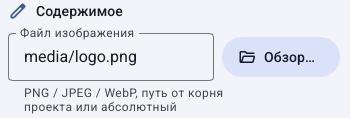

5. В **Положение** выберите верхнюю правую привязку, X и Y `30`, ширину `100`, высоту оставьте автоматической для сохранения пропорций. Это учебный пример для маленького кадра; для своего формата проверьте размер на выходе.
6. Сохраните. Для первой проверки покажите элемент вручную, затем верните управление правилам и [создайте правило показа](graphics-rules.md).

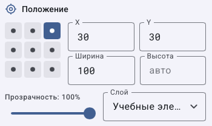

**Проверка:** виден нужный файл, он не растянут и не закрывает важные титры. При пустом изображении проверьте путь именно на сервере. Для замены выберите другой файл и сохраните. Удаление элемента оформления не равнозначно удалению ролика из медиатеки.

## Аватар канала: как использовать уже выбранную картинку

1. Откройте **Каналы → Переименовать** у учебного канала и выберите аватар по [инструкции](manage-channels.md#как-изменить-название-идентификатор-и-аватар).
2. Вернитесь в **Экранная графика → Добавить → Аватар канала**.
3. Выберите добавленный элемент. Он является изображением со ссылкой на файл аватара канала; отдельного текстового стиля у него нет.
4. Проверьте путь, размер и привязку, затем сохраните и проверьте показ.

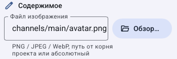

Кнопка добавления аватара не является загрузчиком произвольного логотипа. Если аватар ещё не задан, сначала выберите его в менеджере каналов. Чтобы вернуть независимую картинку, используйте обычное **Изображение**. Общие [анимация и профили](graphics-properties.md#как-настроить-появление-исчезновение-и-профили) доступны и аватару.

## Текст: как разделить содержимое и внешний вид

1. Нажмите **Добавить → Текст**.
2. В **Содержимое → Текст** введите `Сейчас: {title}` либо обычную постоянную подпись.
3. **Вставить переменную** открывает список подстановок. `{title}` заменяется названием текущего материала; слово `Сейчас:` остаётся постоянным.

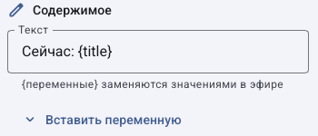

4. Ниже, в группе **Текст**, настройте шрифт, размер и читаемость по [разбору полей](graphics-properties.md#как-настроить-шрифт-цвет-обводку-и-тень).
5. Настройте положение и правило показа, сохраните. Проверьте длинное название и обычную кириллицу на выходе.

**Проверка:** при смене ролика меняется подставленная часть. Если нужен только постоянный текст, уберите переменную и введите фразу буквально. Для нескольких строк с разным оформлением создайте плашку, а не ожидайте независимых стилей внутри одного текстового поля.

## Бегущая строка: как задать сообщение, скорость и ширину

1. Выберите **Добавить → Бегущая строка**.
2. Введите сообщение прямо в **Текст бегущей строки** или используйте `{ticker}` и задайте значение `ticker` на вкладке **Переменные**.
3. В **Скорость, px/с** задайте `90` для первого теста, **Ширина полосы** — `580` для учебного кадра 640 пикселей. У собственного выходного формата подберите размер отдельно.

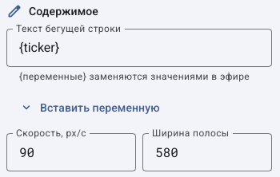

| Поле | За что отвечает | Чего не меняет |
|---|---|---|
| Текст бегущей строки | Содержание | Время автоматического показа |
| Скорость, px/с | Скорость перемещения изображения текста | Размер букв и число сообщений |
| Ширина полосы | Видимая область строки | Ширину всего выходного видео |
| Текстовый стиль ниже | Шрифт, цвет, фон букв | Постоянное значение переменной |

4. Разместите строку у нижнего края, сохраните и проверьте движение в выходе. Одиночный статичный снимок не доказывает скорость.
5. Для оперативной замены сообщения используйте **Эфир → Бегущая строка…**. [Как снять ручное значение](graphics-rules.md#как-менять-бегущую-строку-вручную).

Если строка пустая, сначала проверьте переменную и правило, а не повышайте скорость. Для остановки её использования выключите правило или уберите ручной показ; изменение скорости не является общей кнопкой отключения.

## Часы: как отдельно настроить время и дату

1. Выберите **Добавить → Часы**.
2. В **Формат времени** введите нужную комбинацию из таблицы. Символ `%` является частью формата.

| Формат | Что получится |
|---|---|
| `%H:%M` | Часы и минуты, например 18:15 |
| `%H:%M:%S` | Часы, минуты и секунды |
| `%d.%m.%Y` | День, месяц и год |

3. Для даты и времени в разных углах создайте два элемента часов с разными форматами и положением.
4. Оформите текст, сохраните и проверьте изменение секунд. Время относится к серверу вещания.

При неверной дате проверьте часы сервера. При неверном виде верните простой формат `%H:%M` и сравните результат. [Подробная проверка часов и таймеров](graphics-time-progress.md).

## Таймер: как выбрать событие отсчёта

1. Выберите **Добавить → Таймер**.
2. В **Отсчёт** выберите цель по таблице. На узком поле её название может сокращаться.
3. В **Префикс** введите постоянную подпись, например `Через `, с нужным пробелом после слова.
4. В **Формат** выберите представление остатка времени.

| Вариант | Как понимать |
|---|---|
| До конца ролика | Остаток текущего элемента |
| До следующей передачи | Интервал до следующей передачи по плану |
| До конца передачи | Остаток программы с учётом выбранных исключений |
| Авто | Формат с часами при необходимости |
| ЧЧ:ММ:СС / ММ:СС | Явно выбранный вид времени |
| Минуты | Остаток в минутах |

5. Настройте текст и показ, сохраните. Сравните цель с текущим материалом и прогнозом. Пересчёт плана и ручная команда могут изменить остаток.

Таймер не запускает передачу и не останавливает её при нуле. Если нужно менять фактическое начало, редактируйте сетку. Для выключения уберите его правило или ручной показ.

## До конца передачи: как исключить рекламу из расчёта

1. Выберите **Добавить → До конца передачи**. Это заготовка таймера с нужной целью.
2. Проверьте **Отсчёт**, префикс и формат.
3. В **Не считать в передаче** отметьте только те типы, чьё время не должно входить в счётчик: например, **Реклама** и **Анонсы**.

4. Сохраните и проверьте программу с реальной вставкой соответствующего типа.
5. Если значение неожиданное, проверьте тип материала, блок и прогноз. Название файла «Реклама» само по себе не задаёт тип **Реклама**.

Передача здесь связана с экземпляром блока сетки. Без блока расчёт использует отдельный материал. Исключение типа влияет на счётчик, а не удаляет вставку из эфира.

## Прогресс передачи: как настроить основу, заполнение и оформление

1. Выберите **Добавить → Прогресс передачи**.
2. В **Показывает** выберите **Ход передачи** или **Ход ролика**. Для первого короткого теста проще проверить один ролик.
3. В **Заполнение** выберите направление; затем задайте ширину, высоту и скругление.
4. **Цвет заполнения** задаёт пройденную часть, **Градиент заполнения до** — её второй цвет, **Цвет полосы** — незаполненную основу.

5. Для **Хода передачи** выберите типы в **Не считать в передаче**. Они меняют расчёт, а не условия видимости полосы.

6. Прокрутите до **Оформление**. Рамка, тень, наклон, акцент и текстура относятся к форме полосы; их разбор — в следующем разделе о фигуре.

7. Сохраните, включите показ и сравните начало и конец ролика. Если полоса движется в обратную сторону, измените **Заполнение**, а не время ролика.

## Фигура: как настроить размер, градиент, рамку, тень и акцент

1. Выберите **Добавить → Фигура**. В **Содержимое** задайте цвет, ширину, высоту и скругление. Фигура не содержит текста; для подписи добавьте отдельный текст поверх неё или используйте плашку.

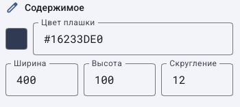

2. В **Оформление** задайте **Градиент до цвета** и **Угол, °**. Угол `0` направляет градиент слева направо, `90` — сверху вниз.
3. Для рамки задайте и цвет, и положительную **Толщина**. При нулевой толщине одного цвета недостаточно.
4. Для разных углов используйте **Углы по отдельности**: четыре числа в порядке левый верхний, правый верхний, правый нижний, левый нижний. Например, `12 0 12 0`. Это заменяет общее скругление для углов.
5. При необходимости измените **Наклон, °**; ноль оставляет обычную фигуру.

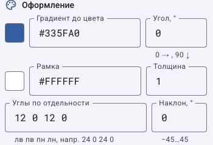

6. В **Тень** задайте цвет, **Размытие** и смещения **Тень dx / Тень dy**. Положительные смещения направляют тень вправо и вниз; они не перемещают саму фигуру.

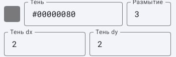

7. В **Акцентная полоса** выберите сторону. После выбора появляются дополнительные **Ширина** и **Цвет полосы**. При **Нет** эти поля не показываются.
8. Для текстуры выберите файл через **Картинка-фон → Обзор…** либо откройте **Готовые фоны для плашек…**. Фоновая картинка заполняет фигуру с обрезкой краёв.

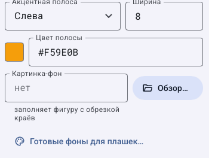

9. Сохраните и проверьте результат на светлом и тёмном видео. Если фигура закрывает подпись, измените порядок слоёв.

Для возврата снимите акцент выбором **Нет**, очистите необязательные цвета и текстуру либо верните записанные значения. Перед сбросом черновика помните, что вместе с ним могут отмениться другие несохранённые правки графики. [Анимация фигуры](graphics-properties.md#как-настроить-появление-исчезновение-и-профили).

## Плашка с текстом: как отдельно настроить фон, строки и стиль строки

1. Выберите **Добавить → Плашка с текстом**.
2. В **Плашка** задайте **Цвет фона**, ширину, минимальную ширину, скругление и поля. Пустая ширина означает рост по тексту; фиксированная ширина и минимальная ширина решают разные задачи.
3. **Поля ↔ / Поля ↕** задают расстояние между текстом и краем фона, **Между строк** — зазор между строками. **Выравнивание текста** задаёт расположение текста внутри плашки, а не положение плашки на экране.

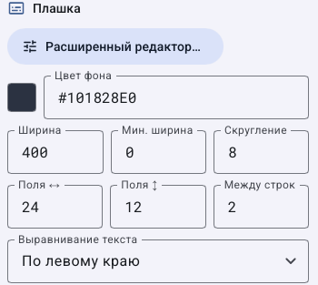

4. В **Строки текста** выберите строку. В **Название строки** введите `Имя`: это подпись для оператора. В **Текст строки** введите `Анна Иванова`: именно этот текст увидит зритель.
5. Нажмите **Добавить строку**, выберите новую и задайте название `Должность`, текст `Гость учебной программы`. Перемещайте строки кнопками **Выше / Ниже**; удаление строки не является удалением всей плашки.

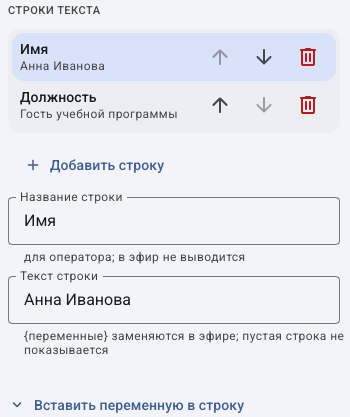

6. Прокрутите до **Текст строки** и измените стиль выбранной строки. Чтобы изменить вторую, сначала выберите её в списке строк. Изменение стиля первой не обязано менять вторую.

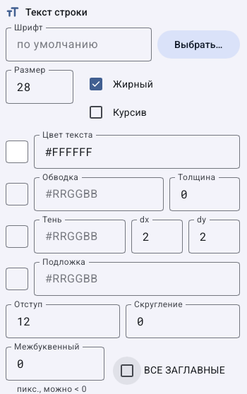

7. В **Оформление** задайте фоновые эффекты. Они относятся к плашке целиком, а не только к выбранной строке.

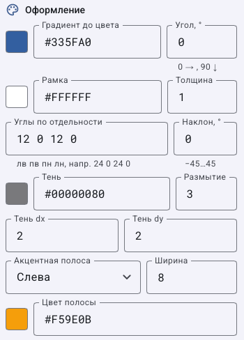

Для текстуры и дополнительных вариантов раскладки откройте **Расширенный редактор…**; [отдельный разбор по вкладкам и фрагментам](graphics-plates.md). В обычной панели часть общих фоновых полей продолжается ниже: аналогичные поля показаны [в группе оформления фигуры](#фигура-как-настроить-размер-градиент-рамку-тень-и-акцент).

8. В расширенном редакторе нажмите **Готово**, затем **Сохранить** на странице графики. Настройте правило показа и проверьте выход.

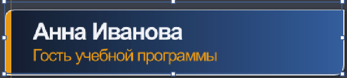

Имена здесь вымышлены. Если строка пуста, она не показывается. Если длинное имя не помещается, настройте ширину и ужатие длинных строк в расширенном редакторе; не уменьшайте весь выходной кадр ради одной подписи. Для возврата измените текст или стиль и сохраните; [как сохранить дизайн для повторного использования](graphics-templates.md).

## Группа: как изменить состав заранее подготовленной композиции

Группа поддерживается форматом графики, но отдельного пункта её создания в меню **Добавить** текущей версии нет. Создание группы через конфигурацию — задача администратора. Не ищите несуществующую кнопку «Создать группу» среди девяти обычных типов.

Если группа уже подготовлена, её состав редактируется через GUI:

1. Выберите группу в **Слоях**.
2. В **Содержимое → Элементы группы (id через запятую)** укажите идентификаторы существующих дочерних элементов. Например, `doc-card, doc-caption` относится к учебному набору снимка.

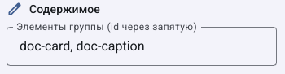

3. Идентификатор дочернего элемента смотрите под его названием в свойствах. Не заменяйте его видимым русским названием.
4. Сохраните и проверьте положение всей композиции и каждого дочернего элемента. Дочерние координаты относятся к группе.
5. Чтобы исключить дочерний элемент из группы, уберите его id из списка и сохраните; отдельно проверьте его собственные правила показа.

Для создания администратор на остановленной копии проекта добавляет элемент типа `group` с `children` в `channels/<id>/graphics.toml` по [схеме графики](../configuration.md#graphicstoml), указывая реальные существующие id. Затем проверяет конфигурацию и локальный рендер. Снимок показывает реальную панель подготовленной через API учебной группы; он не подтверждает её создание кнопкой GUI. Не добавляйте группу саму в себя и не создавайте циклическую вложенность. Для возврата используйте копию конфигурации.

[Общие свойства всех элементов](graphics-properties.md) · [Правила показа](graphics-rule-recipes.md) · [Все гайды](index.md)
