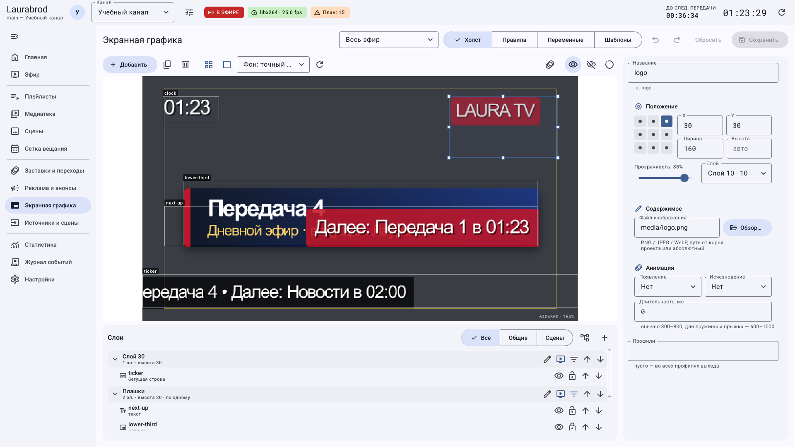
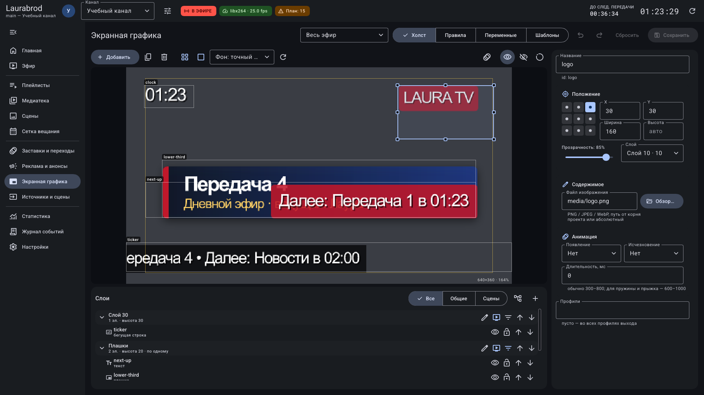
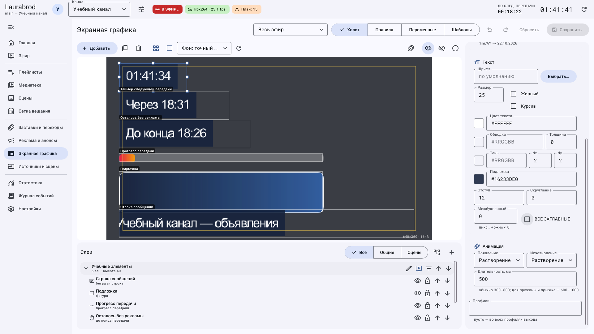

# Как расположить графику, настроить слои и анимацию

> LauraBoard 0.1.0. Поля сверены с кодом и реальным интерфейсом. Снимки показывают учебные данные; полный проход мышью не заявляется. [Проверки и ограничения](../verification.md).

Поля крупным планом: [каждый тип элемента](graphics-elements.md) · [положение, текстовый стиль, анимация и профили](graphics-properties.md).

## Как поставить логотип в угол с точными отступами

1. Выберите элемент на **Холсте** или в списке **Слои**.
2. В **Положение** выберите точку в сетке 3×3: верхний ряд — верх кадра, средний — середина, нижний — низ; столбцы соответствуют левой стороне, центру и правой стороне.
3. Для верхнего правого угла выберите верхнюю правую точку и задайте X/Y как отступы от выбранных краёв. Например, X `30`, Y `30`.
4. Для изображения укажите одну размерность, оставив вторую автоматической, если нужно сохранить пропорции. Значения относятся к пикселям выходного кадра, а не окна редактора.
5. Включите **Показать безопасную зону (5 %)** и **Привязка к краям, центру и безопасной зоне**. При перетаскивании следите за направляющими.
6. Сохраните и проверьте настоящий выход нужного разрешения.

X/Y при угловой привязке не нужно воспринимать как абсолютное положение от левого верхнего угла. После смены привязки повторно проверьте элемент.

## Как отличить скрытие на холсте от скрытия в эфире

| Действие | Что меняет | Как отменить |
|---|---|---|
| Глаз у элемента в слоях | Отображение в редакторе | Повторно нажать глаз |
| Замок у элемента | Возможность перемещать его на холсте | Разблокировать |
| Прозрачность 0 % | Фактическую прозрачность графики | Вернуть прежний процент и сохранить |
| Скрыть в эфире | Ручное переопределение показа | **По правилам показа** |
| Выключение слоя в эфире | Автоматический показ его элементов | Включить слой и проверить ручные переопределения |

Ручное **Показать** может вывести элемент даже при выключенном автоматическом слое. Не используйте выключение слоя как безусловную блокировку любой ручной команды.

## Как создать слои и поменять наложение

1. В **Слои** нажмите **Новый слой** и задайте понятное название, например `Подписи гостей`.
2. Выберите элемент и в его свойствах **Слой** назначьте созданный слой. Либо используйте **В слой выше / В слой ниже** у элемента.
3. Кнопками **Слой выше / Слой ниже** в заголовке слоя измените порядок наложения. Более высокий слой рисуется поверх нижнего.
4. Сверните слой стрелкой, если его элементы мешают навигации; сворачивание само по себе не выключает эфир.
5. Фильтр **Общие** оставляет общие элементы, **Сцены** — элементы, ограниченные сценами, **Все** показывает весь набор.
6. **Разложить по слоям** перераспределяет элементы по типам. Перед этим сохраните текущую конфигурацию: раскладка может изменить наложение. Удаляется только пустой слой.

Тёмный снимок встроен здесь для чтения значков и групп; это тот же редактор, а не дополнительный набор функций.

## Как не показывать две плашки одновременно

1. Поместите конкурирующие плашки в один слой.
2. В заголовке слоя включите **Показывать в слое только один элемент за раз**.
3. На вкладке **Правила** задайте разные приоритеты показа элементов; выше число — выше приоритет.
4. Сохраните и воспроизведите случай, когда подходят оба правила. Проверьте, что выбран ожидаемый элемент.
5. Перед проверкой снимите ручные команды **Показать / Скрыть**, иначе проверяете вмешательство оператора, а не только правила.

## Как добавить анимацию появления и исчезновения

1. Выберите сохранённый элемент и прокрутите свойства до **Анимация**.
2. Выберите эффект в **Появление** и отдельно в **Исчезновение**; **Нет** выключает соответствующий эффект.
3. В **Длительность, мс** задайте, например, `500`. Это полсекунды анимации, а не длительность показа плашки.
4. Нажмите **Предпросмотр появления выбранного элемента** на панели холста; повторным нажатием остановите просмотр.
5. Сохраните, затем проверьте реальное появление и уход по временному правилу. Предпросмотр появления не проверяет исчезновение в эфире.

Предпросмотр обращается к рендеру сервера. При ошибке связи восстановите API; уменьшение анимаций GUI в настройках не заменяет изменение эфирного эффекта. До сохранения доступны отмена и сброс.

[Все гайды](index.md) · [Неполадки](../troubleshooting/index.md) · [Главная](../index.md)
