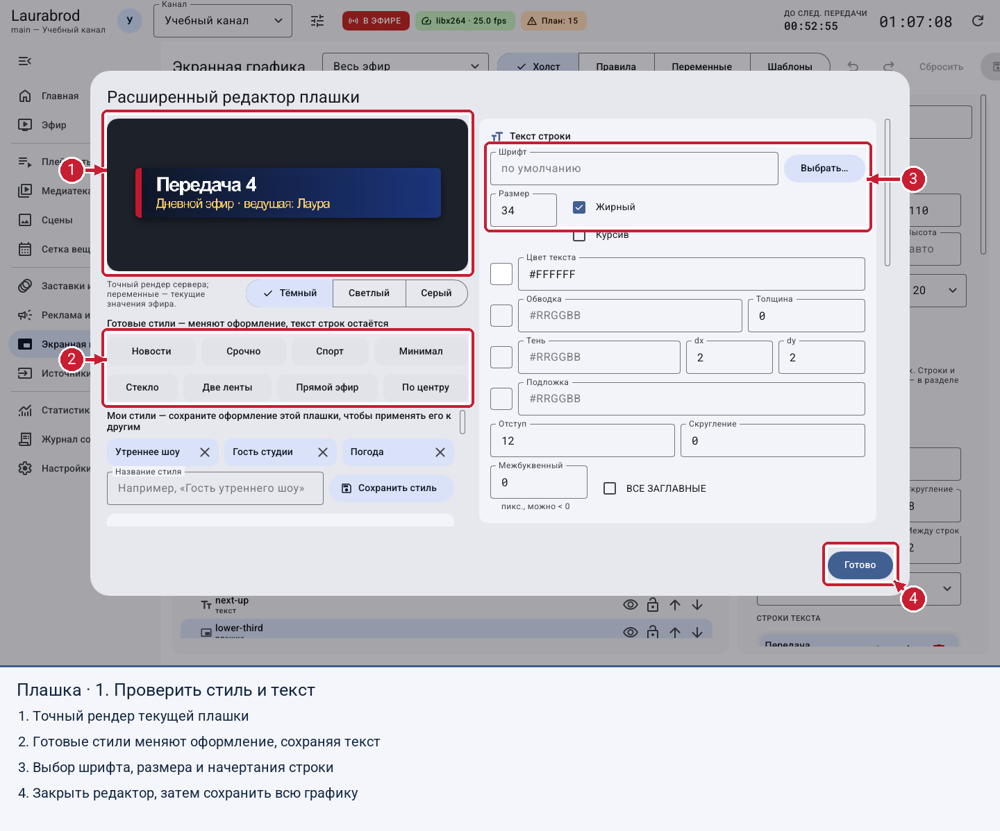
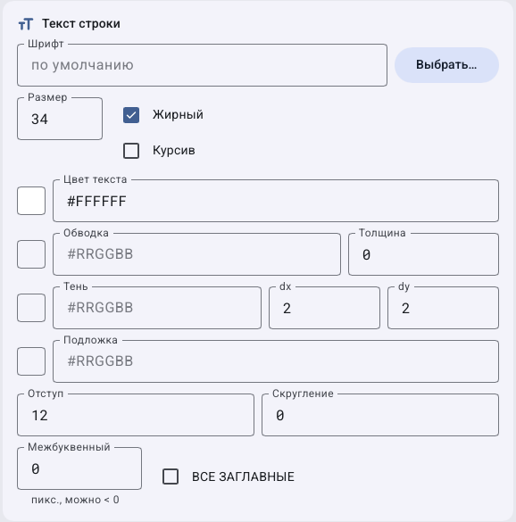
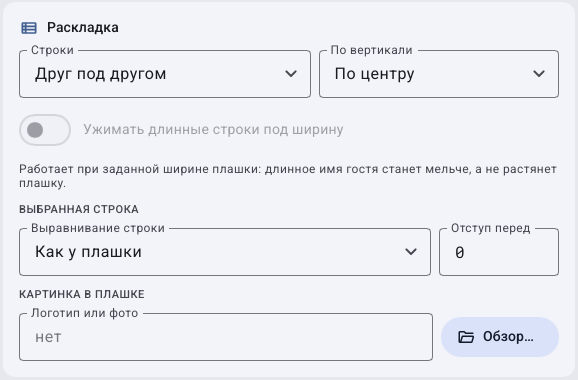
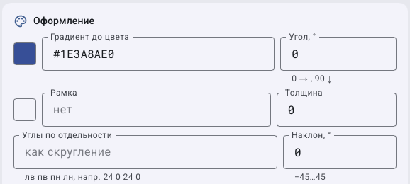
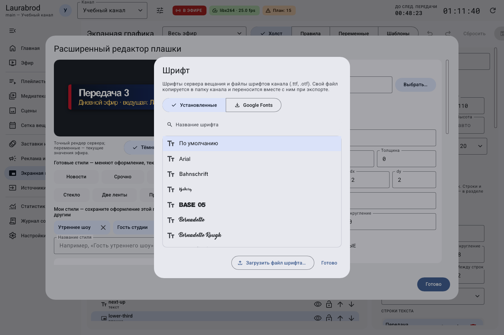

# Как оформить плашку, выбрать шрифты и сохранить стиль

> Laurabrod 0.1.0. Снимки показывают реальный интерфейс; демонстрационные состояния подписаны отдельно. Способы и пределы проверки перечислены в [отчёте](../verification.md).

Поля крупным планом: [каждый тип элемента](graphics-elements.md) · [положение, текстовый стиль, анимация и профили](graphics-properties.md).

**Цель:** создать подпись ведущего или гостя, которую можно повторно использовать.

## Как собрать плашку

1. Откройте **Экранная графика → Добавить → Плашка с текстом**.
2. Выберите её в слоях и нажмите **Добавить строку**. Задайте **Название строки** и **Текст строки**: например, `Имя` и `Анна Иванова`.
3. Добавьте вторую строку с должностью или темой передачи.
4. В **Плашка** задайте фон, ширину, минимальную ширину, поля, скругление, интервал между строками и выравнивание.
5. Нажмите **Расширенный редактор…**. Выберите готовый стиль, проверьте крупное превью, переключая тёмный и светлый фон.
6. В **Раскладка** выберите строки друг под другом или в один ряд, вертикальное выравнивание и ужатие длинных строк. Для ужатия задайте ширину плашки.
7. При необходимости добавьте **Логотип или фото**, его сторону, высоту, зазор и скругление.
8. Нажмите **Готово**, затем **Сохранить** на странице графики. «Готово» закрывает расширенный редактор; не заменяет сохранение всего оформления.

В иллюстрации показан расширенный редактор настоящей плашки на учебных данных; художественное оформление можно изменить независимо от текста.

Обводки выделяют превью, готовые стили, оформление текста и завершение редактора.

## Как настроить фигуру, текстуру и текст

В свойствах фигуры или подложки доступны градиент, угол, рамка, отдельные углы, наклон, тень, акцентная полоса и **Картинка-фон**. **Готовые фоны для плашек…** открывает встроенные текстуры.

Для каждой строки задайте шрифт, размер, жирный/курсив, цвет, обводку, тень, подложку, отступ, скругление, межбуквенный интервал и **ВСЕ ЗАГЛАВНЫЕ**. Проверьте длинное имя: оно не должно выходить за край кадра.

## Расширенный редактор по частям

Часть 1 — шрифт, цвет, обводка, тень, отступы и межбуквенный интервал.

Часть 2 — раскладка строк, ужатие и собственная картинка плашки.

Части 3–4 перекрываются по полям рамки и углов, чтобы ни один параметр не остался только обрезанным на границе прокрутки.

## Как разобрать дополнительные поля раскладки плашки

1. В **Строки** выберите **Друг под другом** для имени и должности либо **В один ряд** для горизонтальной композиции.
2. **По вертикали** задаёт размещение содержимого внутри доступной высоты: сверху, по центру или снизу. Это не привязка всей плашки к экрану.
3. Чтобы длинное имя уменьшалось и помещалось, задайте ширину плашки, затем включите **Ужимать длинные строки под ширину**. При автоматической ширине не ожидайте того же ограничения.
4. Выберите конкретную строку. В **Выравнивание строки** оставьте **Как у плашки** для наследования либо задайте своё. **Отступ перед** добавляет расстояние перед этой строкой, не меняя общий отступ всех строк.
5. Для **Логотип или фото** выберите файл. **Сторона** размещает картинку слева или справа от текста, **Высота** меняет её размер, **Зазор** отделяет её от текста, **Скругление** меняет углы картинки.
6. Проверьте превью и длинный текст, нажмите **Готово**, затем **Сохранить** на основной странице.

Если имя обрезано, сначала проверьте ширину и режим ужатия. Если изменяется не та строка, вернитесь к выбору строки. Если картинка перекрывает подпись, проверьте её высоту и зазор. Картинка внутри плашки отличается от отдельного изображения на холсте: её положение связано с раскладкой плашки.

## Как выбрать или добавить шрифт

1. В **Текст строки → Выбрать…** откройте окно **Шрифт**.
2. На **Установленные** выберите шрифт сервера. **Загрузить файл шрифта…** добавляет собственный файл.
3. На **Google Fonts** найдите семейство; **С кириллицей** отбирает подходящие варианты.
4. Нажмите **Скачать**, дождитесь окончания и выберите шрифт. Интернет требуется серверу вещания.
5. Проверьте кириллицу и сохраните оформление. Если доступа к интернету нет, используйте установленные шрифты или собственный файл с подходящей лицензией.

Окно показывает шрифты сервера и кнопку загрузки файла.

## Как повторно использовать оформление

- В расширенном редакторе задайте **Название стиля → Сохранить стиль**. Стиль содержит оформление без текста строк; хранится в настройках этого компьютера.
- На вкладке **Шаблоны** задайте название и нажмите **Сохранить текущее оформление**. Такой шаблон содержит элементы, правила и переменные всего оформления и хранится локально.
- Перед **Применить** сохраните текущее оформление отдельно: применение шаблона меняет набор графики. Проверьте результат и нажмите **Сохранить**.

Не путайте локальные стили и шаблоны с ресурсами канала на сервере. Для переноса используйте [архив канала](transfer-channel.md) и отдельную копию локальных настроек.

## Подробные сценарии

- [Как расположить графику, настроить слои и анимацию](graphics-layout.md)
- [Как сохранять оформление, стили и профили графики](graphics-templates.md)
- [Как настроить текст, бегущую строку и фигуры](graphics-text-ticker.md)

---

[Все гайды](index.md) · [Решение проблем](../troubleshooting/index.md) · [Главная](../index.md)

[Вкладка шаблонов оформления](../screenshots/interface/graphics-templates-light.png).
