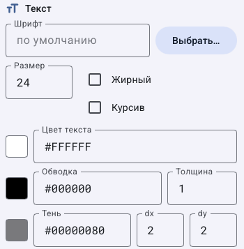
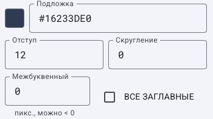
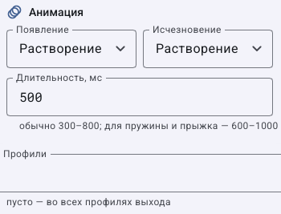
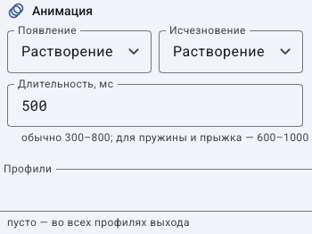
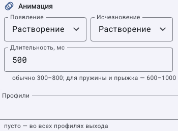

# Как настроить общие свойства графических элементов

Этот гайд продолжает [разбор каждого элемента](graphics-elements.md). Откройте **Экранная графика → Холст**, выберите элемент на холсте или в **Слоях**, затем меняйте его правую панель. Если вместо полей написано **Выберите элемент**, сначала выберите его.

Положение, прозрачность, слой, анимация и профили доступны разным типам. Текстовый стиль есть у текста, бегущей строки, часов, таймера и выбранной строки плашки; у обычного изображения и фигуры такого блока нет. Не ищите шрифт у логотипа-картинки.

## Как задать положение, размер и прозрачность

1. В сетке 3×3 нажмите точку привязки. Верхний правый квадрат означает размещение относительно верхнего правого края.
2. Введите X/Y как отступы от выбранных краёв. Для учебного логотипа: `30` и `30`. При центральной привязке проверяйте смещение от центра по холсту.
3. У изображения задайте одну размерность, оставив другую **авто**, если нужно сохранить пропорции. Размеры относятся к пикселям выходного кадра, а не к монитору оператора.
4. Ползунком **Прозрачность** настройте видимость. Показанные `100 %` означают полностью непрозрачный элемент; `0 %` делает его прозрачным. Подпись интерфейса не следует понимать как «100 % невидимости».
5. В **Слой** выберите нужный слой. Если названия сокращаются, найдите его полное имя в списке слоёв.
6. Сохраните и сравните реальный выход. Масштабирование холста не меняет размер выходного видео.

Для скрытия только в редакторе используйте глаз у элемента; для эфирного скрытия — ручную команду или правило. [Различия и порядок наложения](graphics-layout.md).

## Как настроить шрифт, цвет, обводку и тень

1. Нажмите **Выбрать…** у шрифта и выберите доступный серверу шрифт. Для загрузки собственного — [инструкция шрифтов](graphics-plates.md#как-выбрать-или-добавить-шрифт).
2. В **Размер** задайте размер букв. Переключателями **Жирный** и **Курсив** настройте начертание.
3. В **Цвет текста** выберите цвет или введите его код. `#FFFFFF` — белый. Формат с прозрачностью — `#RRGGBBAA`; последние две цифры задают непрозрачность.
4. Для обводки задайте **Обводка** и положительную **Толщина**. Без толщины один цвет не создаёт заметного контура.
5. Для тени задайте **Тень**, затем dx/dy. В текстовом стиле это смещения тени; размытие из оформления фигуры — отдельный параметр другой группы.
6. Проверьте текст на светлом и тёмном видео. Для плашки сначала выберите нужную строку: блок называется **Текст строки** и относится к ней.

## Как настроить подложку, отступ и расстояние между буквами

1. **Подложка** задаёт фон текста. Она отличается от общего фона плашки или отдельной фигуры.
2. **Отступ** добавляет место между буквами и краем подложки. **Скругление** меняет углы этой подложки.
3. **Межбуквенный** меняет расстояние между буквами в пикселях; отрицательные значения сближают их. Начните с `0` и меняйте понемногу.
4. **ВСЕ ЗАГЛАВНЫЕ** меняет отображение регистра. Оно не заменяет исходное содержимое поля для всех других элементов.
5. Сохраните и проверьте длинную кириллическую подпись. Если край уходит за кадр, исправьте размер, ширину или положение; не обрезайте скриншот так, будто проблемы нет.

## Как настроить появление, исчезновение и профили

1. В **Появление** выберите эффект входа, в **Исчезновение** — эффект ухода. **Нет** выключает соответствующую анимацию.
2. В **Длительность, мс** введите `500` для полусекунды. Это время эффекта, а не продолжительность всего показа.
3. Сохраните. Для входа используйте предпросмотр появления на панели холста; для входа и ухода вместе проверьте временное правило на локальном выходе.
4. **Профили** оставьте пустыми для первого опыта. Поле ограничивает дизайн активным профилем выхода; оно не выбирает тему окна.
5. Для профилей следуйте [инструкции](graphics-templates.md#как-ограничить-элементы-профилем-оформления): активация профиля канала требует конфигурации.

Эти фрагменты показывают реальные отличия типов, а не универсальную форму с несуществующими полями. После проверки снимите ручные переопределения, чтобы результат определяло правило.

## Как проверить изменения и вернуться к прежнему виду

1. До настройки запишите прежние значения нужных полей.
2. Измените одну группу, исправьте ошибки валидации, нажмите **Сохранить** на странице графики.
3. Проверьте и холст, и фактический выход: ручное скрытие, слой, профиль и правило могут давать разные результаты видимости.
4. До сохранения используйте отмену черновика или **Сбросить**. После сохранения верните записанные значения и сохраните снова.
5. Для проверки автоматического показа верните **По правилам**. Выключенное правило не отменяет отдельный ручной показ.

[По типам элементов](graphics-elements.md) · [Слои](graphics-layout.md) · [Правила](graphics-rule-recipes.md) · [Все гайды](index.md)
