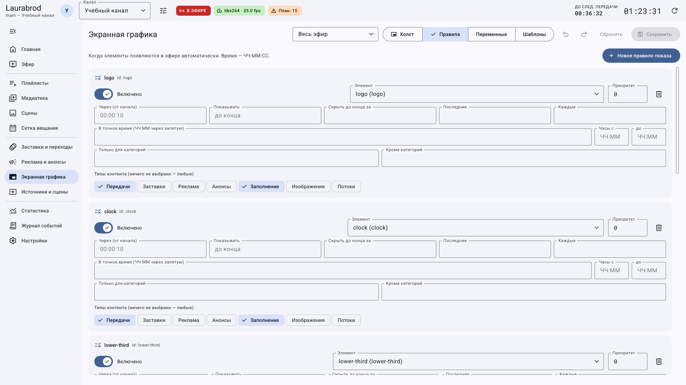
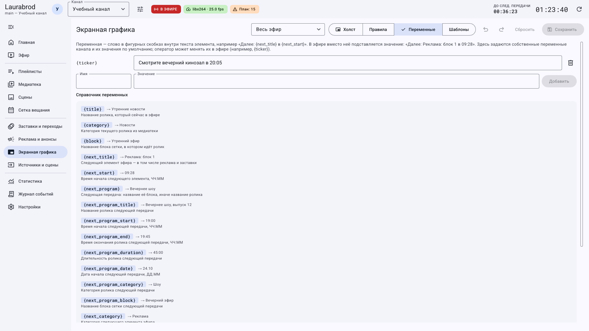

# Как автоматически показывать графику и менять текст в эфире

> Laurabrod 0.1.0. Снимки показывают реальный интерфейс; демонстрационные состояния подписаны отдельно. Способы и пределы проверки перечислены в [отчёте](../verification.md).

Поля крупным планом: [каждый тип элемента](graphics-elements.md) · [положение, текстовый стиль, анимация и профили](graphics-properties.md).

**Потребуется:** сохранённые элементы графики. Без правил они доступны для ручного показа, но не обязаны появляться автоматически.

## Как показать подпись через десять секунд после начала ролика

1. В **Экранная графика → Правила** нажмите **Новое правило показа**.
2. Выберите **Элемент** — созданную плашку. Включите правило.
3. В **Через (от начала)** введите `00:00:10`, в **Показывать** — `00:00:08`.
4. Ограничьте тип контента передачами и при необходимости укажите категории.
5. Задайте текст строк именно для этого правила либо оставьте его пустым, чтобы использовать дизайн элемента.
6. Сохраните. Запустите нужный ролик на учебном канале и проверьте появление через десять секунд.

В одном элементе могут использоваться разные тексты по разным правилам. Для пустых значений переменных доступно **Не показывать, если весь текст пустой**.

## Как настроить другие моменты показа

| Поле | Назначение |
|---|---|
| Скрыть до конца за | Прекратить показ за заданное время до конца ролика |
| Последние | Показ в последнюю часть ролика |
| Каждые | Периодическое появление |
| В точное время | Ежедневные значения ЧЧ:ММ, разделённые запятыми |
| Часы с / до | Ограничить суточное окно |
| Только для категорий / Кроме категорий | Ограничить содержание |
| Только ролики / Кроме роликов | Включить или исключить ID материалов через запятую |
| Только блоки / Только плейлисты | Ограничить показ указанными ID |
| Приоритет | Разрешать конкуренцию правил и элементов в соответствующих режимах слоёв |

Проверяйте сочетания ограничений на коротком тестовом ролике. Пустой выбор типов означает любые типы.

## Как подставлять сведения о передаче

1. В текстовом поле используйте **Вставить переменную** или введите её в фигурных скобках.
2. Например: `Далее: {next_program} в {next_program_start}`.
3. Откройте **Справочник переменных**, выберите нужное значение и проверьте рендер на текущем эфире.

`{title}` — текущий ролик; `{channel}` — название канала; `{next_title}` — следующий элемент, включая вставки; `{next_program}` — следующая передача. Для имён ведущих можно использовать метаданные материала или блока; их настройка описана в [конфигурации](../configuration.md).

Эта вкладка содержит собственные значения по умолчанию и справочник. Значения текущего эфира могут переопределяться оператором.

## Как менять бегущую строку вручную

1. Добавьте элемент **Бегущая строка** с текстом `{ticker}` и сохраните его правило показа.
2. На вкладке **Переменные** добавьте имя `ticker` и значение по умолчанию.
3. На **Эфире** откройте **Бегущая строка…**, введите новый текст и примените.
4. Проверьте строку в мониторе и выходе. Ручное значение действует как переопределение; для снятия можно использовать `laurabrod ctl var ticker` с корректным проектом и токеном.

## Как снять ручное управление видимостью

В быстрых действиях **Графика** нажмите **По правилам (снять ручное управление)** у элемента. Ручные **Показать** и **Скрыть** переопределяют автоматику. Если правило выглядит верным, а элемент не показывается, начните именно с этой проверки.

До сохранения отмените изменение Ctrl+Z или **Сбросить**. Для постоянного отключения выключите правило и сохраните.

## Подробные сценарии

- [Как настроить периодические плашки и показ перед концом передачи](graphics-rule-recipes.md)
- [Как расположить графику, настроить слои и анимацию](graphics-layout.md)

---

[Все гайды](index.md) · [Решение проблем](../troubleshooting/index.md) · [Главная](../index.md)
