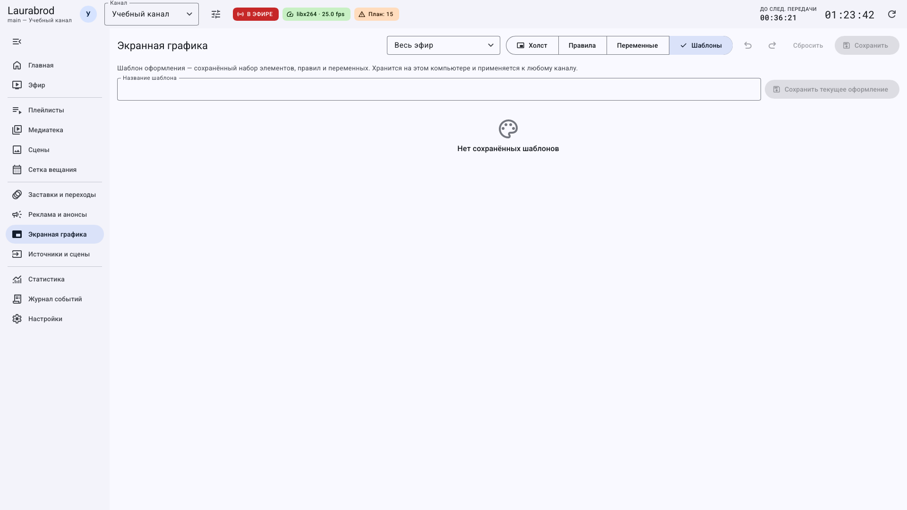
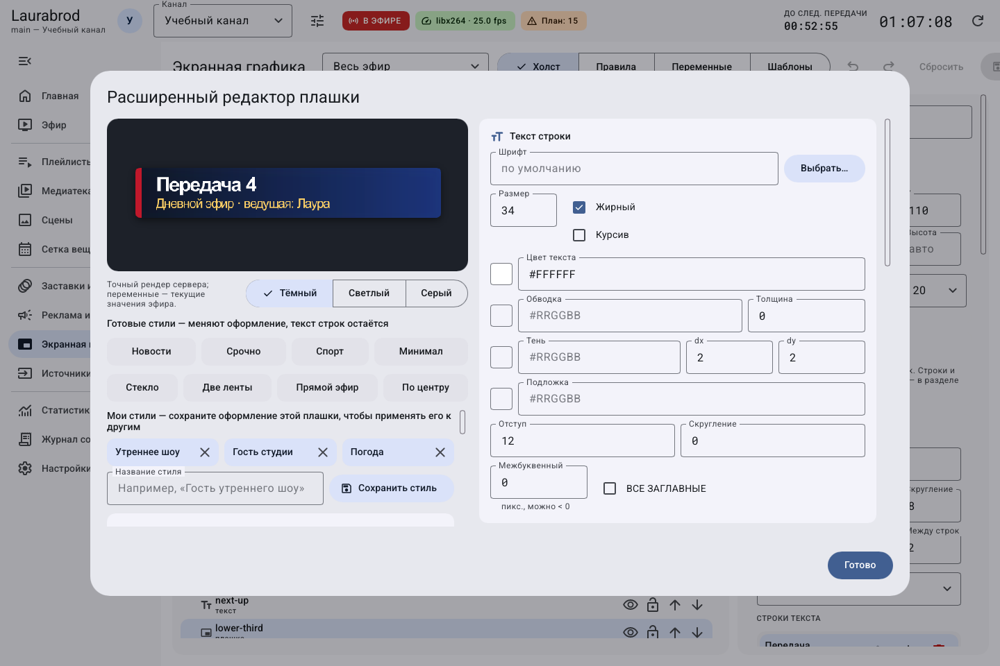

# Как сохранять оформление, стили и профили графики

> Laurabrod 0.1.0. Поля сверены с кодом и реальным интерфейсом. Снимки показывают учебные данные; полный проход мышью не заявляется. [Проверки и ограничения](../verification.md).

## Как сохранить весь набор оформления

**Потребуется:** настроенные элементы, правила и переменные в текущем контексте графики. Перед сохранением проверьте список **Весь эфир / сцена**, чтобы не перепутать общий набор и оформление сцены.

1. Сохраните графику канала обычной кнопкой **Сохранить**.
2. Откройте вкладку **Шаблоны**.
3. Введите **Название шаблона**, например `Дневное оформление`.
4. Нажмите **Сохранить текущее оформление**.
5. Убедитесь, что шаблон появился в списке. Это локальная библиотека компьютера оператора, не автоматический архив всех каналов на сервере.

На снимке список ещё пуст: отсутствие шаблонов не является ошибкой подключения.

## Как применить шаблон к другому каналу

1. В исходном канале сохраните шаблон. Затем выберите другой канал в шапке и откройте **Экранная графика**.
2. Сначала сохраните его прежнее оформление под другим именем либо экспортируйте канал.
3. На вкладке **Шаблоны** выберите нужный набор и нажмите **Применить**.
4. Вернитесь на **Холст**, проверьте размеры, пути изображений, шрифты, переменные и условия правил под новый канал.
5. Сохраните набор в целевом канале. Файлы из пути, существовавшего только у первого канала, не появляются на другом сервере от одного применения локального шаблона.

**Проверка:** после повторного открытия сохранённое оформление осталось, ресурсы доступны, правила соответствуют типам материалов нового канала. Не заменяйте проверку этой процедуры одним нажатием «Применить».

## Чем стиль плашки отличается от шаблона

| Что сохраняете | Где | Что переносится |
|---|---|---|
| Стиль плашки | Расширенный редактор → **Сохранить стиль** | Оформление плашки без конкретного текста строк |
| Шаблон оформления | Вкладка **Шаблоны** | Элементы, правила и переменные текущего набора |
| Экспорт канала | Менеджер каналов → ZIP | Выбранные документы и ресурсы канала, при соответствующих флажках |

Названия собственных стилей на этом кадре — встроенные демонстрационные примеры. Для своего стиля задайте имя и убедитесь, что оно появилось в локальном списке.

## Как ограничить элементы профилем оформления

1. В свойствах элемента найдите **Профили**. Пустое поле означает показ без ограничения этим списком.
2. Укажите идентификатор профиля, например `evening`. Проверьте формат списка по [конфигурации графики](../configuration.md).
3. Активный профиль канала задаётся через `[graphics] profile` в `channel.toml`; отдельного переключателя активации профиля в изученном GUI нет.
4. На остановленной копии проекта задайте активный профиль, проверьте конфигурацию и выполните локальный запуск.
5. Проверьте также `profiles` правил: ограничение элемента и ограничение правила должны подходить одновременно.

Профиль не равен цветовой теме GUI. Ручные команды показа могут переопределять автоматику, поэтому при тесте снимайте их. Для отмены верните прежние значения из копии. Перенос локальной библиотеки описан в [данных и копиях](../data-and-backup.md).

[Все гайды](index.md) · [Неполадки](../troubleshooting/index.md) · [Главная](../index.md)
