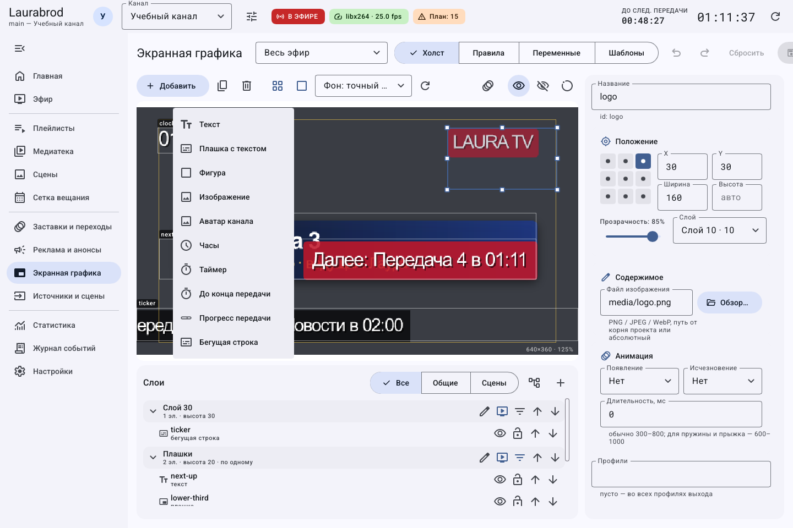
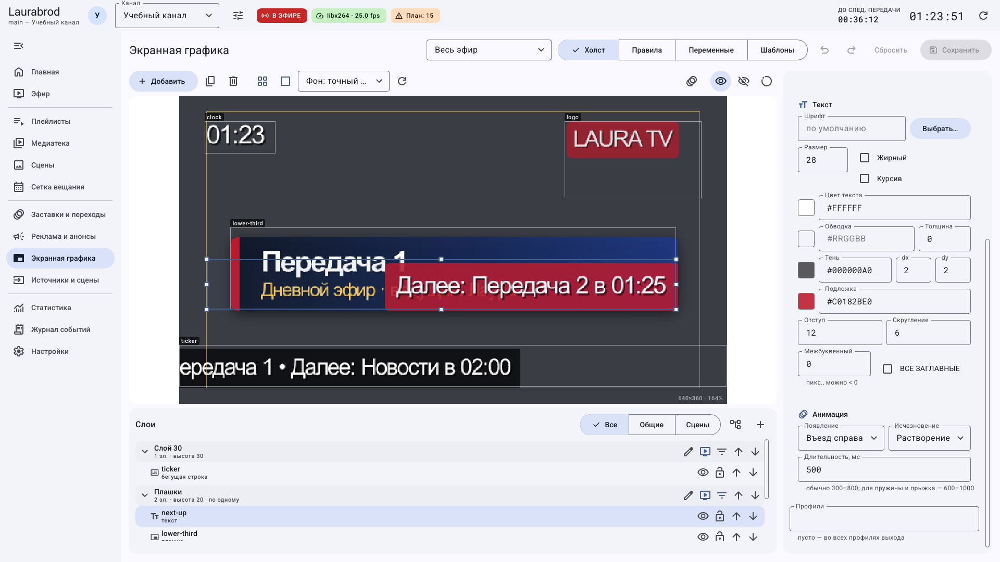
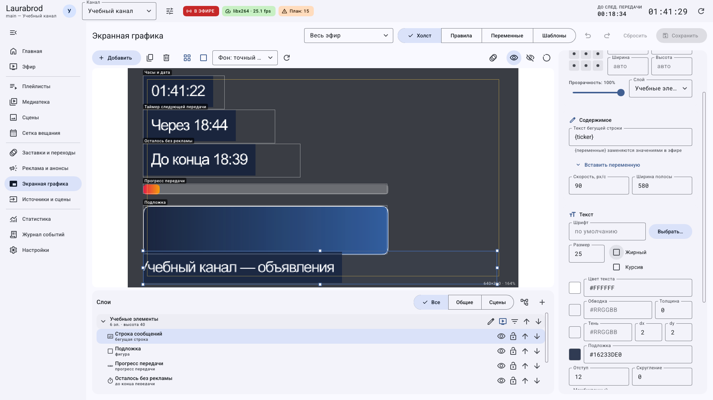
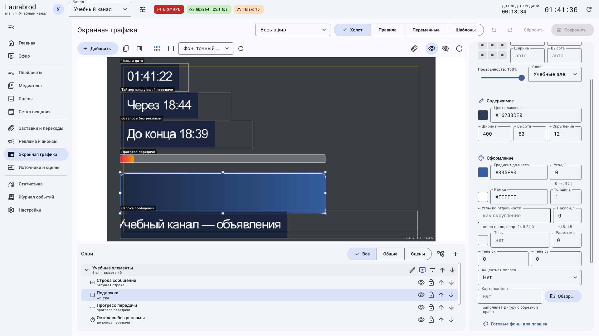
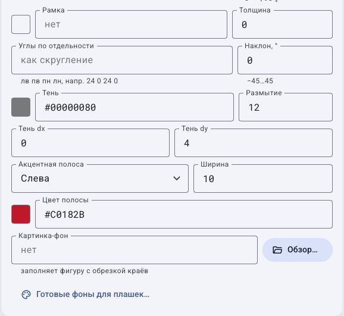

# Как настроить текст, бегущую строку и фигуры

> Laurabrod 0.1.0. Поля сверены с кодом и реальным интерфейсом. Снимки показывают учебные данные; полный проход мышью не заявляется. [Проверки и ограничения](../verification.md).

## Как сделать текстовую подпись с переменными

1. Откройте **Экранная графика → Добавить → Текст**.
2. В **Текст** введите `Сейчас: {title}`. **Вставить переменную** открывает справочник; выбор вставляет её обозначение в текст.
3. В разделе **Текст** задайте шрифт, размер, жирное/курсивное начертание и цвет.
4. Если нужен читаемый текст на разном видео, настройте обводку или тень. Подложка, её отступ и скругление относятся к тексту; прозрачная подложка не делает прозрачными сами буквы.
5. Для плотного заголовка измените **Межбуквенный**, для верхнего регистра включите **ВСЕ ЗАГЛАВНЫЕ**. Проверьте длинное кириллическое название, а не только короткое тестовое слово.
6. Сохраните и добавьте правило показа. Если `{title}` пусто, проверьте текущий материал и контекст рендера.

Второй снимок показывает нижнюю часть свойств после прокрутки. Один общий текстовый элемент не содержит несколько независимых строк с разными стилями — для этого используйте [плашку](graphics-plates.md).

## Как настроить движение бегущей строки

1. Выберите **Добавить → Бегущая строка**.
2. В **Текст бегущей строки** введите `{ticker}`, а на вкладке **Переменные** задайте начальный текст `ticker`.
3. Установите **Скорость, px/с**, например `90`, и **Ширина полосы**, например `580` для учебного кадра 640 пикселей. Для собственного формата подберите ширину и отступы по реальному выходу.
4. Настройте шрифт и положение у нижнего края. Сохраните и включите правило показа.
5. Сравните читаемость в записи. Чем длиннее текст и выше скорость, тем сложнее его прочитать; параметры не являются количеством символов в секунду.
6. Для замены сообщения во время работы используйте **Эфир → … → Бегущая строка…**. Это ручное значение переменной; [как вернуть исходное](graphics-rules.md).

**Если текст стоит или отсутствует:** проверьте тип элемента, положительную скорость, непустое значение переменной, правило показа и ручное скрытие. Замена текста сама по себе не создаёт новое правило.

## Как создать фигуру с градиентом, рамкой и тенью

1. Нажмите **Добавить → Фигура**, задайте ширину, высоту и скругление в **Содержимом**.
2. Выберите основной цвет; для прозрачности используйте формат `#RRGGBBAA`, где последние две шестнадцатеричные цифры задают непрозрачность. Например, `#16233DE0` — полупрозрачный тёмный цвет.
3. В **Оформление** задайте **Градиент до цвета** и угол: `0` — по горизонтали, `90` — по вертикали.
4. Укажите **Рамка** и её **Толщина**. Настройте отдельные углы, если нужны разные скругления, и **Наклон, °**, если требуется скошенная форма.
5. В **Тень** задайте цвет, размытие и смещение dx/dy. Смещения определяют направление тени, не перемещение самой фигуры.
6. В **Акцентная полоса** выберите сторону, ширину и цвет.
7. Для текстуры используйте **Картинка-фон → Обзор…** или **Готовые фоны для плашек…**. Изображение заполняет фигуру с обрезкой краёв.
8. Поместите фигуру ниже текста по слоям, сохраните и проверьте наложение.

Оформление фигуры и фона плашки использует одинаковую группу свойств. На втором снимке показана эта группа в плашке; он не выдаётся за другую форму фигуры.

**Возврат:** отмените черновик или очистите необязательный цвет/изображение и сохраните. Выбор «Без картинки» в диалоге текстур убирает текстуру, но не удаляет сам элемент.

[Все гайды](index.md) · [Неполадки](../troubleshooting/index.md) · [Главная](../index.md)
