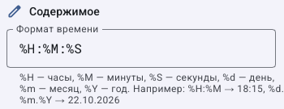
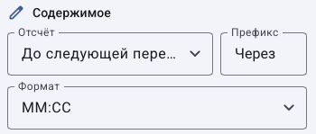
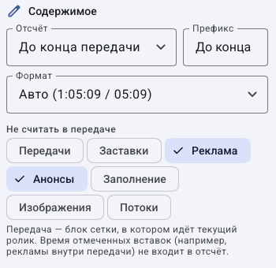
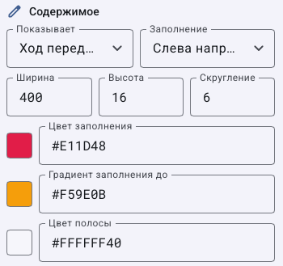
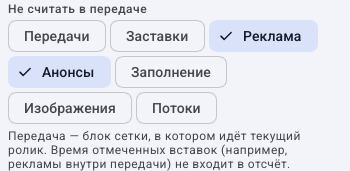
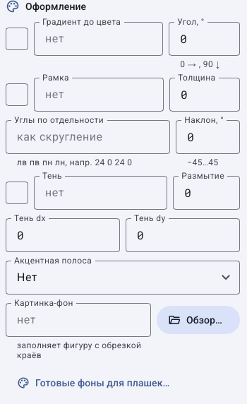

# Как настроить часы, дату, таймеры и прогресс передачи

> Laurabrod 0.1.0. Поля сверены с кодом и реальным интерфейсом. Снимки показывают учебные данные; полный проход мышью не заявляется. [Проверки и ограничения](../verification.md).

Поля крупным планом: [каждый тип элемента](graphics-elements.md) · [положение, текстовый стиль, анимация и профили](graphics-properties.md).

## Как вывести часы с секундами и дату

**Задача:** часы в углу кадра. Потребуется доступ к графике выбранного канала. Время берётся с сервера вещания, а не из часов компьютера оператора.

1. Откройте **Экранная графика → Холст → Добавить → Часы**.
2. Выберите элемент в слоях и назовите его `Часы канала`.
3. В **Содержимое → Формат времени** введите `%H:%M:%S`. Для даты используйте `%d.%m.%Y`; для часов без секунд — `%H:%M`.
4. В **Текст** выберите размер, цвет и подложку. Для двух независимых позиций часов и даты добавьте второй элемент «Часы» с форматом даты.
5. В **Положение** выберите угол привязки и отступы; [как работают координаты](graphics-layout.md).
6. Сохраните. Для проверки нажмите **Показать в эфире**, затем верните **По правилам показа** и настройте правило на нужные типы материалов.

Фрагмент показывает поле формата с подсказкой. [Оформление текста разобрано отдельно](graphics-properties.md). Превью на холсте не заменяет проверку автоматического показа.

**Проверка:** секунды меняются, дата соответствует серверу, текст не обрезается. При неверном времени проверьте часы и часовой пояс сервера. При неверном формате верните `%H:%M`; исходный файл видео не изменяется.

## Как сделать обратный отсчёт до следующей передачи

1. Нажмите **Добавить → Таймер**.
2. В **Отсчёт** выберите **До следующей передачи**.
3. В **Префикс** введите `До начала: `; в **Формат** выберите **ММ:СС** либо **ЧЧ:ММ:СС**, если интервал может быть больше часа.
4. Задайте расположение и текстовый стиль, сохраните.
5. Добавьте правило показа и проверьте таймер в промежутке перед передачей с известным стартом.

**Результат:** уменьшается интервал до следующей передачи из текущего прогноза. После ручного переключения или пересчёта плана значение может измениться. Если нужен остаток отдельного ролика, выберите **До конца ролика**; это другая цель.

## Как показать время передачи без рекламных вставок

1. Выберите **Добавить → До конца передачи**.
2. Проверьте **Отсчёт → До конца передачи** и задайте префикс, например `Осталось: `.
3. В **Не считать в передаче** отметьте **Реклама** и **Анонсы**. Если заставки также исключаются из вашего расчёта, отметьте их отдельно.
4. Сохраните и включите показ по правилу.
5. Сравните значение до вставки и во время неё: исключённая вставка не прибавляется к учитываемой длительности программы.

Программа здесь — экземпляр блока сетки с его материалами и вставками. Если у материала нет блока, расчёт использует сам материал. Это не таймер до произвольного времени, введённого оператором.

**Если не совпадает ожидание:** проверьте блок, типы вставок и актуальный прогноз. Одинаковое название передачи у двух блоков не объединяет их в один расчёт.

## Как создать полосу прогресса

1. Нажмите **Добавить → Прогресс передачи**.
2. В **Показывает** выберите **Ход передачи** или **Ход ролика**.
3. Задайте **Ширина**, **Высота**, **Скругление**. Пример для учебного кадра: ширина `400`, высота `16`, скругление `6`; для своего формата проверьте итоговый размер.
4. В **Заполнение** выберите направление: слева направо, справа налево, снизу вверх или сверху вниз.
5. Задайте **Цвет заполнения**, при необходимости **Градиент заполнения до**, и **Цвет полосы** для незаполненного фона.
6. Для **Хода передачи** выберите исключаемые типы. Сохраните и создайте правило показа.

Три фрагмента показывают разные задачи: расчёт и цвета, исключения типов и оформление формы. Рамка и тень не меняют, какое время учитывается в прогрессе.

**Проверка:** полоса растёт в выбранном направлении. Для короткого теста выберите **Ход ролика**, повторите ролик кнопкой **Сначала** и сравните начало и конец. Для возврата прежнего вида используйте Ctrl+Z до сохранения либо верните записанные значения после сохранения.

[Все гайды](index.md) · [Неполадки](../troubleshooting/index.md) · [Главная](../index.md)
