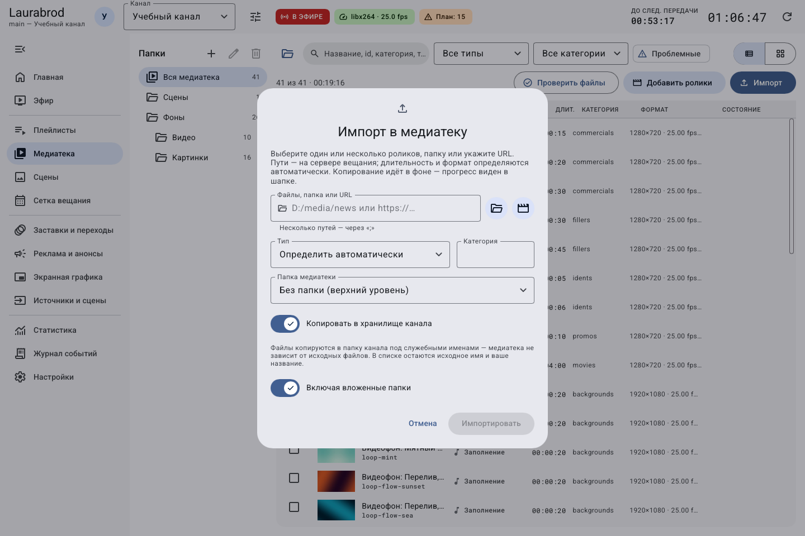
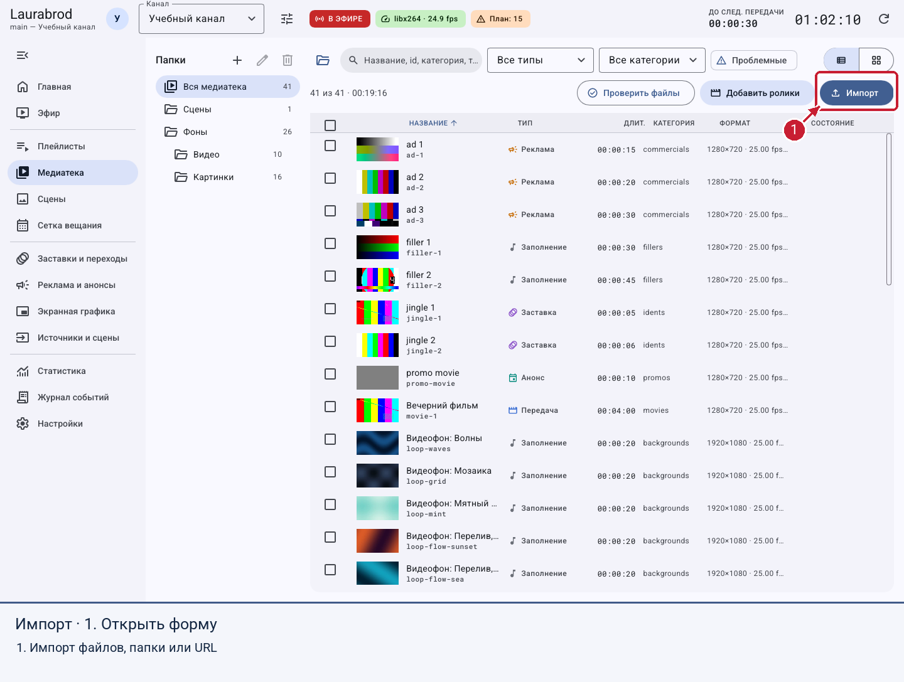
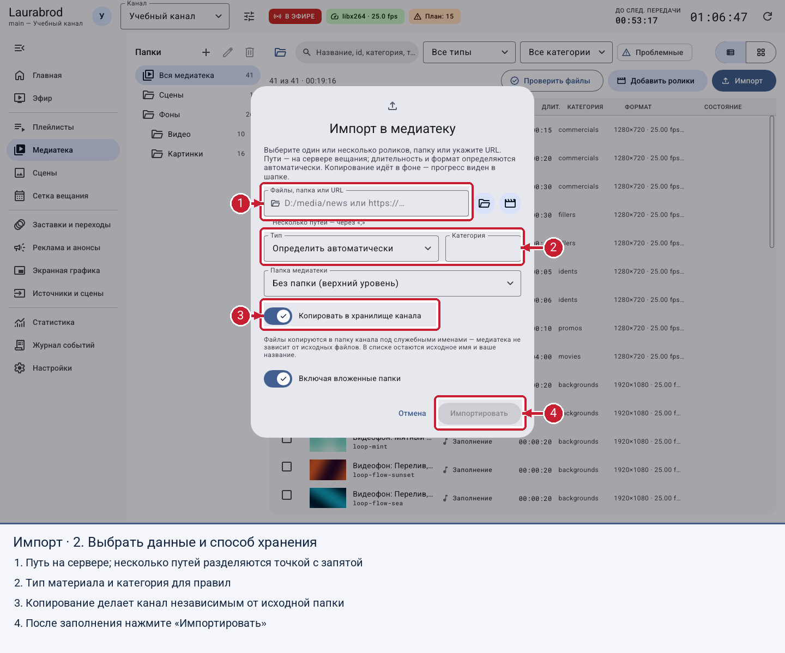
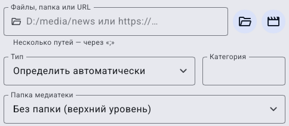
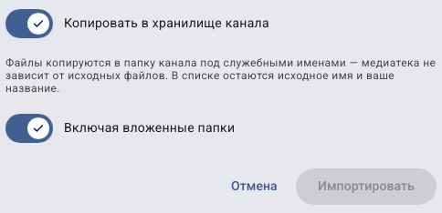

# Как добавить ролики, папки, картинки и потоки

> LauraBoard 0.1.0. Снимки показывают реальный интерфейс; демонстрационные состояния подписаны отдельно. Способы и пределы проверки перечислены в [отчёте](../verification.md).

**Цель:** заполнить медиатеку канала. Медиатека — каталог материалов, из которого вы собираете эфир; добавление файла не ставит его в расписание автоматически.

**Потребуется:** доступный серверу файл, папка или адрес потока; FFmpeg и ffprobe; роль operator или admin. При удалённом подключении путь относится к компьютеру вещания.

## Как подготовить путь, тип и категорию

1. Выберите один небольшой файл для первого опыта. Откройте его обычным проигрывателем на компьютере вещания и убедитесь, что это нужное видео со звуком.
2. Узнайте его полный путь. Пример `D:/TV/Lesson/first.mp4` сработает только если такой файл действительно существует у вас; его нельзя просто скопировать из инструкции.
3. Если управляете удалённо, сначала поместите файл на сервер разрешённым способом и получите путь именно на сервере. Ввод пути к файлу на ноутбуке не загружает его автоматически на другой компьютер.
4. Для простой передачи выберите тип **Передача**, категорию назовите, например, `lesson`. Потом используйте то же написание в фильтрах и правилах.

**Тип** отвечает за назначение материала: реклама и передача обрабатываются разными правилами. **Категория** — ваша метка отбора, например `news`; она не создаёт папку. **Папка медиатеки** организует список внутри программы; это не физическое расположение файла. Переключатель копирования определяет, будет ли канал зависеть от исходного пути.

Для папки сначала проверьте импорт одного файла, затем используйте путь к папке и решите, нужны ли вложенные каталоги. Для нескольких путей в общем поле используйте `;`, а не запятую. Не импортируйте один и тот же набор повторно, пока не выяснили результат первого задания.

## Как импортировать материалы

1. Выберите канал и откройте **Медиатека → Импорт**. Для обычного выбора файлов есть **Добавить ролики**.
2. В поле **Файлы, папка или URL** укажите путь. Несколько путей разделяйте `;`. Кнопки выбора файлов доступны при локальном подключении.
3. Выберите **Тип**: передача, заставка, реклама, анонс, заполнение, изображение или поток. Для обычного видео можно оставить **Определить автоматически**.
4. Задайте **Категория**, например `news`. Это ваше обозначение для отбора правилами, а не папка на диске.
5. Выберите **Копировать в хранилище канала**, если нужна независимость от исходной папки. Для больших архивов заранее проверьте место на диске.
6. Для обхода подпапок включите **Включая вложенные папки**.
7. Нажмите **Импортировать**. При копировании дождитесь завершения фонового задания в шапке.
8. Найдите материал по названию, откройте свойства и проверьте длительность, путь и отсутствие ошибки файла.

Форма принимает путь на сервере, тип и категорию. При отмене до отправки ничего не импортируется; запущенное копирование контролируется через [фоновые задания](jobs.md).

## По шагам на экране

Рамки показывают, где задать свой путь, тип и способ хранения. В пустой форме кнопка импорта недоступна.

## Как отдельно проверить параметры перед импортом

Сверху укажите, **что читать**, затем определите, **как записать материал в каталог**. Если нужна категория `lesson`, введите её в **Категория**, а не в путь. Если нужна виртуальная папка, выберите её отдельным списком **Папка медиатеки**.

Теперь решите, **где хранить файлы**: включение копирования занимает место в канале, выключение сохраняет зависимость от исходного пути. Переключатель вложенных папок относится к обходу каталога. **Импортировать** отправляет операцию; **Отмена** закрывает эту форму до запуска. При неактивной кнопке вернитесь к пути и ошибкам полей.

## Ссылки на файлы или копии

| Способ | Когда выбрать | Последствия |
|---|---|---|
| Копировать в канал | Переносимый самостоятельный канал | Занимает дополнительное место; собственная копия может удаляться вместе с записью медиатеки |
| Оставить на месте | Общая медиатека на стабильном диске | Перемещение или удаление исходника нарушит воспроизведение |
| URL потока | Прямой сетевой источник | Нужен доступ сервера к адресу; доступность может меняться |

## Как добавить сетевой поток

1. В форме импорта выберите **Поток** и укажите адрес `http`, `https`, `rtmp`, `srt` или `udp`, который вы вправе использовать.
2. Либо откройте **Источники и сцены → Добавить поток**: задайте название, адрес и **Длительность в эфире**.
3. Добавьте источник в плейлист или сетку. Кнопка **В эфир** немедленно прерывает текущий материал; для плановой работы используйте очередь.

Поддержка конкретного протокола и кодека зависит также от сборки FFmpeg. Не вставляйте ключи или закрытые URL в скриншоты для поддержки.

## Если импорт не удался

Проверьте путь именно с компьютера вещания, существование файла, права чтения и доступность ffprobe. Для списка без результатов очистите фильтры. Запись с ошибкой проверьте через **Проверить файлы**; см. [неполадки медиа](../troubleshooting/media.md).

## Подробные сценарии

- [Как разобрать импортированные материалы и выполнить массовые действия](media-bulk.md)

---

[Все гайды](index.md) · [Решение проблем](../troubleshooting/index.md) · [Главная](../index.md)
