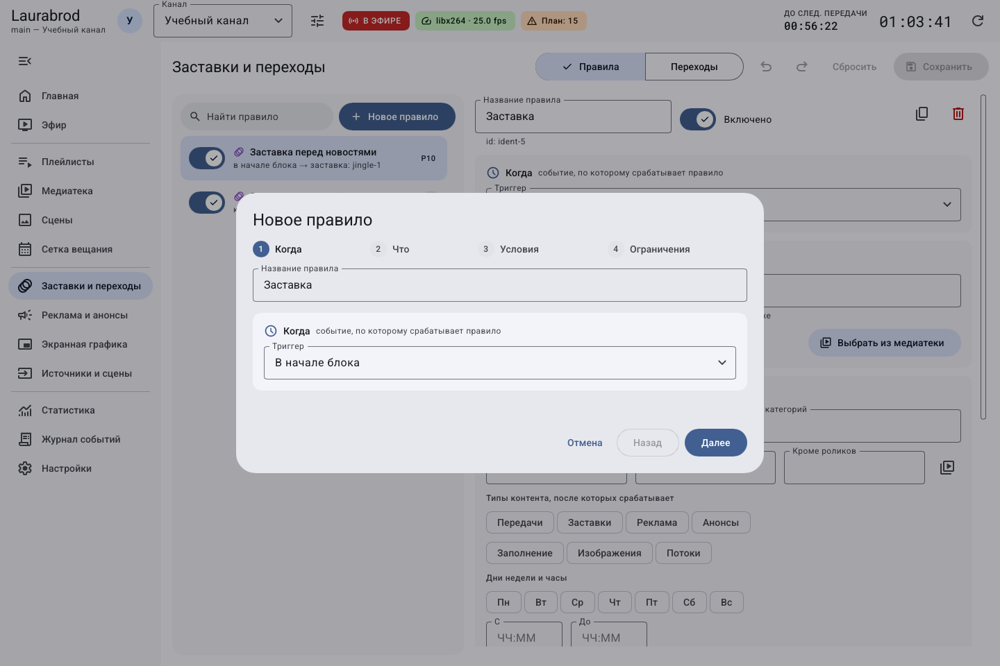
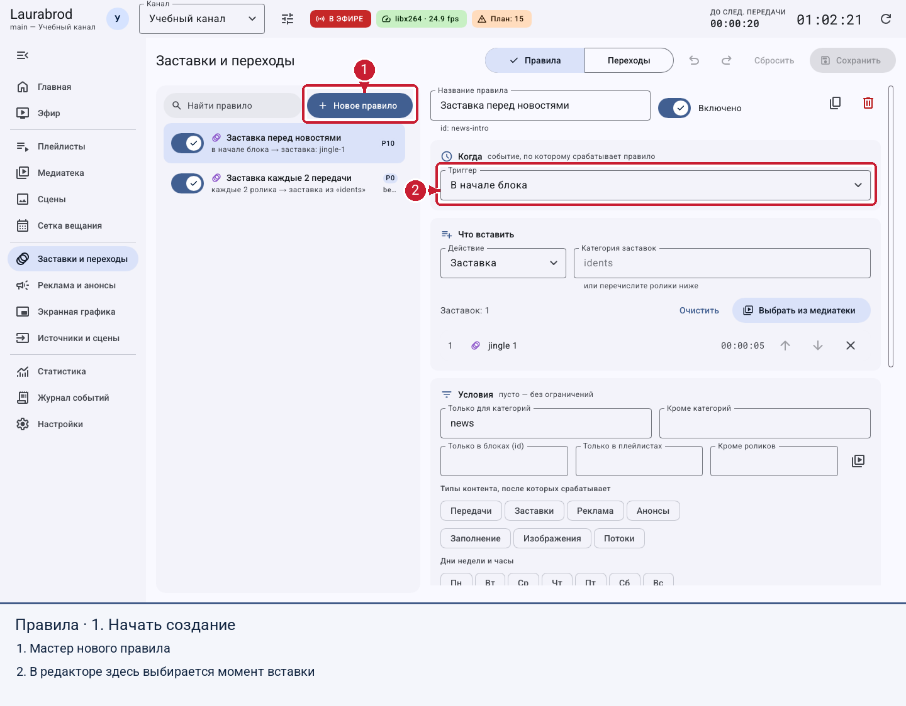
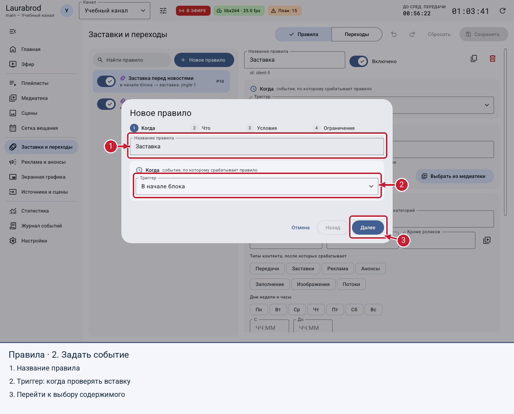
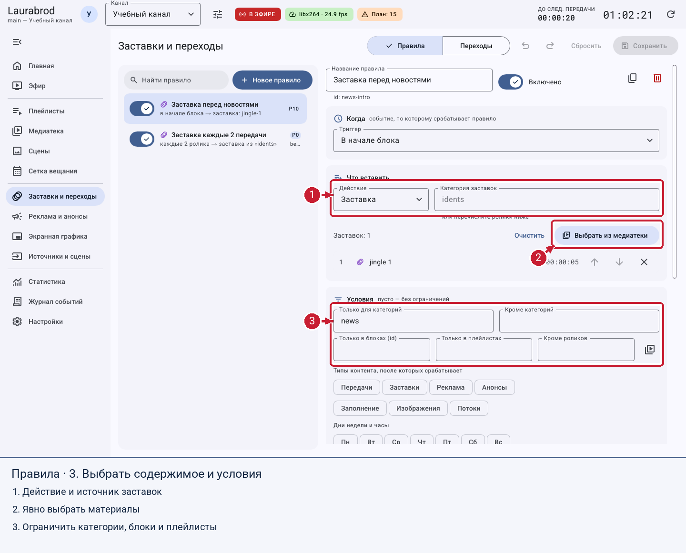
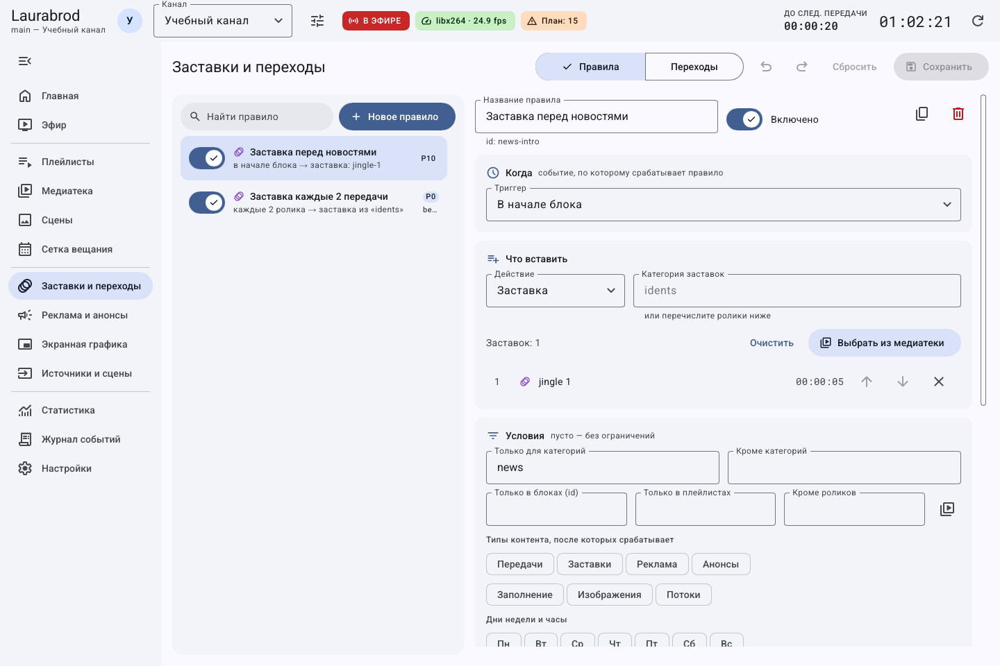
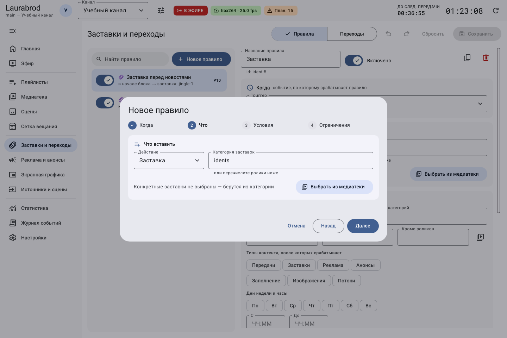
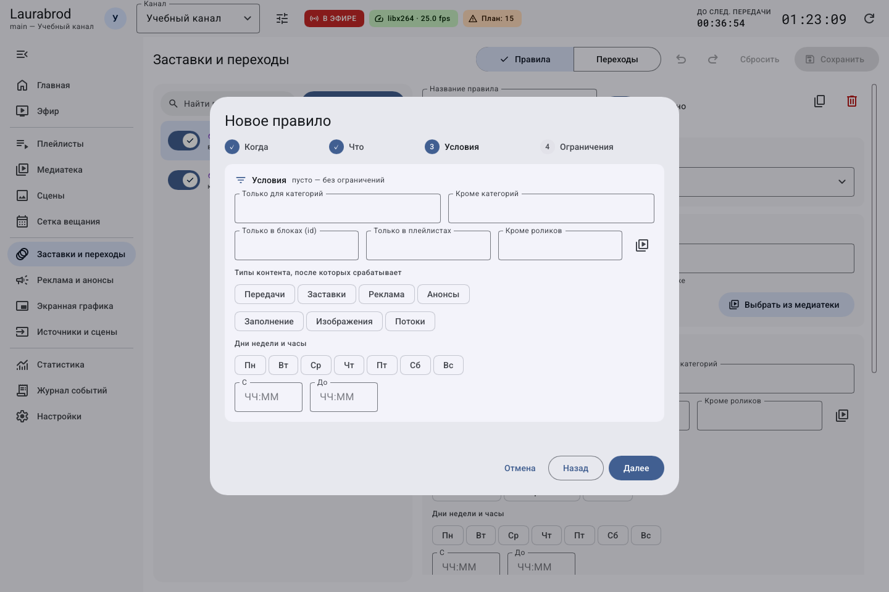
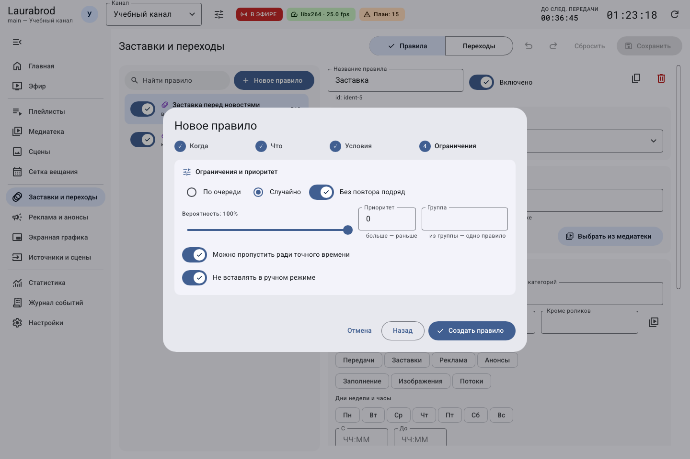
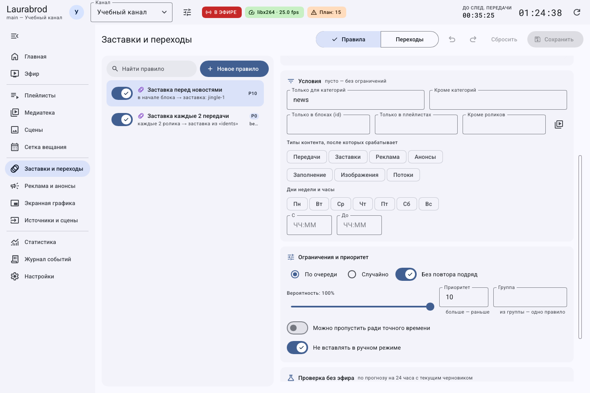
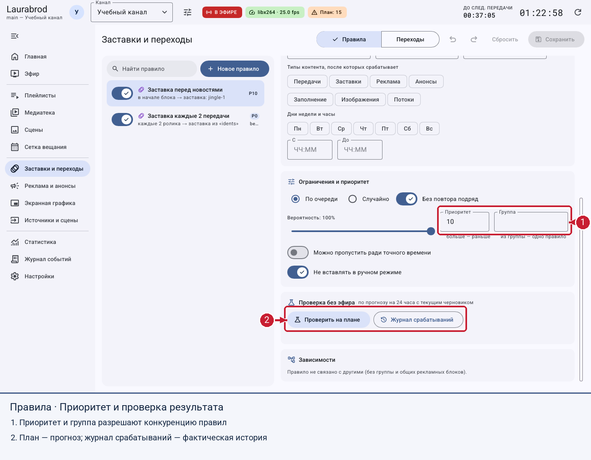

# Как настроить правила вставок для канала

> LauraBoard 0.1.0. Снимки показывают реальный интерфейс; демонстрационные состояния подписаны отдельно. Способы и пределы проверки перечислены в [отчёте](../verification.md).

**Пример задачи:** после каждых двух передач показывать одну заставку только по будням с 08:00 до 23:00.

**Потребуется:** хотя бы одна включённая заставка в медиатеке, сохранённая сетка с включёнными правилами вставок и роль operator или admin.

## Как проверить все четыре части правила

Правило отвечает на четыре разных вопроса. Сначала сформулируйте их словами, затем заполняйте мастер.

| Часть | Пример ответа | Частая путаница |
|---|---|---|
| Когда? | После каждых двух основных роликов | Это не каждые две секунды и не два повтора заставки |
| Что? | Показать одну из выбранных заставок | Список заставок отличается от списка роликов-условий |
| Где и когда разрешено? | В передачах категории `lesson`, по будням | Имя папки не подменяет категорию материала |
| Как выбирать и разрешать пропуск? | Последовательно, вероятность 100 %, можно пропустить ради точного времени | Группа и приоритет не задают время запуска |

Перед созданием добавьте хотя бы одну заставку в медиатеку, проверьте её тип и доступность. Для первого опыта оставьте одно понятное условие: не заполняйте одновременно все фильтры. Пустой разрешающий список обычно снимает именно это ограничение; это не удаляет правило.

После последнего шага мастера нажмите **Создать правило**, затем **Сохранить** на странице набора. Только после этого выполните **Проверить на плане**. В прогнозе найдите конкретное место вставки, а после эфира сравните его с **Журналом срабатываний**. Снимок мастера не подтверждает сохранение вашего правила.

## Как создать правило через мастер

1. Выберите нужный канал в шапке — правила принадлежат этому каналу.
2. Откройте **Заставки и переходы → Правила → Новое правило**.
3. Назовите правило `Заставка после двух передач`.
4. На шаге **Когда** выберите **Каждые N роликов**, введите `2`.
5. Нажмите **Далее**. На шаге **Что** выберите действие **Заставка** и нажмите **Выбрать из медиатеки**. Отметьте нужные заставки и подтвердите выбор.
6. На шаге **Условия** выберите будни, задайте **С** `08:00:00`, **До** `23:00:00`. Для любых категорий оставьте категорийные ограничения пустыми.
7. На шаге **Ограничения** оставьте вероятность 100 %, выберите порядок и **Без повтора подряд**. При одном кандидате запрет повтора может ограничивать подбор — подготовьте несколько заставок.
8. Нажмите **Создать правило**, затем **Сохранить** на странице правил.

Мастер разделяет настройку на четыре шага. После завершения правило остаётся частью редактируемого набора: сохраните набор.

## По шагам на экране

На снимках показаны реальные начальные состояния мастера и существующего учебного правила. Выберите значения из своего сценария; цифры на обводках являются пояснениями документации.

## Как выбрать другой момент вставки

| Триггер | Назначение |
|---|---|
| Каждые N роликов | После нужного числа основных элементов внутри блока |
| Каждые N минут | После завершения основного ролика, когда прошёл интервал |
| В начале / В конце блока | Оформить границы передачи |
| Между блоками | Добавить переход между передачами |
| После / Перед категорией | Привязать вставку к категории основного материала |
| После роликов | Привязать к выбранным элементам медиатеки |
| После плейлиста | Вставлять после завершения прохода плейлиста |
| В заданное время | В заданный момент дня; можно обрезать текущий ролик или дождаться его конца |
| Каждый час | В указанную минуту и секунду каждого часа, например `59:00` |
| В начале / В конце эфира | Открывающая или закрывающая вставка при запуске / остановке вещания |

Для временных правил переключатель **Точное время важнее: обрезать текущий ролик** разрешает прервать материал по часам. Без него ролик доиграет. Примеры — в [гайде новых правил эфира](air-updates.md).

## Как уточнить условия и приоритеты

1. Выберите правило в списке.
2. В **Условия** задайте разрешённые и исключённые категории, идентификаторы блоков, плейлисты, исключённые ролики и типы контента.
3. В **Ограничения и приоритет** задайте **Приоритет** и **Группа**. В одной группе в одной точке выбирается правило с большим приоритетом.
4. **Можно пропустить ради точного времени** разрешает планировщику убрать вставку. **Не вставлять в ручном режиме** исключает её в ручной работе.
5. Для случайного выбора задайте вероятность и подготовьте кандидатов. Вес материала меняет случайный выбор.
6. Сохраните. Для временного отключения снимите **Включено**; для копии используйте **Дублировать правило**.

## Нижняя часть редактора и шаги мастера

Выберите действие и материалы.

Задайте ограничения применения. На снимке показаны начальные значения мастера, а не уже заполненный пример с двумя роликами.

Настройте порядок, приоритет, вероятность и поведение ради точного времени, завершите создание и сохраните набор правил.

Нижние блоки сняты отдельно: они не помещаются в первый обзорный кадр редактора.

## Как проверить результат

Нажмите **Проверить на плане**, прочитайте примеры и предупреждения. Затем **Журнал срабатываний** показывает фактическую историю, если правило уже работало. Прогноз не является доказательством фактического показа.

Если вставок нет, проверьте сохранение, включение правила и правил блока, кандидатов, категорию, часы, дни, группу и ручной режим. До сохранения используйте **Сбросить** или Ctrl+Z. Далее: [реклама и анонсы](ads-promos.md), [вставка сцен](scene-rules.md).

## Подробные сценарии

- [Как настроить вставки под конкретный сценарий канала](rule-recipes.md)
- [Как подобрать рекламный блок и ограничить частоту показов](ads-recipes.md)

---

[Все гайды](index.md) · [Решение проблем](../troubleshooting/index.md) · [Главная](../index.md)
