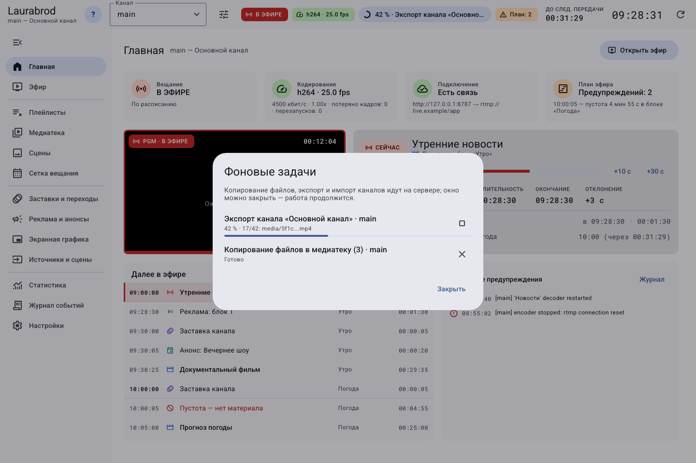

# Как следить за импортом и экспортом в фоне

> Laurabrod 0.1.0. Снимки показывают реальный интерфейс; демонстрационные состояния подписаны отдельно. Способы и пределы проверки перечислены в [отчёте](../verification.md).

**Цель:** понять, завершилось ли копирование медиа или перенос канала. Закрытие формы запуска не означает завершение операции.

1. Запустите [импорт с копированием](import-media.md), [экспорт или импорт канала](transfer-channel.md).
2. Нажмите индикатор задания в шапке окна.
3. Найдите нужную операцию по названию, каналу и состоянию.
4. Дождитесь завершения. При ошибке прочитайте её текст; проверьте место, пути и права записи.
5. Если у выполняемого задания доступна отмена, используйте её только для ненужной операции. Отмена не означает откат уже скопированных файлов.
6. Проверьте результат в медиатеке, списке каналов или целевом ZIP. Наличие файла без успешного состояния ещё не доказывает, что архив завершён.

**На снимке — встроенное демонстрационное состояние настоящего окна «Фоновые задачи».** Проценты и названия иллюстрируют интерфейс; фактические задания экспорта и импорта проверены отдельно через API. После завершения задания индикатор в шапке может исчезнуть; наличие полосы не требуется для успешного результата.

Не закрывайте сервер и не перемещайте исходные файлы во время копирования. При потере связи сначала восстановите её и проверьте состояние задания; не запускайте несколько одинаковых операций вслепую. История заданий не является долговременным журналом резервных копий.

---

[Все гайды](index.md) · [Решение проблем](../troubleshooting/index.md) · [Главная](../index.md)
