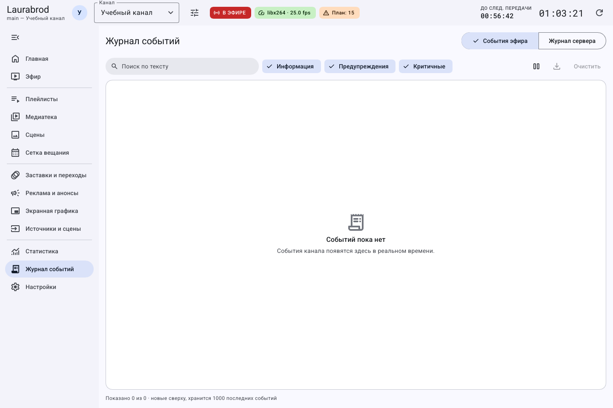
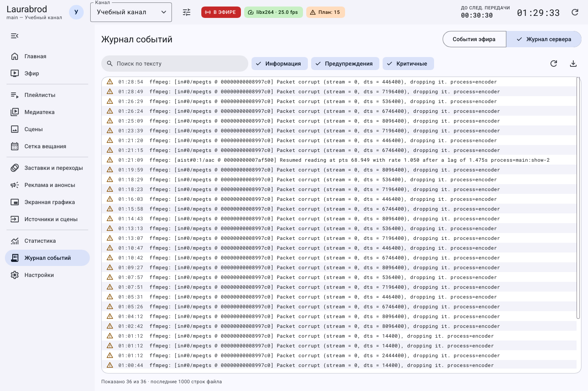

# Как найти ошибку в журнале и сохранить диагностику

> LauraBoard 0.1.0. Снимки показывают реальный интерфейс; демонстрационные состояния подписаны отдельно. Способы и пределы проверки перечислены в [отчёте](../verification.md).

**Потребуется:** доступ к серверу. Если связь потеряна, экран журнала может не получить последние строки — тогда запросите файлы журнала с сервера.

## Как найти событие

1. Откройте **Журнал событий → События эфира**.
2. Включите уровни **Информация**, **Предупреждения**, **Критичные** по задаче.
3. Введите часть сообщения в **Поиск по тексту**.
4. Для чтения без сдвига списка нажмите **Пауза: не обновлять список**. Это останавливает обновление списка, а не эфир.
5. После анализа нажмите **Продолжить обновление**.

В этой вкладке отображаются события, полученные интерфейсом. Это не вся история работы сервера.

## Как пользоваться фильтрами журнала отдельно от эфира

1. Введите фрагмент сообщения в **Поиск по тексту**. Для полной выборки очистите поле.
2. Включите нужные уровни. Если ничего не найдено, сначала включите все три: **Информация**, **Предупреждения**, **Критичные**.
3. Значком паузы остановите только обновление списка для чтения; затем возобновите его.
4. Для сохранения используйте кнопку выгрузки. Если она недоступна при пустом списке, сначала получите показанные строки.
5. **Очистить** убирает видимый список событий; не используйте её вместо устранения ошибки.

Пауза журнала, пауза расписания и остановка эфира — три разных действия. Нажатие паузы в этой строке не должно использоваться для управления воспроизведением.

## Как получить журнал сервера

1. Перейдите на **Журнал сервера**.
2. Нажмите **Перечитать файл журнала**, если данные могли измениться.
3. Найдите время сбоя и ближайшие предупреждения FFmpeg или приложения.
4. Нажмите **Сохранить показанные строки в файл**. Фильтр влияет на сохраняемую выборку.
5. Перед отправкой удалите ключи, токены, закрытые URL и персональные данные из копии файла.

На снимке видны фактические предупреждения учебного эфира. Их разбор — в [диагностике FFmpeg](../troubleshooting/broadcast.md#предупреждения-ffmpeg-packet-corrupt-и-отставание-чтения).

Кнопка **Очистить** в событиях очищает список интерфейса; она не является удалением серверного as-run или файлов журнала. После перезапуска окна ранее полученные события могут не восстановиться.

## Как читать сообщение и искать причину по порядку

Время помогает связать событие с вашим действием. Уровень показывает серьёзность сообщения, а текст — конкретную причину. Начните с момента, когда появилась проблема, и прочитайте несколько строк перед ним, а не только последнюю строку после повторного запуска.

1. Запишите действие и время: например, «нажал Начать вещание в 14:05 по Москве».
2. Откройте **Журнал событий**, включите все уровни и очистите поиск, чтобы не скрыть причину.
3. Найдите нужный момент. Если список быстро движется, включите **Пауза: не обновлять список**.
4. Найдите имя файла, адрес точки или кодек в сообщении. Проверьте именно этот объект: наличие другого работающего видео не исправляет недоступный путь.
5. Для полного файла перейдите на **Журнал сервера** и перечитайте его. Затем сохраните нужные показанные строки.
6. Возобновите обновление интерфейса, чтобы видеть новые события после исправления.

**Предупреждение** не всегда означает остановку, а работающий монитор не делает предупреждение неважным. Сравните сообщение с состоянием выхода и записи. Не используйте **Очистить** как исправление: очистка видимого списка не устраняет причину и усложняет разбор.

## Как описать проблему

Запишите время с часовым поясом, версию, канал, действия до ошибки, ожидаемое и фактическое поведение. Приложите безопасную копию журнала и снимок. Шаблон — [обращение в поддержку](../support.md).

Если фильтры скрывают строки, включите все уровни и очистите поиск. Если сервер недоступен, сначала [восстановите подключение](connection.md).

---

[Все гайды](index.md) · [Решение проблем](../troubleshooting/index.md) · [Главная](../index.md)
