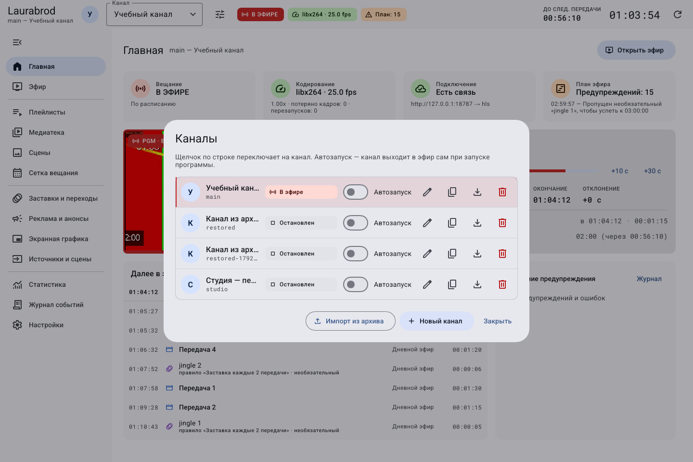
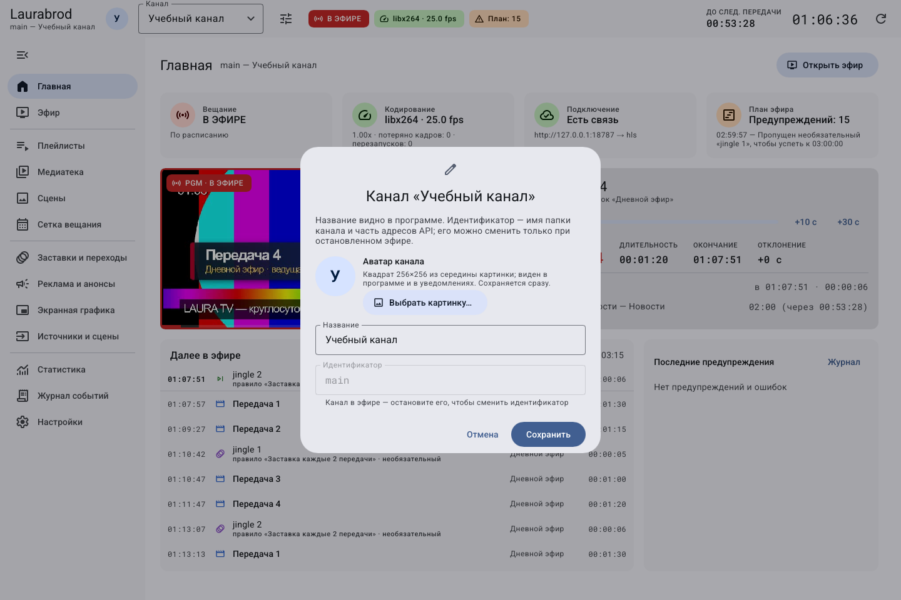
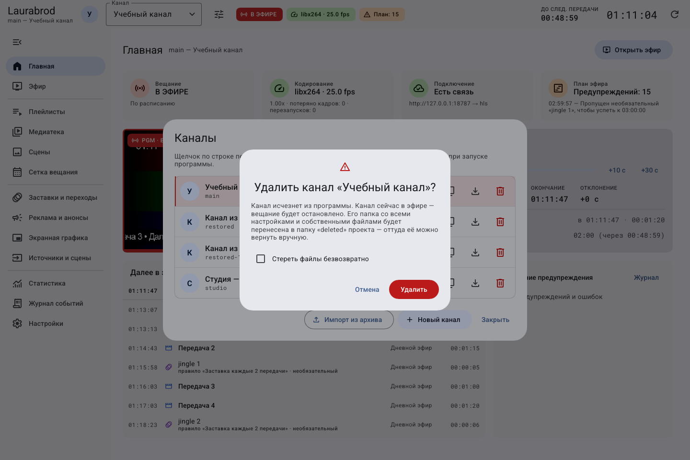

# Как переключать, переименовывать и копировать каналы

> Laurabrod 0.1.0. Снимки показывают реальный интерфейс; демонстрационные состояния подписаны отдельно. Способы и пределы проверки перечислены в [отчёте](../verification.md).

**Потребуется:** хотя бы один канал. Для изменения каналов нужна роль администратора.

В диалоге «Каналы» у каждой строки есть состояние, автозапуск и кнопки действий. Ориентируйтесь на подсказку при наведении на значок.

## Как переключиться на другой канал

1. Выберите канал в списке в шапке либо откройте **Каналы** и нажмите его строку.
2. Проверьте название в шапке, медиатеку и состояние на **Главной**.

Переключение выбранного канала меняет объект управления. Другие работающие каналы продолжают вещание.

## Как изменить название, идентификатор и аватар

1. Откройте **Каналы → Переименовать** у нужной строки.
2. Измените **Название** и нажмите **Сохранить**.
3. Для смены **Идентификатора** сначала остановите эфир этого канала. Пока он в эфире, поле недоступно. Новый идентификатор меняет папку и адреса API: обновите внешние подключения.
4. В той же форме нажмите **Выбрать картинку…** или **Заменить…**. Программа вырезает квадрат 256×256 из середины изображения.
5. Проверьте аватар в шапке и менеджере. **Убрать** удаляет аватар. Выбор картинки сохраняется сразу, независимо от сохранения названия.

## Как сделать полную копию канала

1. Нажмите **Дублировать со всем содержимым**.
2. Введите новый уникальный идентификатор и название.
3. Нажмите **Создать копию**. Проверьте плейлисты, сетку и графику у копии.
4. Настройте выходы отдельно: ключи трансляции не копируются, автозапуск выключен.

## Как настроить автозапуск

В менеджере включите **Автозапуск** у нужного канала. Он начнёт вещание при следующем запуске движка. Для учебных каналов оставляйте переключатель выключенным. Изменение применяется сразу; для отмены верните прежнее положение.

## Как удалить канал

> Обычное удаление переносит папку канала в `deleted/` проекта. Флажок **Стереть файлы безвозвратно** удаляет её содержимое, включая собственные медиа, графику и историю. Сначала [экспортируйте канал](transfer-channel.md). Ctrl+Z не восстанавливает удалённый канал.

1. Проверьте идентификатор и остановите эфир.
2. Откройте **Каналы → Удалить канал** у нужной строки.
3. Прочитайте подтверждение и подтвердите только выбранный канал.
4. Убедитесь, что он исчез из списка. Если удалён последний канал, появится стартовый экран.

Флажок безвозвратного стирания меняет последствия операции. На снимке открыт диалог, удаление не подтверждалось.

При конфликте идентификатора выберите другой. При ошибке доступа проверьте роль и права записи сервера. Подробности — [данные и резервные копии](../data-and-backup.md).

---

[Все гайды](index.md) · [Решение проблем](../troubleshooting/index.md) · [Главная](../index.md)
