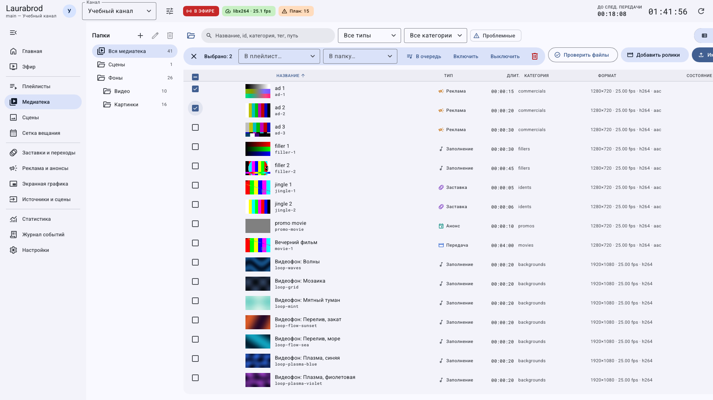

# Как разобрать импортированные материалы и выполнить массовые действия

> Laurabrod 0.1.0. Поля сверены с кодом и реальным интерфейсом. Снимки показывают учебные данные; полный проход мышью не заявляется. [Проверки и ограничения](../verification.md).

**Задача:** разложить учебную подборку по виртуальным папкам, добавить её в список и временно отключить лишнее. Потребуются импортированные материалы; действия выполняются в выбранном канале.

## Как перенести подборку в виртуальную папку

1. В **Медиатека → Папки** создайте папку `Передачи`, затем вложенную `Вечер`.
2. Найдите материалы поиском и фильтрами. Отметьте нужные строки флажками.
3. Проверьте **Выбрано: N** и названия отмеченных записей. Перед новой подборкой снимайте старое выделение; не полагайтесь только на текущий видимый фильтр.
4. Нажмите **В папку…** и выберите `Передачи/Вечер`.
5. Откройте эту папку и проверьте состав. Физические файлы на диске при этом не перемещаются.

Общий кадр сохранён в широком формате, чтобы панель действий не обрезалась. Флажки выделения и статус **Используется в эфире** решают разные задачи.

## Как добавить несколько материалов в плейлист или очередь

1. Выделите нужные записи; нажмите **В плейлист…**, выберите целевой список.
2. Откройте **Плейлисты** и проверьте добавленные строки. Итоговый порядок уточните в редакторе плейлиста, затем сохраните его при наличии черновика.
3. Для оперативной подачи используйте **В очередь**, после чего откройте **Эфир** и проверьте очередь. Добавление в очередь не равнозначно изменению постоянного расписания.
4. Удалите ошибочно добавленную строку из плейлиста или очереди; не удаляйте ради этого материал из медиатеки.

## Как временно исключить подборку без удаления файлов

1. Отметьте материалы и нажмите **Выключить**.
2. Проверьте состояние записей и прогноз: выключенные материалы не должны подбираться как доступный включённый контент.
3. Для возврата выделите их и нажмите **Включить**. Если они не видны, очистите фильтры и поиск.
4. Не используйте удаление для краткой паузы: у медиатеки нет общей корзины, собственная копия файла в хранилище канала может удаляться вместе с записью.

## Как перенести или убрать ветку папок

1. Выберите папку и нажмите **Переименовать или переместить папку**.
2. Введите новый путь, например `Архив/Вечер`, вместо `Передачи/Вечер`; проверьте дерево после сохранения.
3. Для удаления только виртуальной папки используйте **Удалить папку (содержимое перейдёт на уровень выше)**.
4. Для обратного перемещения создайте нужную папку и снова используйте **В папку…**.

**Проверка:** найдите одну запись через общий список и через новую папку; сравните свойства, плейлист и очередь. Если удаление отклонено из-за использования, сначала уберите ссылки. Если пропал файл, проверьте путь на сервере и [диагностику медиа](../troubleshooting/media.md).

[Все гайды](index.md) · [Неполадки](../troubleshooting/index.md) · [Главная](../index.md)
