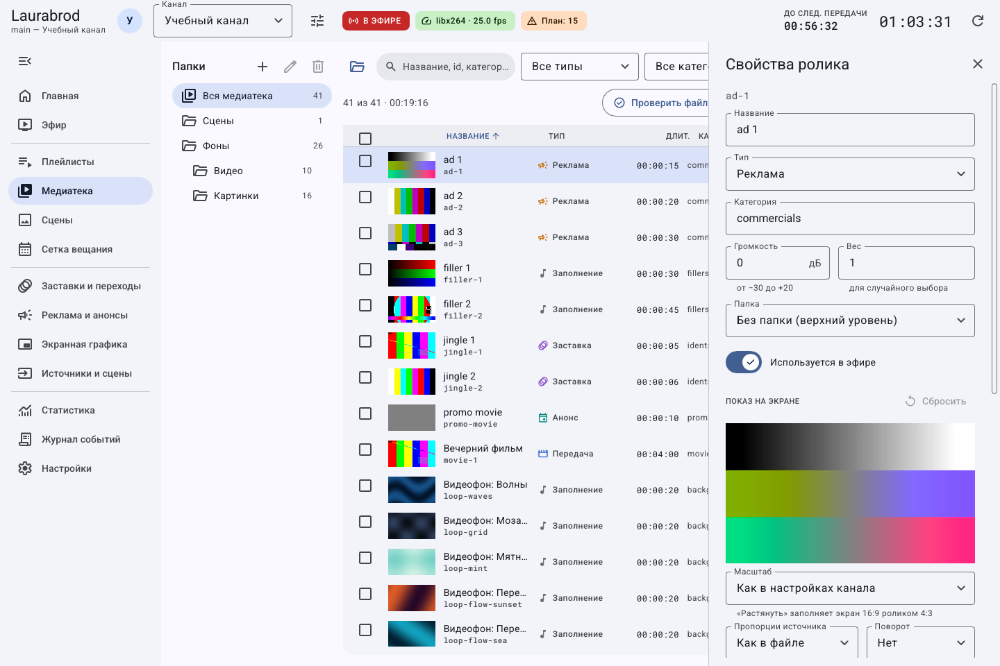
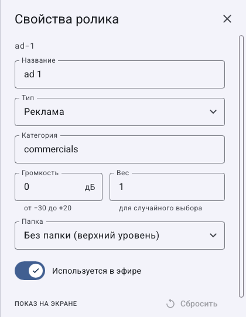
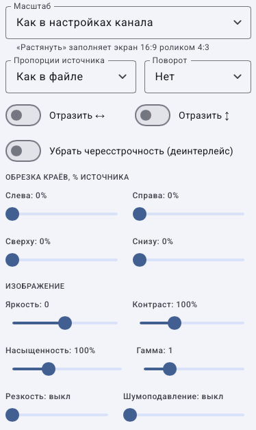
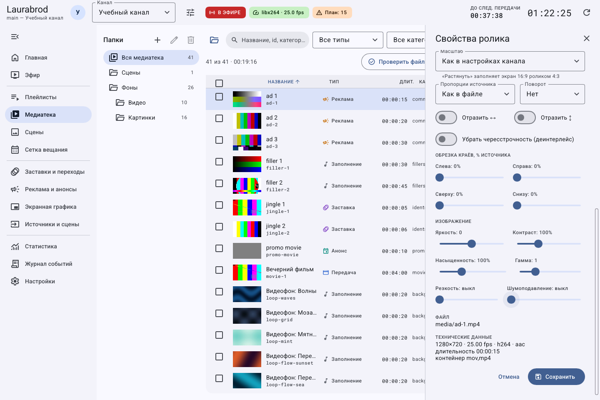

# Как настроить изображение и громкость ролика

> LauraBoard 0.1.0. Снимки показывают реальный интерфейс; демонстрационные состояния подписаны отдельно. Способы и пределы проверки перечислены в [отчёте](../verification.md).

**Цель:** исправить пропорции, поля, ориентацию или звук отдельного материала без изменения исходного файла.

1. В **Медиатека** откройте **Изменить свойства** нужного ролика.
2. В **ПОКАЗ НА ЭКРАНЕ** выберите **Масштаб**.
3. Дождитесь рендера кадра и сравните результат с задачей.
4. Настройте дополнительные параметры из таблицы. Меняйте по одному, чтобы понимать эффект.
5. В верхней части свойств задайте **Громкость** в дБ: отрицательное значение делает тише, положительное громче. Допустимый диапазон формы — от −30 до +20.
6. Нажмите **Сохранить**. Проверьте следующий показ ролика и при необходимости тестовую запись; текущий декодер не следует считать немедленно обновлённым.

Панель свойств прокручивается: параметры показа расположены ниже основной информации.

| Параметр | Когда использовать |
|---|---|
| Как в настройках канала | Унаследовать общий режим масштаба |
| Вписать (с полями) | Сохранить весь кадр и пропорции |
| Заполнить (обрезать края) | Убрать поля ценой части изображения |
| Растянуть на весь экран | Заполнить кадр с изменением пропорций |
| Вписать, поля — размытый фон | Сохранить пропорции, заменить поля размытым изображением |
| Пропорции источника | Исправить неверную интерпретацию формата исходника |
| Поворот, Отразить ↔ / ↕ | Исправить ориентацию |
| Убрать чересстрочность | Обработать материал с чередующимися строками |
| Обрезка краёв | Убрать лишнюю область, значения заданы в процентах исходника |
| Яркость, Контраст, Насыщенность, Гамма | Скорректировать изображение |
| Резкость, Шумоподавление | Скорректировать детализацию; чрезмерные значения ухудшают картинку |

## Длинная форма по частям

Часть 1 — основные свойства и громкость. Это фрагмент исходного снимка, поля не дорисовывались.

Часть 2 — параметры показа после прокрутки: масштаб, пропорции, поворот, отражение, обрезка и коррекция изображения.

Часть 3 — нижняя область, сведения о файле и кнопки завершения. Прокрутите форму до конца, чтобы сохранить изменения.

## Как исправить поля, обрезку и ориентацию

1. Откройте свойства одного материала и прокрутите до **Масштаб**.
2. Для полного изображения выберите **Вписать (с полями)**, для заполнения экрана с потерей краёв — **Заполнить (обрезать края)**. Если исходник искажён, сначала проверьте **Пропорции источника**, а не компенсируйте ошибку растяжением.
3. В **Поворот** выберите нужный угол. **Отразить ↔ / ↕** включайте только для соответствующего отражения, а не для поворота.
4. В **Обрезка краёв, % источника** меняйте стороны по одной: например, небольшое значение **Слева**, если дефект расположен слева. Обрезка задаётся в процентах исходника, не пикселях выходного кадра.
5. Сохраните и проверьте следующий полный показ: края, лица, подписи и пропорции. При ошибке верните прежние значения либо сбросьте параметры показа и сохраните.

## Как скорректировать цвет, резкость и шум

1. В свойствах прокрутите до **Изображение**.
2. Сначала проверьте нейтральные значения: **Яркость: 0**, **Контраст: 100 %**, **Насыщенность: 100 %**, **Гамма: 1**. Они показаны на кадре ниже.
3. Изменяйте один ползунок и сравнивайте результат: яркость меняет светлоту, контраст — различие светлых и тёмных участков, насыщенность — выраженность цвета, гамма — распределение тонов.
4. Включайте **Резкость** и **Шумоподавление** постепенно. Проверьте мелкий текст и движение: чрезмерное усиление создаёт контуры, чрезмерное подавление сглаживает детали.
5. Нажмите **Сохранить** внизу формы и проверьте следующую подачу материала или завершённую тестовую запись. Коррекция относится к этому материалу и не переписывает исходный файл.

Параметры обрезки видны сверху для связи с предыдущей частью. При неудачной коррекции верните записанные значения; **Сбросить** в разделе показа также затронет другие параметры показа, поэтому это не отмена только одного ползунка.

## Как вернуть прежний вид

До сохранения нажмите **Отмена**. Кнопка **Сбросить** в разделе показа возвращает параметры показа к исходным, а не отменяет все свойства ролика; затем нужно сохранить. Для точного возврата ранее настроенного вида запишите прежние значения заранее.

Общая громкость канала и нормализация настраиваются отдельно: [кодировщик](encoder.md). Если кадр не строится, проверьте файл и FFmpeg по [инструкции диагностики](../troubleshooting/media.md).

---

[Все гайды](index.md) · [Решение проблем](../troubleshooting/index.md) · [Главная](../index.md)
