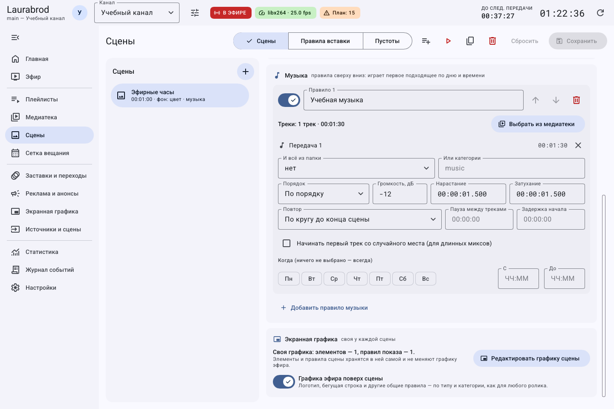
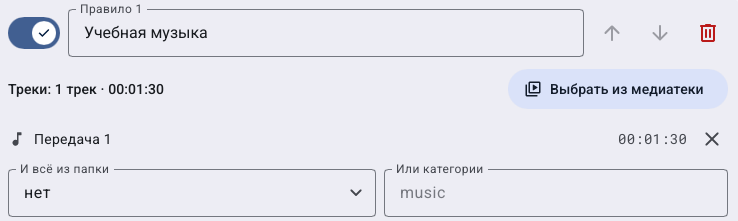
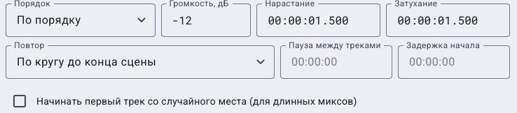

# Как настроить музыку сцены: расписание, повторы и паузы

> LauraBoard 0.1.0. Поля сверены с кодом и реальным интерфейсом. Снимки показывают учебные данные; полный проход мышью не заявляется. [Проверки и ограничения](../verification.md).

## Как подобрать музыку из списка, папки или категории

**Потребуется:** аудио либо видео со звуком в медиатеке и сохранённая сцена. Потоки и картинки не являются подходящими обычными музыкальными треками.

1. В **Сцены** выберите сцену и добавьте музыкальное правило.
2. **Выбрать из медиатеки** задаёт явный список треков. Уберите ненужный трек крестиком, не удаляя исходный материал.
3. **И всё из папки** добавляет включённые материалы выбранной папки и подпапок; **Или категории** — материалы категории.
4. Эти источники могут дополнять друг друга: поле папки не означает автоматически «забыть явный список». Для строгого набора оставьте только нужный источник.
5. Выберите **По порядку**, **Перемешать** или **Один случайный трек**.

**Проверка:** в сводке правила есть треки, у них положительная длительность, они включены и доступны серверу.

## Как настроить дневную и ночную музыку

1. Первому правилу дайте имя `Ночь`, укажите спокойные материалы, **С** `22:00`, **До** `06:00`.
2. Второе правило назовите `День`, задайте другой набор и дневное время либо оставьте общим резервом.
3. Кнопками **Выше — проверяется раньше / Ниже** поставьте специальное ночное правило над общим.
4. Правила проверяются сверху вниз; играет первое включённое подходящее, а не несколько одновременно.
5. Сохраните и проверьте сцену в нужном временном контексте. Подбор привязан к началу показа сцены, а не означает бесшовное переключение в середине длинной сцены ровно в 22:00.

Пустой выбор дней означает отсутствие ограничения по дням. При отсутствии подходящего правила сцена может идти без музыки. Выключайте правило его переключателем, если хотите сохранить его как заготовку.

## Как проиграть музыку один или несколько раз

1. В **Повтор** выберите **Один раз** либо **Несколько раз**.
2. Для нескольких проходов задайте **Сколько раз**. Для непрерывного фона используйте **По кругу до конца сцены**.
3. В **Пауза между треками** задайте, например, `00:00:02`, в **Задержка начала** — `00:00:03`.
4. **Нарастание** и **Затухание** регулируют громкость в начале/конце музыкального интервала; это не паузы.
5. Сохраните и проверьте начало, границу двух треков и окончание в записи. После конечного числа проходов музыка может закончиться раньше сцены, и остаток будет тихим.

## Как закончить сцену вместе с музыкой

1. Используйте конечный предсказуемый набор с режимом повторов, для которого программа может вычислить длину.
2. Нажмите **Длительность сцены по музыке**, когда это действие доступно.
3. Проверьте новую **Длительность** сцены и сохраните.
4. При **Один случайный трек** или случайном старте точная длина заранее может быть неизвестна; не ожидайте доступности вычисления в любой комбинации.

Для длинного микса флажок **Начинать первый трек со случайного места** меняет начальную позицию, а не случайно перемешивает все правила. Выключите его для проверки по секундомеру. При неверном результате верните длительность вручную или сбросьте черновик до сохранения.

## Как оставить сцену без общего логотипа

1. В **Экранная графика** выбранной сцены выключите **Графика эфира поверх сцены**.
2. Через **Редактировать графику сцены** добавьте собственные часы или подпись.
3. Сохраните и проверьте показ этой сцены, затем обычного ролика: собственная графика сцены не должна стать оформлением всех передач.

## Как читать музыкальную форму по трём частям

1. Проверьте сводку количества треков и список. Крестик у трека убирает его из правила, а не стирает исходный файл.
2. Решите, нужны ли дополнительно папка и категория. Для строго заданного списка оставьте дополнительные источники пустыми.

3. Настройте порядок и громкость. Например, `−12` дБ делает музыку тише; это не проценты.
4. Выберите режим повторов, затем задайте появившиеся дополнительные поля. Для **Несколько раз** нужен счётчик; при цикле до конца сцены он не требуется.
5. **Пауза между треками** относится к границам внутри подборки, **Задержка начала** — к началу её показа. Нарастание и затухание меняют громкость, не заменяя паузы.

6. Ограничьте дни и время только при необходимости. Подбор идёт сверху вниз, используется первое подходящее правило.
7. Сохраните сцену и проверьте её новый показ со звуком. Изменение правила в форме не является прослушиванием конечного выхода.

[Все гайды](index.md) · [Неполадки](../troubleshooting/index.md) · [Главная](../index.md)
