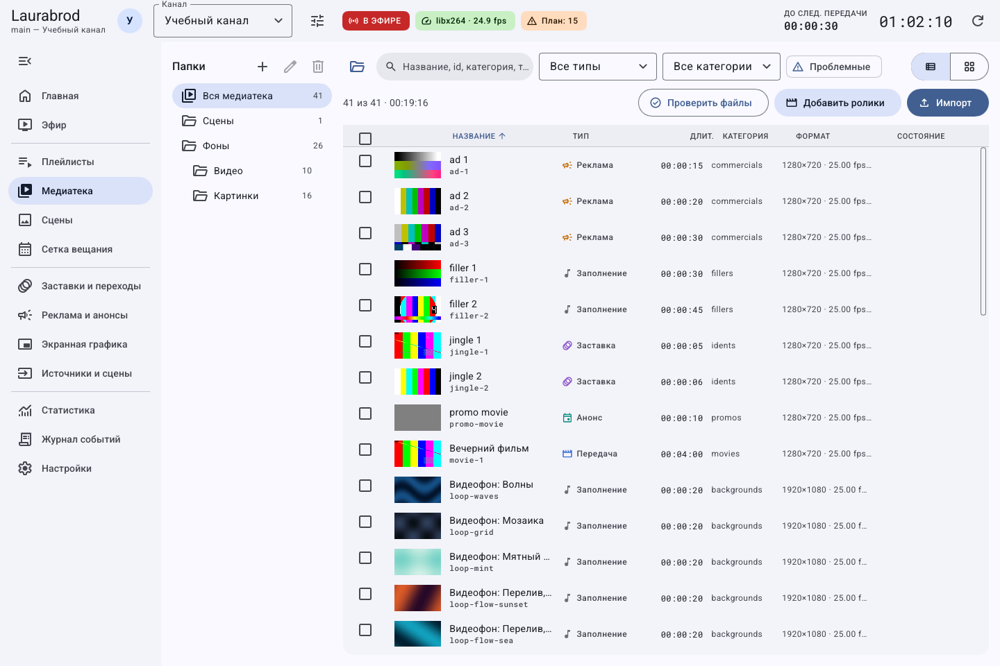
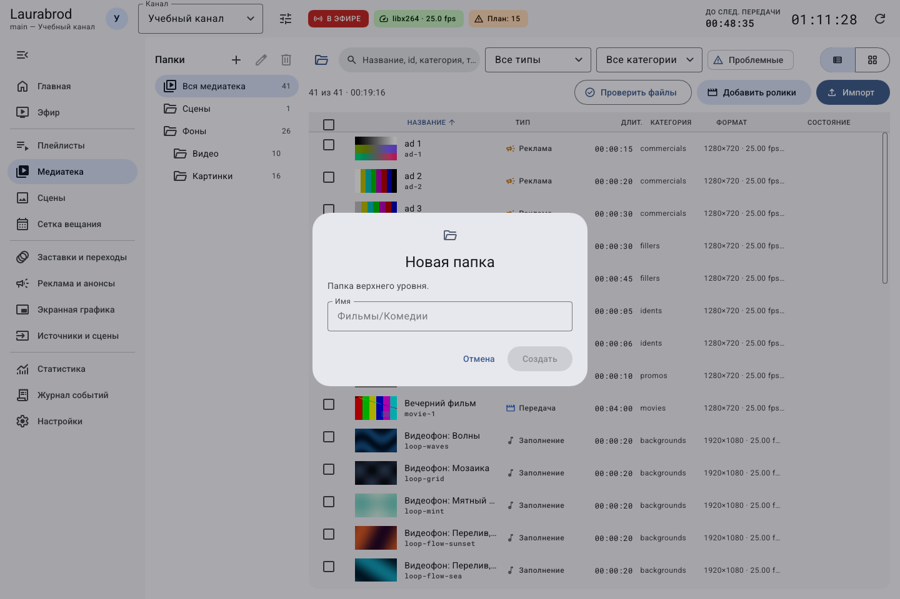

# Как организовать медиатеку и работать с несколькими роликами

> Laurabrod 0.1.0. Снимки показывают реальный интерфейс; демонстрационные состояния подписаны отдельно. Способы и пределы проверки перечислены в [отчёте](../verification.md).

**Потребуется:** импортированные материалы. Перед массовыми действиями проверьте выбранный канал и число выделенных записей.

Слева расположены виртуальные папки, сверху — поиск и фильтры, справа — список материалов.

## Как найти и отсортировать материалы

1. Откройте **Медиатека** и выберите папку либо общий список.
2. Введите часть названия в поиск; выберите тип и категорию.
3. Для поиска повреждённых или недоступных материалов включите **Проблемные**.
4. Переключайте таблицу и плитки кнопками вида. В таблице нажмите заголовок столбца для сортировки.
5. Если запись не найдена, очистите поиск, фильтр типа, категорию и **Проблемные**, вернитесь в общий список.

## Как создать, переместить и удалить папку

1. На панели **Папки** нажмите **Новая папка**. При выбранной папке новая создаётся внутри неё.
2. Введите имя и нажмите **Создать**.
3. Откройте **Свойства ролика**, выберите **Папка** и сохраните.
4. Для изменения дерева используйте **Переименовать или переместить папку** и задайте новый путь.
5. Кнопка **Удалить папку (содержимое перейдёт на уровень выше)** убирает виртуальную папку, а не сами материалы.

Эти папки организуют список медиатеки. Они не означают перенос исходных файлов между каталогами диска.

## Как выполнить массовое действие

1. Отметьте записи флажками в таблице. Проверьте надпись **Выбрано: N**.
2. На появившейся панели выберите плейлист или папку либо нажмите **В очередь**, **Включить**, **Выключить**.
3. Проверьте результат в целевом плейлисте, папке или очереди эфира.
4. Снимите выделение перед следующей операцией.

Выключенный материал остаётся в каталоге, но не используется как включённый контент. Отключение не является удалением.

## Как изменить свойства и удалить материал

1. Откройте контекстное меню строки → **Изменить свойства**.
2. Измените название, тип, категорию, громкость, вес случайного выбора, папку и **Используется в эфире**.
3. Нажмите **Сохранить**; до сохранения изменения можно закрыть через **Отмена**.

> **Удалить из медиатеки…** может удалить и собственную копию в хранилище канала. Исходники вне хранилища при удалении записи не удаляются. Сначала сделайте копию нужных файлов.

Удаление материала, используемого в плейлисте, отклоняется: сначала уберите ссылки из плейлистов. Также проверьте ссылки сетки и правил, чтобы не оставить недоступные материалы. Общей корзины медиатеки нет.

Связанные инструкции: [импорт](import-media.md), [показ и звук](media-display.md), [плейлисты](playlists.md).

---

[Все гайды](index.md) · [Решение проблем](../troubleshooting/index.md) · [Главная](../index.md)
