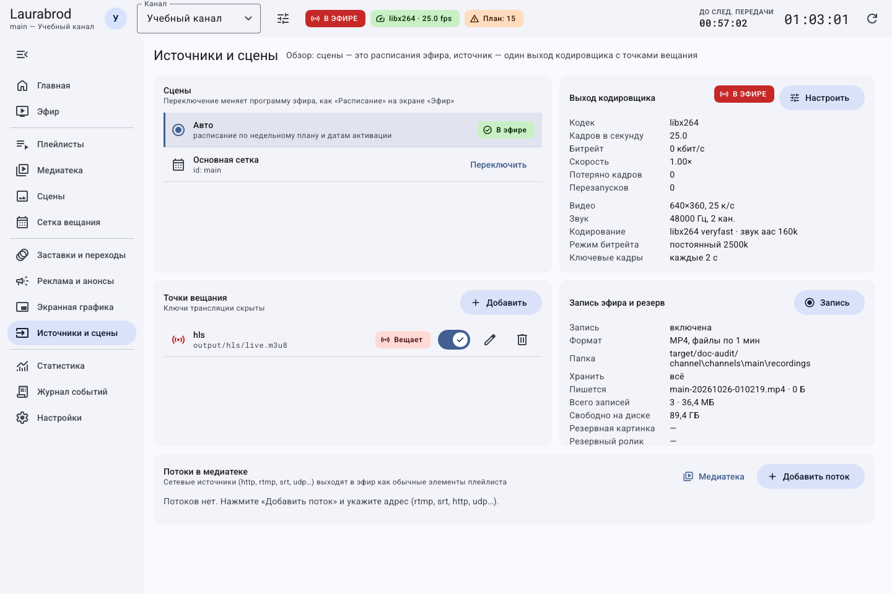
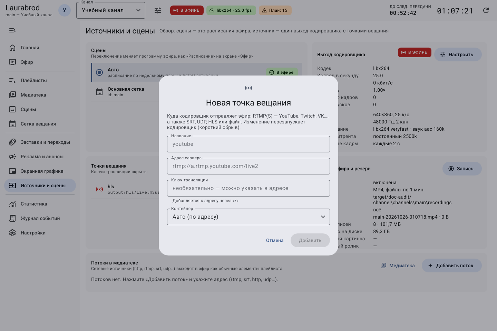
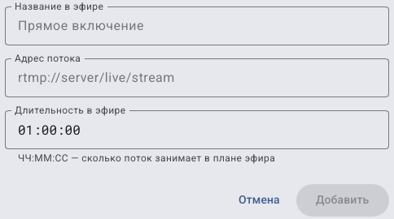

# Как настроить точки вещания и сетевые источники

> Laurabrod 0.1.0. Снимки показывают реальный интерфейс; демонстрационные состояния подписаны отдельно. Способы и пределы проверки перечислены в [отчёте](../verification.md).

**Потребуется:** роль admin для параметров канала; адрес и требования принимающей стороны. Для внешнего вещания используйте свои данные платформы, а не примеры из документации.

Раздел показывает расписания, кодировщик, точки назначения и входящие потоки. «Сцены» в верхней части этого экрана означают расписания; собственные фоновые сцены редактируются в отдельном разделе «Сцены».

## Как заполнить форму точки и проверить адрес

1. Найдите блок **Точки вещания**. Кнопка **Добавить поток** относится к входящему источнику и не создаёт выход.
2. В **Название** введите понятную подпись назначения: например, `Локальная проверка` или название вашей площадки.
3. В **Адрес сервера** введите адрес назначения либо путь HLS. Это разные варианты одного поля; не вводите одновременно путь к локальному файлу и адрес RTMP.
4. **Ключ трансляции** заполняйте только по данным принимающей площадки. Для локального HLS он не нужен. Если площадка выдала готовую полную строку, согласуйте способ ввода с её инструкцией, чтобы не добавить один ключ дважды.
5. Выберите подходящий контейнер в списке, сохраните и проверьте появившуюся строку.
6. Проверьте переключатель включения точки. Сохранённая выключенная точка не получает эфир.

Для локального опыта используйте `output/hls/training.m3u8`, пустой ключ и **hls**. После запуска файл ищут от корня проекта, а не в папке, откуда открыт ярлык. Не направляйте два канала в один и тот же файл. [Полный пример](first-channel-workshop.md#шаг-8-добавьте-локальный-выход).

Если добавлена лишняя точка, выключите именно её строку, проверьте результат, затем удаляйте при необходимости. Изменение выхода работающего канала может перезапустить кодировщик; дождитесь восстановления и проверьте получателя.

## Как добавить RTMP-выход

1. Откройте **Источники и сцены → Точки вещания → Добавить**.
2. Задайте **Название**, **Адрес сервера** и **Ключ трансляции**, выданные площадкой.
3. Для RTMP выберите **Авто (по адресу)** либо **flv — RTMP**.
4. Сохраните. Изменение выходов работающего кодировщика может вызвать перезапуск и короткий обрыв: планируйте его вне рабочего эфира.
5. Запустите эфир и проверьте приём в панели платформы. Рабочий локальный монитор ещё не подтверждает доступность выхода.

Ключ скрыт в списке, но хранится в параметрах канала. Не публикуйте конфигурацию или архив с ключами.

Впишите свои адрес и ключ; не используйте пример площадки как действительные реквизиты.

## Как выбрать другой протокол

| Выход | Адрес и контейнер |
|---|---|
| HLS | Путь к `.m3u8`, например `output/hls/live.m3u8`; **hls** |
| SRT | Адрес принимающего устройства/сервера с его параметрами; **mpegts — SRT / UDP** |
| UDP | Адрес получателя `udp://…`; **mpegts — SRT / UDP** |
| RTMP | Сервер и ключ площадки; **flv — RTMP** |

HLS создаёт файлы, но сам по себе не публикует их в интернете: для зрителей нужен отдельно настроенный HTTP-сервер. Laurabrod API не следует считать сервером раздачи этих файлов.

Несколько точек получают общий выход кодировщика, а не отдельные независимые видеопрофили. Поддержка протокола зависит от FFmpeg и сети. Для временного отключения используйте переключатель в строке точки; для возврата включите его снова. Переключатель потока аналогично включает или выключает материал источника. Сохранение параметров выхода может перезапустить кодировщик. Кнопки **Изменить адрес и ключ** и **Удалить точку вещания** находятся в строке точки.

## Как заполнить форму входящего потока по полям

1. На **Источники и сцены** найдите **Потоки в медиатеке** и нажмите **Добавить поток**.
2. В **Название в эфире** введите понятное имя источника. Серый текст «Прямое включение» — подсказка, пока вы его не ввели.
3. В **Адрес потока** введите свой действительный URL. Подсказка `rtmp://server/live/stream` не является работающим адресом.
4. В **Длительность в эфире** укажите время в плане: например, `00:10:00` означает десять минут. Это не таймаут подключения и не часы начала эфира.

5. Нажмите **Добавить**. На снимке адрес ещё не введён, поэтому кнопка недоступна; это не ошибка сервера.
6. Найдите источник в списке потоков и медиатеке. Добавьте его в плейлист или очередь. Для первого теста проверьте источник на отдельном локальном канале.
7. Прослушайте и просмотрите фактический выход. Сохранение URL не доказывает, что источник сейчас доступен по сети.

Для изменения используйте **Изменить** у нужного потока; для временного исключения — переключатель включения. **Удалить поток из медиатеки** убирает запись источника, а не только останавливает текущий показ. Для выхода без добавления нажмите **Отмена**. Внешние источники в этой проверке не подключались: кадр показывает открытую форму, а не успешный приём внешнего потока.

## Как подключить входящий поток

В **Потоки в медиатеке → Добавить поток** задайте название, адрес и **Длительность в эфире**. Источник появится в медиатеке; используйте его в плейлисте или сетке. **В эфир** немедленно прерывает текущий элемент. Изменение и удаление доступны в строке потока.

При ошибке начните с [сети и вещания](../troubleshooting/broadcast.md). Не меняйте одновременно URL, кодек и битрейт: иначе трудно определить причину.

---

[Все гайды](index.md) · [Решение проблем](../troubleshooting/index.md) · [Главная](../index.md)
