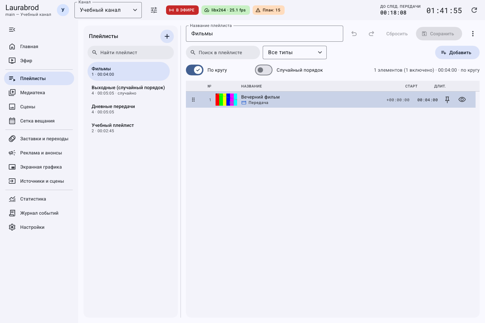

# Как закреплять, дублировать и временно исключать строки плейлиста

> LauraBoard 0.1.0. Поля сверены с кодом и реальным интерфейсом. Снимки показывают учебные данные; полный проход мышью не заявляется. [Проверки и ограничения](../verification.md).

**Результат:** один список с повторяемой заставкой и временно исключённой передачей без удаления исходников. Потребуется сохранённый плейлист из нескольких материалов.

## Как переставить и продублировать строку

1. Откройте **Плейлисты**, выберите список, очистите поиск и фильтр типа внутри него.
2. Откройте контекстное меню нужной строки.
3. Используйте **Переместить выше**, **Переместить ниже** или **В начало**. Для произвольного места перетащите строку за рукоятку.
4. Выберите **Дублировать**, если один материал должен встретиться ещё раз. Это вторая ссылка списка на тот же материал; отдельной копии файла не создаётся.
5. Расположите новую строку и нажмите **Сохранить**. Повторно откройте список, чтобы проверить сохранённый порядок.

На снимке выбрана строка, диалог свойств не открыт. Контекстное меню включает операции, перечисленные выше; не следует считать выделение строки открытием её свойств.

## Как оставить заставку на месте при перемешивании

1. Поставьте заставку на нужную позицию, например первой строкой.
2. В её меню выберите **Закрепить** либо включите **Закреплён при перемешивании** в свойствах строки.
3. Включите **Случайный порядок**, сохраните и посмотрите прогноз блока, использующего плейлист.
4. Для возврата свободного перемешивания выберите **Открепить**. Переключатель **По кругу** отдельно отвечает за повтор всего списка.

## Как исключить строку только из этого списка

1. В меню строки нажмите **Выключить** либо выключите **Включён** в её свойствах.
2. Сохраните. Материал должен остаться в медиатеке и в других плейлистах; выключена именно эта запись списка.
3. Верните её через **Включить** и сохраните. Если нужно исключение во всём канале, используйте [выключение в медиатеке](media-bulk.md#как-временно-исключить-подборку-без-удаления-файлов).
4. Действие **Удалить из плейлиста** убирает ссылку из текущего списка, не удаляя исходный файл. Вернуть её можно через добавление из медиатеки.

## Как подать строку в эфир без изменения сетки

1. Выберите **В очередь эфира** в меню строки.
2. Откройте **Эфир** и проверьте добавленный материал в очереди.
3. Для отмены уберите его из очереди до запуска. Сохранённый плейлист и расписание от этого не меняются.

**Ошибки:** если перестановка недоступна, очистите фильтр; если порядок в эфире отличается, проверьте перемешивание и сохранённый курсор; если список начинается не с первой строки, настройте [старт блока](schedule-sources.md#как-ограничить-блок-следом-и-начать-плейлист-заново).

До сохранения правок работают отмена, повтор и сброс редактора. После сохранения верните значения и сохраните снова. [Создание, повтор и M3U](playlists.md).

[Все гайды](index.md) · [Неполадки](../troubleshooting/index.md) · [Главная](../index.md)
