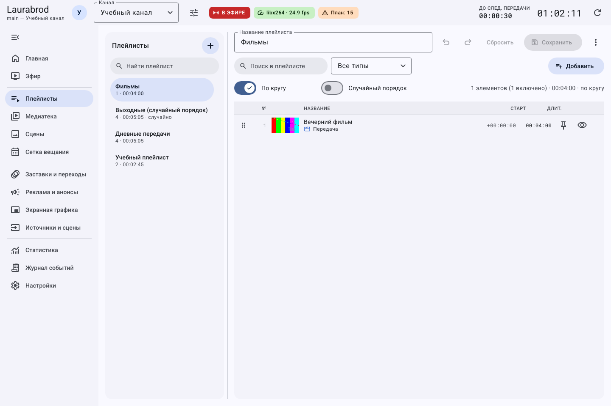
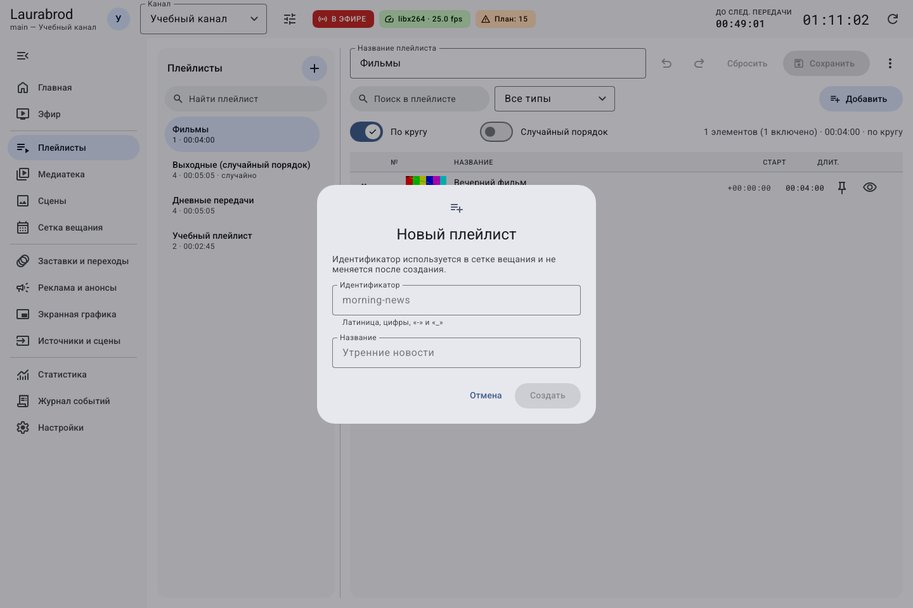
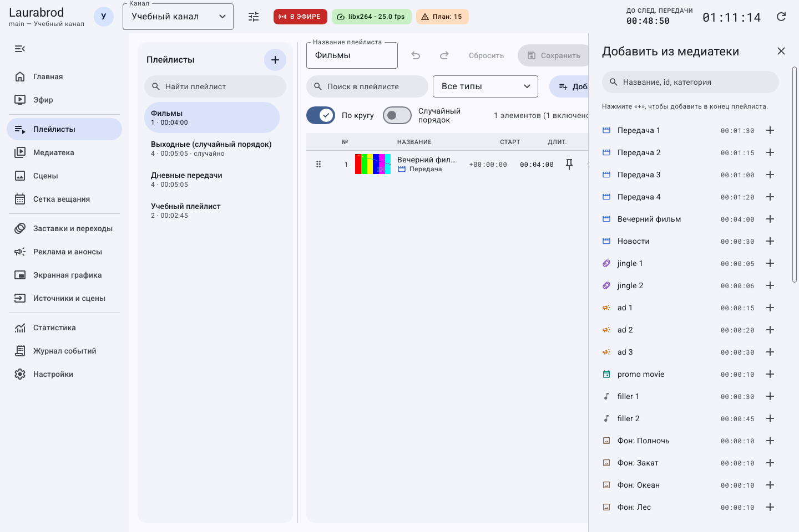

# Как создать плейлист и настроить порядок передач

> Laurabrod 0.1.0. Снимки показывают реальный интерфейс; демонстрационные состояния подписаны отдельно. Способы и пределы проверки перечислены в [отчёте](../verification.md).

**Потребуется:** хотя бы два доступных материала в медиатеке. Плейлист — список воспроизведения; для автоматического эфира его нужно назначить источником блока сетки или последовательного режима.

## Как создать и заполнить плейлист

1. Откройте **Плейлисты** и нажмите **Новый плейлист** (`+` слева).
2. Введите **Идентификатор**, например `morning`, и **Название** — `Утренний эфир`. Идентификатор после создания не редактируется этой формой.
3. Нажмите **Создать**, выберите список слева.
4. Нажмите кнопку добавления материалов в редакторе. В панели **Добавить из медиатеки** найдите материал и нажмите его `+`.
5. Добавьте остальные записи и закройте панель.
6. Переставьте строки перетаскиванием. Перед этим очистите фильтр внутри плейлиста: при фильтрации изменение порядка ограничено.
7. Нажмите **Сохранить** или Ctrl+S. Повторно откройте список и проверьте порядок.



Слева выбирается плейлист; справа редактируются его состав и параметры. Несохранённые изменения отмечаются в интерфейсе.





## Как настроить повтор, перемешивание и закрепление

1. В редакторе включите **По кругу**, если список должен повторяться, и **Случайный порядок**, если нужен случайный порядок.
2. Откройте свойства нужной строки и включите **Закреплён при перемешивании**, чтобы сохранить её позицию.
3. Переключатель **Включён** позволяет временно исключить запись из этого плейлиста.
4. Сохраните. Прогноз проверяйте в **Сетке вещания**: случайное воспроизведение не обязано повторять видимый порядок списка.

Позиция списка сохраняется между блоками и перезапусками. Чтобы каждый блок начинался с первого ролика, включите **Плейлист каждый раз с начала** в свойствах блока сетки.

## Как удалить запись, очистить или удалить список

Удалите выбранную запись через её действие удаления. Для очистки всего состава откройте **Ещё → Очистить плейлист**. Для удаления самого списка используйте соответствующее действие меню редактора. Перед подтверждением проверьте ссылки сетки: удаление списка не означает удаление файлов медиатеки.

До сохранения доступны **Отменить**, **Повторить**, **Сбросить**. Не считайте Ctrl+Z восстановлением после удаления списка на сервере.

## Как импортировать и экспортировать M3U

В GUI доступен **Ещё → Экспорт в M3U…**: сохраните файл и проверьте пути. Импорт существующего M3U выполняется через CLI:

```powershell
laurabrod -p "D:/TV/MyChannel" playlist import morning "D:/TV/Import/list.m3u"
```

Здесь `morning` — идентификатор целевого плейлиста. Перед импортом сохраните его текущую версию: импорт изменяет состав. Пути M3U должны быть доступны компьютеру вещания. Подробности — [справочник CLI](../cli.md).

Если список пуст при существующих записях, очистите фильтр; если ролик отмечен проблемным, проверьте медиатеку. Далее: [сетка вещания](schedule.md).

## Подробные сценарии

- [Как закреплять, дублировать и временно исключать строки плейлиста](playlist-operations.md)

---

[Все гайды](index.md) · [Решение проблем](../troubleshooting/index.md) · [Главная](../index.md)
