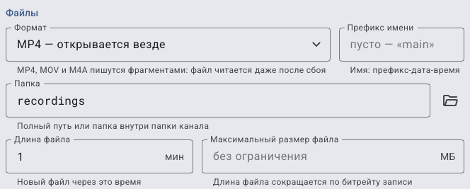
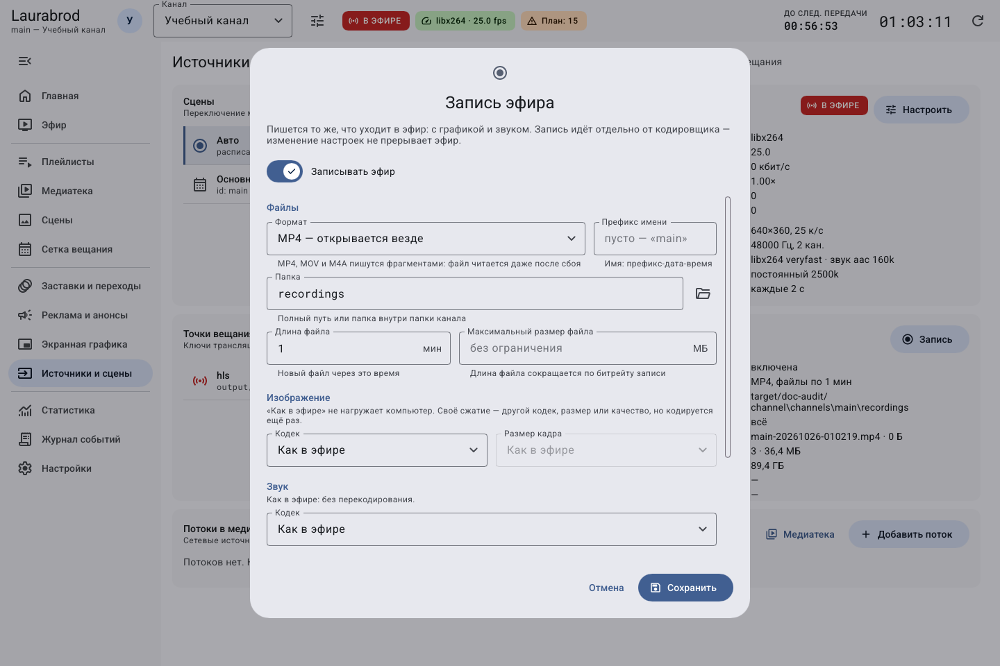
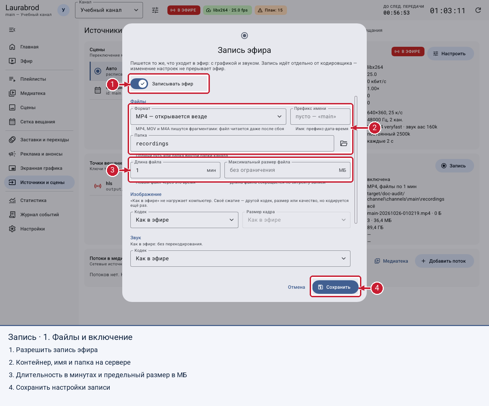
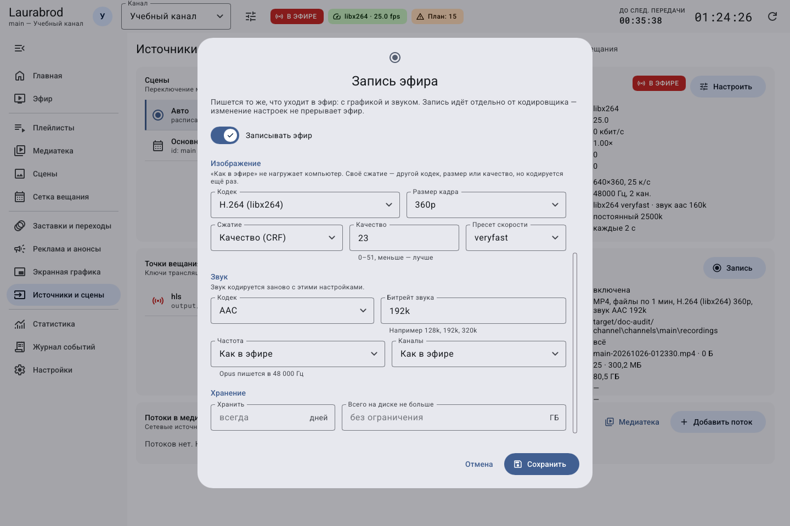
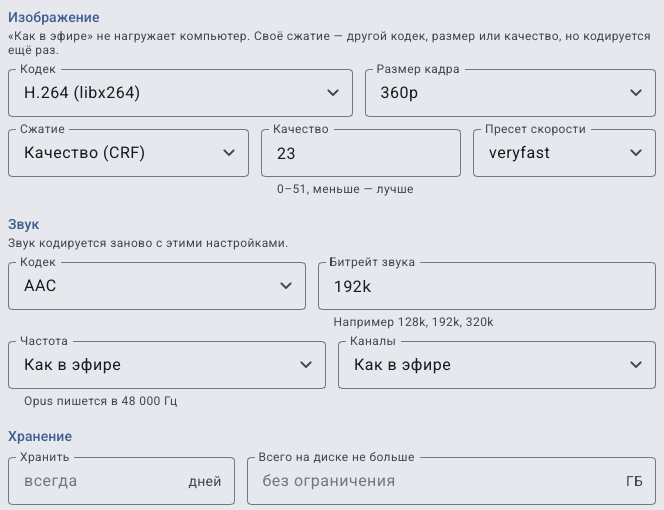
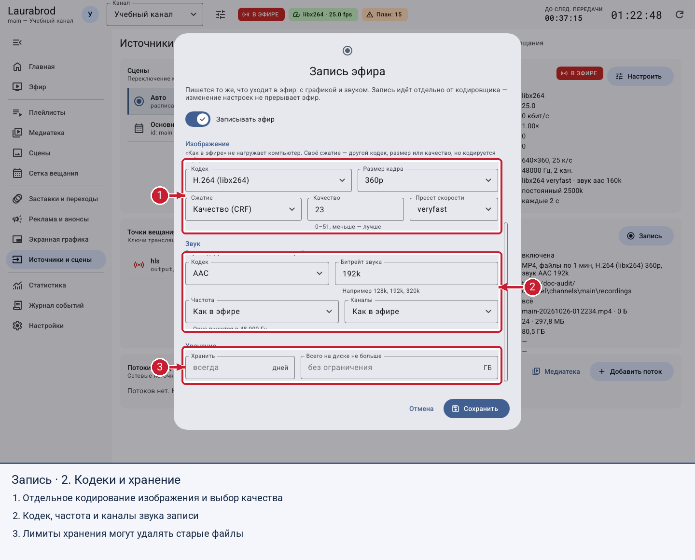

# Как записывать эфир и ограничить место на диске

> LauraBoard 0.1.0. Снимки показывают реальный интерфейс; демонстрационные состояния подписаны отдельно. Способы и пределы проверки перечислены в [отчёте](../verification.md).

**Потребуется:** роль admin, каталог с правами записи и достаточное место. Записывается программа канала с графикой и звуком. Запись использует отдельный процесс и может дополнительно нагружать систему.

## Как не перепутать эфир, запись и готовый файл

Запись и вещание включаются отдельно. Работающий эфир без включённой записи не обязан создавать MP4; включённая настройка записи при остановленном эфире не доказывает наличие видеоданных.

1. Выберите учебный канал и убедитесь, что локальный эфир воспроизводится со звуком.
2. Откройте форму записи, задайте свою папку и префикс, сохраните.
3. Проверьте появление нового файла именно в этой папке. Относительный путь записи отсчитывается от каталога канала.
4. Через короткое время снимите **Записывать эфир** и сохраните. Дождитесь окончания файла.
5. Откройте завершённый файл, проверьте изображение, звук и длительность. Ненулевой размер файла ещё не заменяет воспроизведение.

Для первой пробы не включайте лимиты удаления старых записей. Сначала разберитесь с местом хранения и одним готовым файлом. Отдельное перекодирование понадобится только при понятной задаче, например ином размере записи; [подробные режимы](recording-recipes.md).

## Как включить запись

1. Откройте **Источники и сцены → Запись эфира и резерв → Запись**.
2. Включите **Записывать эфир**.
3. Выберите **Формат**, **Папка** и **Префикс имени**. Относительная папка записи считается от каталога канала, в отличие от относительных выходов HLS.
4. Задайте **Длина файла** в минутах (например, `60`) и при необходимости **Максимальный размер файла** в МБ. Ноль в лимитах означает отсутствие соответствующего ограничения; единицы проверяйте по подписи поля.
5. В **Изображение** и **Звук** выберите параметры записи. Копирование потока экономит ресурсы; отдельный размер кадра, CRF или кодек может требовать перекодирования.
6. Сохраните. Если эфир остановлен, начните его.
7. Дождитесь появления файла, затем остановите запись и откройте файл проигрывателем. Проверьте картинку, графику и звук.

Диалог содержит настройки файлов, изображения, звука и хранения. Изменение записи не требует остановки основного кодировщика, но может завершить текущий файл и начать новый.

Длина в этой форме задаётся в минутах, предельный размер — в МБ.

## Как выбрать формат и звук

Для видео доступны MP4, MKV, TS, MOV и FLV; для записи только звука — MP3, M4A (AAC), OGG (Opus), FLAC и WAV. Выберите аудиоформат, если видеодорожка не нужна. Формат определяет доступные кодеки: например, WAV использует несжатый PCM, FLAC — звук без потерь. Выбор проверяйте по требованиям проигрывателя или монтажа. Для MP4 используется фрагментированный формат, который лучше переносит незавершённую запись, но восстановление любого повреждённого файла не гарантируется.

Для изображения доступны кодек, размер кадра, качество CRF либо битрейт и пресет. Для звука — кодек, битрейт, разрядность для соответствующих форматов, частота и каналы. Несовместимые варианты могут ограничиваться выбранным контейнером; читайте ошибку формы.

## Длинный диалог по частям

Часть 1 — формат, префикс, путь, минуты на файл и размер в МБ.

Часть 2 — изображение и звук при выбранном перекодировании. В отличие от режима «Как в эфире» дополнительные поля активны.

Часть 3 — оставшиеся параметры звука и лимиты хранения в нижней части.

## Как ограничить хранение

> Лимиты **Хранить** и **Всего на диске не больше** разрешают программе удалять старые записи. Сначала скопируйте важные файлы в отдельное архивное место.

1. Задайте число дней и/или общий объём хранения в диалоге.
2. Сохраните и периодически проверяйте каталог. Деление по максимальному размеру рассчитывается по параметрам потока; не считайте его точной границей каждого файла.
3. Для отключения записи снимите **Записывать эфир** и сохраните. Убедитесь, что новых файлов нет.

При отсутствии файлов проверьте, включены ли эфир и запись, права папки, свободное место, контейнер и журнал. Если место заканчивается, сначала остановите запись или перенесите ненужные файлы вручную после проверки; не удаляйте наугад состояние канала. См. [данные и запись](../troubleshooting/data.md).

## Подробные сценарии

- [Как выбрать режим записи, качество звука и лимиты хранения](recording-recipes.md)

---

[Все гайды](index.md) · [Решение проблем](../troubleshooting/index.md) · [Главная](../index.md)
