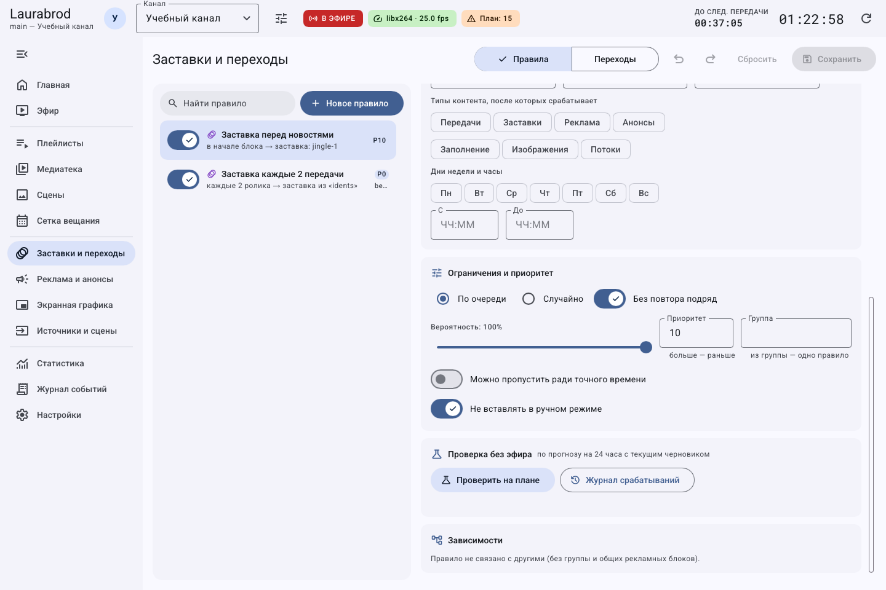
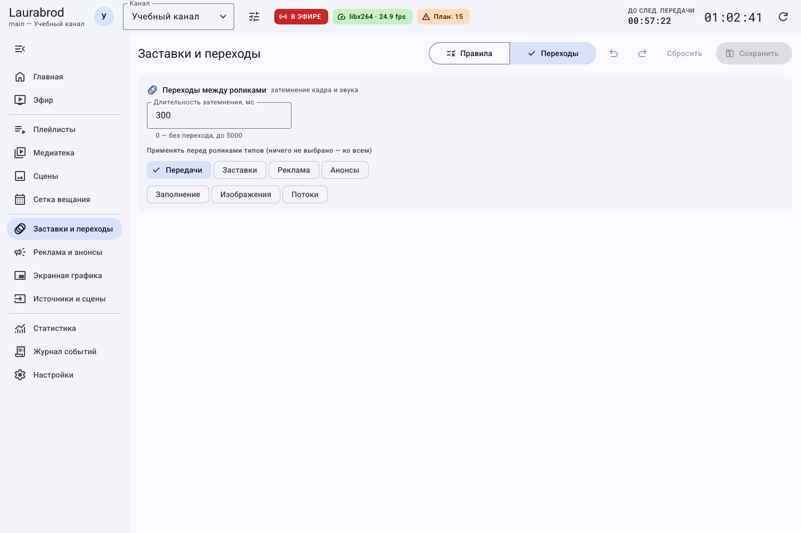
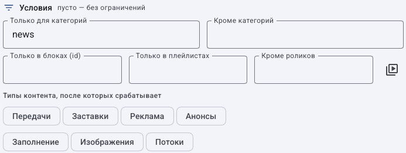
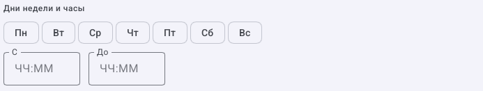
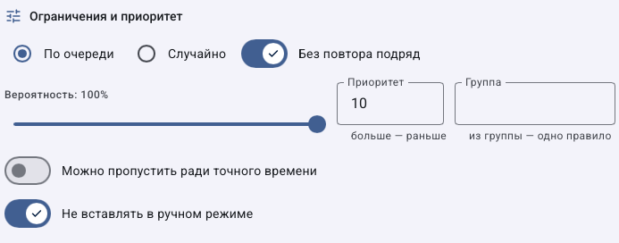

# Как настроить вставки под конкретный сценарий канала

> LauraBoard 0.1.0. Поля сверены с кодом и реальным интерфейсом. Снимки показывают учебные данные; полный проход мышью не заявляется. [Проверки и ограничения](../verification.md).

Начните с сохранённых материалов и [мастера правил](insertion-rules.md). Во всех рецептах после создания нажмите **Сохранить**, затем **Проверить на плане**. Поле «Каждые N минут» не прерывает ролик посреди воспроизведения.

## Заставка перед новостями и после передачи

1. На **Заставки и переходы → Правила** создайте правило `Перед новостями`.
2. **Когда → Перед категорией**, **Категория** `news`.
3. **Что → Заставка**, явно выберите материал из медиатеки.
4. Для отбивки после передачи создайте второе правило с **После категории** и категорией нужного основного материала.
5. Если требуется оформление всего блока независимо от категорий его роликов, используйте **В начале блока / В конце блока** и условие **Только в блоках (id)**.

Категория проверяется у основного материала в контексте правила. Похожее название папки не заменяет категорию.

## Вставка после определённых роликов или плейлиста

1. Выберите триггер **После роликов**.
2. Нажмите **Выбрать из медиатеки** именно в секции триггера и отметьте материалы, после которых вставлять.
3. В секции **Что вставить** отдельно выберите вставляемую заставку/ролик. Это два разных списка: условие и действие.
4. Для завершения прохода сериала выберите **После плейлиста** и нужный плейлист вместо списка роликов.
5. Проверьте прогноз как минимум на один полный проход. Выключенные или отсутствующие элементы списка могут менять фактическое завершение.

## Разные правила утром, ночью и по выходным

1. Откройте **Условия** выбранного правила.
2. В **Дни недели и часы** отметьте нужные дни, **С** `08:00`, **До** `23:00` для дневного окна.
3. Для ночного окна создайте второе правило, например `23:00`–`08:00`: переход через полночь поддерживается. Верхняя граница окна не включается.
4. Уточните **Только для категорий** и **Кроме категорий**. Пустой разрешающий список не ограничивает категории, исключающий список продолжает действовать.
5. Для ограничения источника укажите **Только в плейлистах**, для определённой передачи — идентификатор блока.
6. Сохраните и проверьте прогноз по обе стороны границы времени и в нужный день недели.

Списки в текстовых полях задаются через запятую; используйте идентификаторы объектов там, где поле требует id, а не видимые русские названия. Начало и конец времени не должны совпадать.

## Вставка в заданные моменты дня

1. Выберите **В заданное время**, введите время в соответствующее поле.
2. Укажите действие и условия. Для нескольких значений используйте формат, который принимает форма; убедитесь, что не осталось ошибки валидации.
3. Проверьте границы роликов около заданного момента: вставка возникает после первого подходящего основного ролика, закончившегося не раньше этого времени.
4. Если старт нужен точно в секунду, создайте фиксированный блок сетки; правило не является жёстким таймером прерывания.

## Как разрешить конкуренцию и не потерять обязательную вставку

1. Для взаимоисключающих вариантов задайте одинаковую **Группа**, например `station-ident`, и разные **Приоритеты**.
2. Для обязательной вставки снимите **Можно пропустить ради точного времени**, осознавая возможное опоздание следующего блока.
3. Для необязательной оставьте разрешение пропуска. Вероятность меньше 100 % означает, что отсутствие вставки может быть штатным результатом выбора.
4. Подготовьте несколько доступных кандидатов, если включено **Без повтора подряд**. Вес в медиатеке влияет на случайный подбор, но не гарантирует конкретный выбор.
5. В **Зависимости** прочитайте предупреждения об одинаковых триггерах/приоритетах и используемых рекламных блоках.
6. Сопоставьте прогноз с **Журналом срабатываний** после тестового эфира.

## Как настроить затемнение между роликами

1. Откройте **Заставки и переходы → Переходы**.
2. Задайте **Длительность затемнения, мс**, например `300` для теста.
3. Отметьте типы, перед которыми нужен переход. Ничего не выбрано означает применение ко всем типам, а не выключение.
4. Сохраните и проверьте границу двух материалов в записи. Для отключения задайте нулевую длительность и сохраните.

Не путайте видео-переход с анимацией графики: первый относится к смене материалов, второй — к появлению отдельного элемента оформления.

## Как заполнить условия, часы и приоритет по отдельности

1. В разрешающем списке укажите, где правило должно работать; в исключающем — что пропустить.
2. Для блоков вводите `id`, для категорий — их точное обозначение. Не подставляйте произвольное видимое название плейлиста вместо требуемого идентификатора.

3. Отметьте нужные дни. Если ограничение не нужно, оставьте дни невыбранными.
4. Введите **С** и **До**, например `08:00` и `23:00`. Для ночного окна допустим переход через полночь; одинаковые границы не используйте для обозначения суток.

5. Настройте порядок выбора и повтор. Для первого предсказуемого теста используйте вероятность 100 %.
6. При конфликтующих альтернативах укажите одинаковую группу и осмысленные разные приоритеты. Большее число приоритета не означает «показать больше раз».
7. Выберите, допустим ли пропуск ради точного времени и нужна ли вставка в ручном режиме.
8. Сохраните, проверьте план, затем фактическое срабатывание. Если не сработало, проверяйте фильтры сверху вниз, а не удаляйте их все одновременно.

[Все гайды](index.md) · [Неполадки](../troubleshooting/index.md) · [Главная](../index.md)
