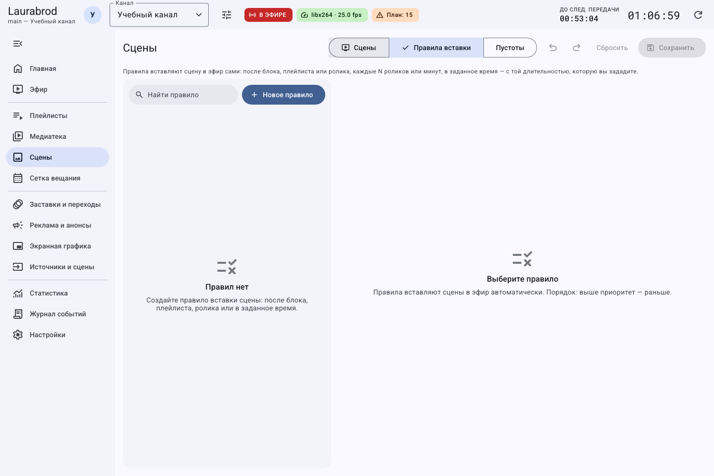
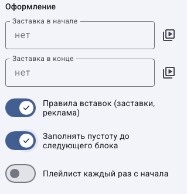
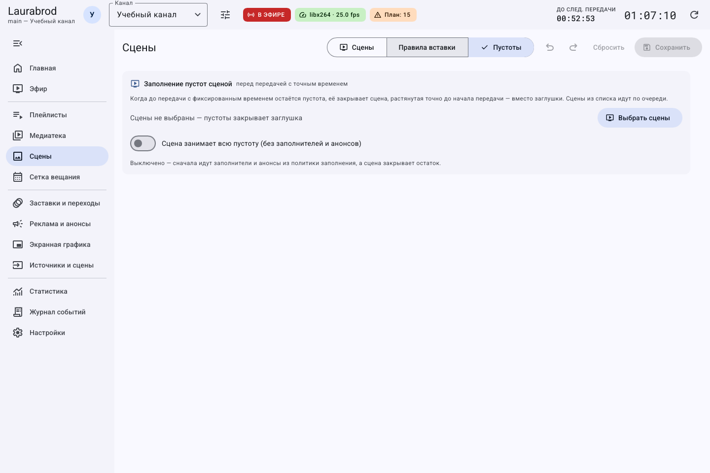

# Как автоматически вставлять сцены и закрывать ими пустоты

> Laurabrod 0.1.0. Снимки показывают реальный интерфейс; демонстрационные состояния подписаны отдельно. Способы и пределы проверки перечислены в [отчёте](../verification.md).

**Потребуется:** сохранённая сцена, например «Эфирные часы», и работающий прогноз сетки.

## Как показывать сцену после передач

1. Откройте **Сцены → Правила вставки → Новое правило**.
2. Задайте название, например `Часы после плейлиста`.
3. На шаге **Когда** выберите **После плейлиста**, затем нужный список. Другие варианты: после роликов, в конце блока, каждые N роликов или минут, в заданное время.
4. На шаге выбора сцены нажмите **Выбрать сцены** и отметьте одну или несколько.
5. Задайте **Длительность**, если показ должен отличаться от собственной длительности сцены.
6. Настройте условия, порядок, повтор и приоритет, завершите мастер и нажмите **Сохранить**.
7. Нажмите **Проверить на плане**. После тестового эфира проверьте **Журнал срабатываний**.

Здесь используются правила именно текущего канала. Пустой список кандидатов допускает подбор любой включённой сцены; для предсказуемого результата выберите её явно.

## Как выбрать между вставкой сцены и заполнением пустоты

| Задача | Где настраивать | Какой результат искать |
|---|---|---|
| Показать часы после определённого плейлиста | **Правила вставки** | Сцена следует за завершением подходящего прохода |
| Закрыть свободное время до новостей | **Пустоты** и свойства блока сетки | Сцена занимает реальный промежуток до фиксированного старта |
| Один раз проверить сцену сейчас | Очередь или немедленный показ | Ручной показ, без создания постоянного правила |

Для проверки пустоты возьмите сохранённую сцену и откройте прогноз: между концом содержимого и следующим фиксированным блоком должен быть промежуток. Если его нет, настройка заполнения не обязана добавить сцену поверх передач.

Сначала выберите одну сцену явно, сохраните настройки пустот, затем разрешите заполнение в свойствах блока и сохраните сетку. После пересчёта найдите этот промежуток на прогнозе. Если выбрать несколько сцен, результат может отличаться от ожидания «всегда одна и та же».

Для отмены заполнения уберите тестовую сцену из списка или верните переключатель блока и сохраните соответствующий редактор. Удалять саму сцену для этого не требуется.

## Как закрывать паузы перед новостями

В этой вкладке выбираются сцены, закрывающие промежутки, и приоритет перед заполнителями.

1. Откройте **Сцены → Пустоты**.
2. Нажмите **Выбрать сцены**, выберите «Эфирные часы».
3. Включите **Сцена занимает всю пустоту (без заполнителей и анонсов)**, если не нужны промежуточные ролики.
4. Сохраните. В свойствах блока сетки разрешите заполнение пустоты.
5. Откройте прогноз промежутка до новостей: сцена растягивается до начала фиксированного блока.

Снятый флажок означает, что сначала подбираются заполнители и анонсы, а сцена закрывает остаток. Несколько сцен из списка используются по очереди.

Если сцена не появляется, проверьте, есть ли реальная пустота, включена ли сцена, сохранены ли правила и разрешено ли заполнение. Для отмены автоматической вставки выключите соответствующее правило либо очистите список сцен заполнения и сохраните.

Подробнее: [обычные правила](insertion-rules.md), [точное время](schedule-timing.md).

## Подробные сценарии

- [Как настроить музыку сцены: расписание, повторы и паузы](music-recipes.md)

---

[Все гайды](index.md) · [Решение проблем](../troubleshooting/index.md) · [Главная](../index.md)
