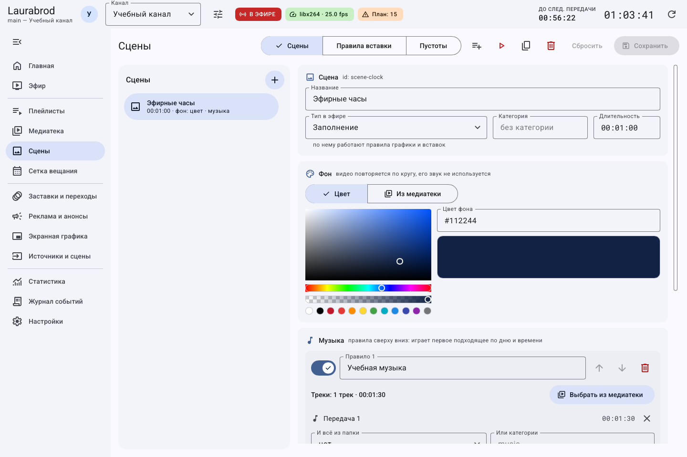
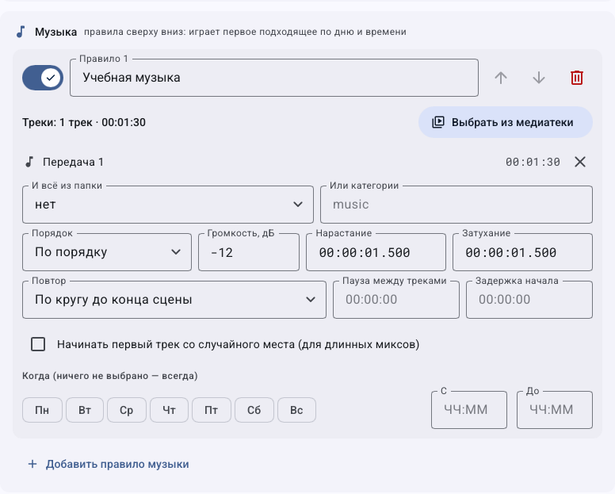
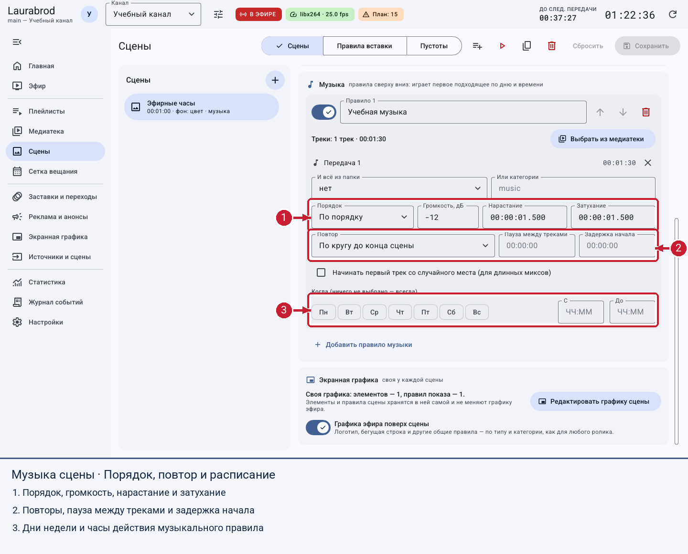

# Как создать сцену с фоном, музыкой и графикой

> Laurabrod 0.1.0. Снимки показывают реальный интерфейс; демонстрационные состояния подписаны отдельно. Способы и пределы проверки перечислены в [отчёте](../verification.md).

**Результат:** элемент эфира, который собирается программой из фона, музыки и графики, без заранее смонтированного видео.

## Как создать сцену из шаблона

1. Выберите канал → **Сцены → Сцены**.
2. Нажмите **Новая сцена** (`+`) и выберите **Пустая сцена**, **Эфирные часы**, **Музыкальная пауза** или **Скоро в эфире**.
3. Введите **Название**, выберите **Тип в эфире**, **Категория** и **Длительность**.
4. В **Фон** выберите **Цвет** и цвет фона либо **Из медиатеки → Выбрать из медиатеки**.
5. Для фонового видео выберите материал из папки **Фоны** или импортированное видео. Оно повторяется по кругу; его исходный звук не служит музыкой сцены.
6. Нажмите **Сохранить**.

В сцене отдельно настраиваются фон, музыкальные правила и графика. Если сцены ещё нет, список предложит создать её через `+`.

## Как добавить музыку и выбрать порядок

1. В выбранной сцене нажмите **Музыка → Добавить правило музыки**.
2. Задайте название правила. Нажмите **Выбрать из медиатеки**, добавьте треки; либо выберите **И всё из папки**, либо укажите **Или категории**.
3. Выберите **Порядок**: **По порядку**, **Перемешать**, **Один случайный трек**.
4. Задайте **Громкость, дБ**, **Нарастание**, **Затухание**.
5. В **Повтор** выберите цикл до конца сцены, один проход либо несколько проходов. При необходимости задайте количество, **Пауза между треками** и **Задержка начала**.
6. Для длинного микса можно включить **Начинать первый трек со случайного места**. Если сцена должна завершиться вместе с музыкой, используйте **Длительность сцены по музыке**.
7. Настройте дни и часы. Правила проверяются сверху вниз: переместите более специальное правило выше общего.
8. Сохраните и прослушайте тестовый эфир или запись. Без подходящего музыкального правила сцена может идти в тишине.

Фрагмент после прокрутки показывает музыкальное правило целиком: источники, порядок, повторы, паузы, громкость и условия времени.

## Как добавить собственную графику сцены

1. Нажмите **Экранная графика → Редактировать графику сцены**.
2. Добавьте элементы по [инструкции графики](graphics.md). Убедитесь, что выбран контекст нужной сцены.
3. Сохраните. Эта графика хранится в сцене, не заменяя общий набор канала.
4. Переключатель **Графика эфира поверх сцены** определяет участие общих правил оформления.

Отдельный блок открывает редактор именно этой сцены.

## Как поставить сцену в эфир

Добавьте её в плейлист или блок сетки как материал. Для ручной проверки используйте **В очередь эфира (после текущего)**. **Показать в эфире сейчас** прервёт текущий элемент.

Кнопки дублирования и удаления находятся в редакторе сцены. До сохранения доступны **Сбросить**, Ctrl+Z и Ctrl+Y. Перед удалением уберите её из плейлистов и правил. Если нет фона или музыки, проверьте сохранение, выбранные материалы, условия музыкальных правил и доступность файлов.

Далее: [автоматическая вставка сцен](scene-rules.md).

---

[Все гайды](index.md) · [Решение проблем](../troubleshooting/index.md) · [Главная](../index.md)
