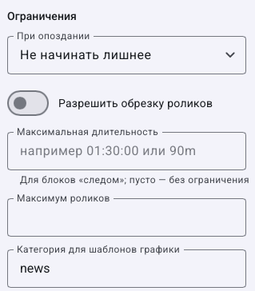

# Как выбрать содержимое блока и ограничить его длительность

> LauraBoard 0.1.0. Поля сверены с кодом и реальным интерфейсом. Снимки показывают учебные данные; полный проход мышью не заявляется. [Проверки и ограничения](../verification.md).

**Результат:** блок с понятным источником, пределом воспроизведения и оформлением. Потребуются материалы, плейлист или рекламный блок. Сначала работайте в копии расписания; выбор в редакторе не переключает эфир.

## Как поставить плейлист, отдельные ролики, категорию или рекламу

1. Откройте **Сетка вещания**, выберите расписание и шаблон дня.
2. Добавьте **Блок по времени** с началом `09:00:00` либо **Блок следом**.
3. Выберите источник согласно задаче в таблице ниже.
4. Сохраните и посмотрите прогноз именно того дня, которому назначен шаблон.

| Источник | Что подготовить и выбрать | Что проверять в прогнозе |
|---|---|---|
| Плейлист | Сохранённый список; выберите его в блоке | Состав, включение строк, повтор и положение курсора списка |
| Ролики | Через **Добавить ролики из медиатеки** добавьте конкретные записи | Нужные названия и порядок; наличие файлов |
| Категория | Назначьте категорию материалам в медиатеке, затем укажите её в блоке | Есть ли подходящие включённые материалы; результат подбора |
| Рекламный блок | Создайте его в **Реклама и анонсы**, затем выберите блок источником | Реальные ролики, ограничения рекламы и итоговую длительность |

Не путайте категорию источника с **Категория для шаблонов графики**: второе поле описывает блок для оформления и само не выбирает видео.

## Как ограничить блок «следом» и начать плейлист заново

1. Откройте дополнительные свойства нужного блока.
2. В **Максимальная длительность** задайте `30m` или `00:30:00`. Подпись поля указывает, что оно предназначено для блоков «следом»; пустое значение снимает этот предел.
3. В **Максимум роликов** укажите нужное число, например `3`. Для неограниченного варианта очистите поле.
4. Включите **Плейлист каждый раз с начала**, если выпуск должен начинаться первым роликом. Без него используется сохранённая позиция списка.
5. В **При опоздании** выберите подходящее поведение: **Не начинать лишнее**, **Доиграть, сдвинуть следующий** или **Обрезать в фикс. время**. Для обрезки дополнительно требуется **Разрешить обрезку роликов**.
6. Сохраните и проверьте границу со следующим фиксированным блоком. Предел блока не следует считать обещанием обрезки при любой политике опоздания.

## Как добавить заставки и разрешить заполнение промежутка

1. В **Заставка в начале** и **Заставка в конце** используйте **Выбрать из медиатеки** и выберите нужные заставки.
2. Включите **Правила вставок (заставки, реклама)**, если блок должен участвовать в автоматических вставках. При выключении не ожидайте обычного набора вставок внутри блока.
3. Включите **Заполнять пустоту до следующего блока**, если после завершения содержимого нужен подбор заполнения.
4. Настройте сами материалы заполнения в политиках канала или [сцену для пустот](scene-rules.md): один переключатель блока не создаёт подходящий материал.
5. Сохраните и изучите участок прогноза между окончанием блока и следующим точным стартом.

**Исправление:** если состав пуст, проверьте источник, включение материалов и фильтры категории. Если первый ролик меняется между днями, проверьте сохранение позиции и переключатель старта с начала. Если эфир использует другую сетку, [переключите активное расписание](schedule.md#как-выбрать-активное-расписание).

**Отмена:** до сохранения используйте отмену или сброс редактора. После сохранения верните прежние значения либо восстановите копию расписания. Дальше: [точное время, пустоты и конфликты](schedule-timing.md).

[Все гайды](index.md) · [Неполадки](../troubleshooting/index.md) · [Главная](../index.md)
