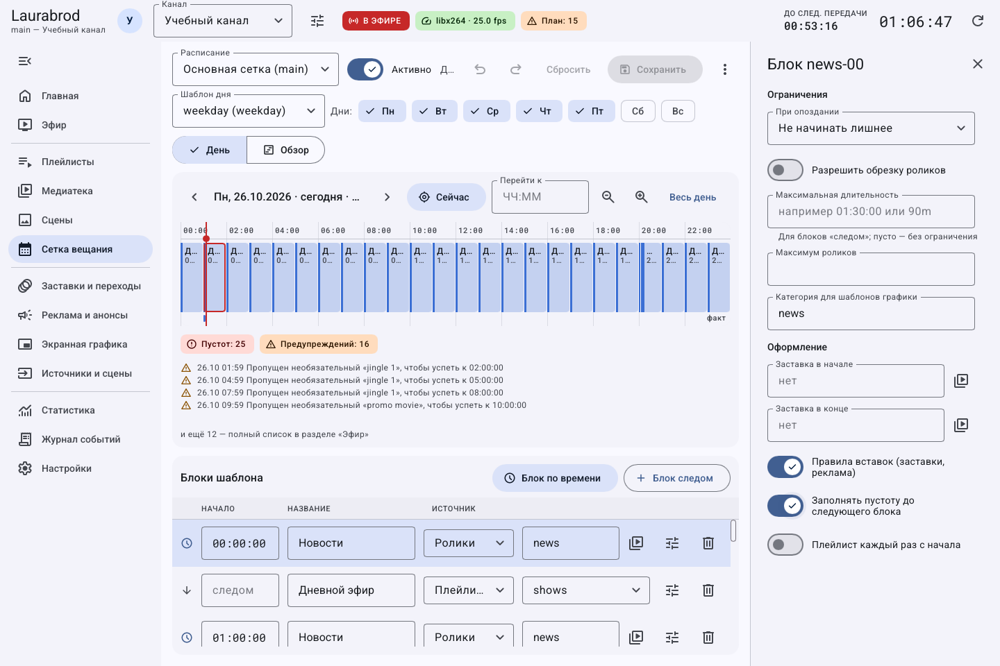

# Как выдерживать точное время и устранять пустоты в сетке

> Laurabrod 0.1.0. Снимки показывают реальный интерфейс; демонстрационные состояния подписаны отдельно. Способы и пределы проверки перечислены в [отчёте](../verification.md).

**Потребуется:** расписание с фиксированными блоками и известной длительностью материалов.

Дополнительные ограничения открываются кнопкой «Свойства блока» в строке таблицы.

## Как выбрать поведение при опоздании

1. В **Сетка вещания** найдите блок и откройте **Свойства блока**.
2. Выберите **При опоздании** по таблице.
3. Если действительно допустимо прерывать материал, включите **Разрешить обрезку роликов**. Не включайте это для передач, которые должны завершаться полностью.
4. При необходимости ограничьте блок полями **Максимальная длительность** и **Максимум роликов**.
5. Настройте **Заставка в начале**, **Заставка в конце**, применение правил и заполнение пустот.
6. Сохраните и пересчитайте прогноз.

| Политика | Смысл |
|---|---|
| Не начинать лишнее | Не запускать очередной материал, который не укладывается в окно |
| Доиграть, сдвинуть следующий | Закончить ролик, допуская сдвиг следующего блока |
| Обрезать в фикс. время | Допустить прерывание в заданное время при разрешённой обрезке |

Планировщик может убрать необязательные вставки ради точного времени. Жёсткий старт не является безусловной гарантией при запрещённой обрезке и несовместимых длительностях: читайте предупреждения прогноза.

## Как заполнить промежутки

1. В свойствах блока включите **Заполнять пустоту до следующего блока**.
2. В **Реклама и анонсы → Политики → Заполнение пустот** укажите категории заполнения, минимальную пустоту, интервал повторов и использование анонсов.
3. Для фоновой сцены откройте **Сцены → Пустоты**, нажмите **Выбрать сцены**.
4. Включите **Сцена занимает всю пустоту (без заполнителей и анонсов)**, если сцена должна закрывать весь промежуток. Иначе она закрывает остаток после заполнителей.
5. Сохраните правила и сетку. Проверьте промежуток в прогнозе.

## Как читать прогноз и проверять изменения

1. Выберите нужную дату стрелками, **Сейчас** или полем **Перейти к**.
2. Масштабируйте таймлайн кнопками либо Ctrl+колесо; **Весь день** возвращает обзор суток.
3. В **Обзор** выберите 3, 7 или 14 суток.
4. Прочитайте счётчики пустот, предупреждения и полный список на **Эфире**.
5. После сохранения используйте **Ещё → Пересчитать прогноз**.

Перетаскивание фиксированного блока меняет время с шагом привязки; для точного значения редактируйте поле начала. Если результат неверен, отмените правку до сохранения либо верните прежние значения. Подробности алгоритма — [планирование](../planning.md).

## Подробные сценарии

- [Как выбрать содержимое блока и ограничить его длительность](schedule-sources.md)

---

[Все гайды](index.md) · [Решение проблем](../troubleshooting/index.md) · [Главная](../index.md)
