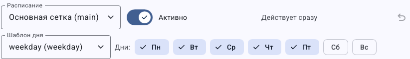

# Как составить сетку вещания канала

> LauraBoard 0.1.0. Снимки показывают реальный интерфейс; демонстрационные состояния подписаны отдельно. Способы и пределы проверки перечислены в [отчёте](../verification.md).

**Цель:** назначить передачи на время и заполнить промежутки последовательными блоками. Потребуются сохранённые плейлисты или материалы.

## Как различать дату, шаблон и активное расписание

| Элемент | Какой вопрос решает | Пример |
|---|---|---|
| Расписание в редакторе | Какой набор вы сейчас изменяете? | Основная или праздничная сетка |
| Шаблон дня | Какие блоки редактируются? | Будни или выходной |
| Дни рядом с шаблоном | В какие дни недели применять этот набор? | Понедельник–пятница |
| Дата просмотра | За какой день построен видимый прогноз? | Сегодня или ближайшая суббота |
| Расписание на **Эфире** | Какой набор использует работающий канал? | Действительно активная сетка |

Сначала выберите расписание и шаблон, затем изменяйте блоки. Сохраните их и только после этого проверьте конкретную дату. Нажатие субботы в назначении шаблона и переход прогноза на субботу — разные действия.

Время начала `09:00:00` означает девять утра по часам сервера. Оно не означает «через девять часов после нажатия». Если сейчас вечер, утренний блок может быть уже позади; для первого знакомства используйте [учебный пример с блоком от полуночи](first-channel-workshop.md#шаг-6-назначьте-плейлист-расписанию).


**Проверка перед запуском:** у текущего дня есть шаблон, блок ссылается на существующий сохранённый источник, а на **Эфире** выбрано то же расписание. Пустой будущий день не исправляется простым переключением текущего материала вручную.

## Как создать расписание и первый блок

1. Откройте **Сетка вещания**.
2. Если расписания нет, нажмите **Создать расписание**. Для дополнительного используйте **Ещё → Новое расписание**.
3. Выберите **Расписание** и **Шаблон дня**. Шаблон — повторяемый набор блоков для выбранных дней.
4. Нажмите **Блок по времени** и задайте начало в формате `ЧЧ:ММ:СС`, например `09:00:00`.
5. Задайте название и источник: плейлист, ролики, категория или рекламный блок. Для плейлиста выберите нужный список; для роликов используйте **Добавить ролики из медиатеки**.
6. Нажмите **Блок следом**, если следующий блок должен начаться после предыдущего, без собственного фиксированного времени.
7. Нажмите **Сохранить**. Проверьте прогноз на нужную дату.


Таймлайн показывает прогноз дня; таблица ниже редактирует блоки шаблона. Текущая дата просмотра и шаблон дня — разные элементы управления.

## По шагам на экране


Сначала выберите расписание и шаблон, затем добавьте блок и настройте ограничения. Рамки относятся к реальным элементам, текст полей не заменялся.

## Как назначить шаблоны на будни и выходные



Сначала выберите шаблон в нижнем списке, затем нажимайте дни справа. Не путайте его назначение с датой просмотра таймлайна.

1. Через **Ещё → Новый шаблон дня** создайте отдельный набор либо выберите **Дублировать шаблон**.
2. Добавьте и измените его блоки.
3. При выбранном шаблоне нажмите нужные дни рядом с **Дни:**.
4. Сохраните и откройте прогноз конкретного буднего и выходного дня.

Чтобы сделать исключение на определённую дату, используйте CLI: отдельной формы исключений в этом экране нет.

```powershell
lauraboard -p "D:/TV/MyChannel" schedule list
lauraboard -p "D:/TV/MyChannel" schedule exception --schedule main 2026-12-31 day-2
```

В примере `main` и `day-2` замените реальными идентификаторами из списка. Исключение меняет выбранную дату; для отмены назначьте нужный шаблон обратно. `none` означает день без сетки, а не возврат к обычной неделе.

## Как выбрать активное расписание

Выбор расписания в редакторе определяет, что редактируется. Для переключения эфира выберите **Расписание** на экране **Эфир** либо **Переключить** в **Источники и сцены**. Подтвердите изменение и проверьте состояние. В ручном режиме новое расписание вступает в работу после возврата к нему.

Автоматическое включение расписания по дате задаётся параметром `activate_at` в [конфигурации](../configuration.md). Последовательный режим без сетки также настраивается там, в `[planning]`.

Отмена правок до сохранения: **Отменить** или **Сбросить**. Если блок не появился в прогнозе, проверьте назначение шаблона на день, активное расписание, сохранение и доступность источника. Далее: [точное время и пустоты](schedule-timing.md).

## Подробные сценарии

- [Как выбрать содержимое блока и ограничить его длительность](schedule-sources.md)

---

[Все гайды](index.md) · [Решение проблем](../troubleshooting/index.md) · [Главная](../index.md)
