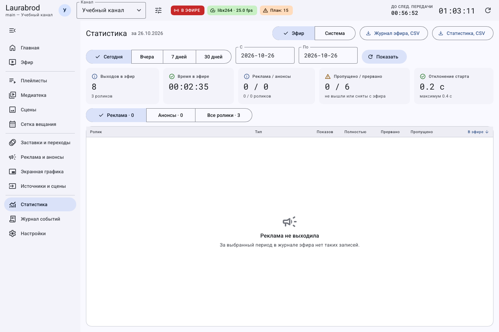
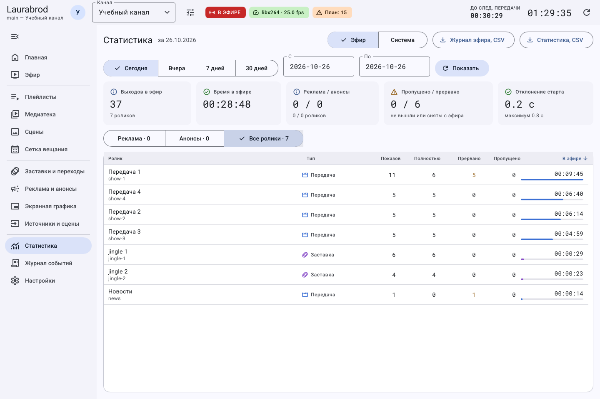
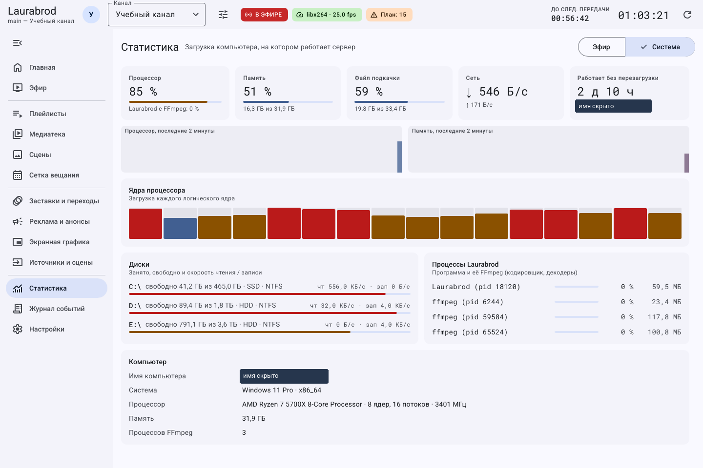

# Как проверить фактический эфир, рекламу и нагрузку

> LauraBoard 0.1.0. Снимки показывают реальный интерфейс; демонстрационные состояния подписаны отдельно. Способы и пределы проверки перечислены в [отчёте](../verification.md).

**Цель:** отличить запланированный показ от фактического и получить отчёт. Нужен хотя бы короткий завершённый эфир для наполнения истории.

## Как получить статистику показов

1. Выберите канал → **Статистика → Эфир**.
2. Выберите готовый период либо задайте начальную и конечную дату в формате `ГГГГ-ММ-ДД`; после ручного изменения нажмите **Показать**.
3. Выберите таблицу рекламы, анонсов или всех материалов.
4. Проверьте число показов и время в эфире. Нажимайте заголовки столбцов для сортировки.
5. Нажмите **Статистика, CSV**, выберите файл и откройте его в табличном редакторе. **Журнал эфира, CSV** сохраняет отдельные фактические события, а не сводную статистику.

Сводка и таблицы относятся к выбранному периоду и каналу. Пустой период не означает неисправность. Точное название кнопки экспорта может отображаться вместе со значком загрузки.

Выберите **Все ролики**, если реклама ещё не выходила и её вкладка пуста.

Источником отчёта служит журнал фактического эфира (as-run). Завершение материала и запись истории могут происходить позже появления его в мониторе. Прогноз расписания не заменяет as-run.

## Как выбрать правильный отчёт за смену

1. Запишите дату смены по часам сервера. Для первого опыта дождитесь завершения хотя бы одного ролика.
2. Откройте **Статистика → Эфир** и проверьте канал в шапке.
3. Если используете свои даты, вводите год, месяц и день: например, `2026-10-26`. Нажмите **Показать** после изменения полей.
4. Для проверки любого учебного ролика выберите **Все ролики**, а не только рекламу. Вкладка рекламы может быть пустой при исправном эфире без рекламных показов.
5. Сравните название и количество показов с тем, что действительно завершилось во время занятия.

| Кнопка | Что получите | Когда использовать |
|---|---|---|
| Статистика, CSV | Сводные показатели за период | Сравнить количество и длительность показов |
| Журнал эфира, CSV | Отдельные фактические события | Разобрать, что выходило и в каком порядке |

После выбора файла дождитесь сохранения, затем откройте его и проверьте заголовки и строки. CSV — текстовая таблица; если табличный редактор показал всё одним столбцом, используйте его импорт CSV и выбор разделителя, не меняя исходные данные вручную.

**При пустом отчёте:** сначала другой период и **Все ролики**, затем проверьте завершение материала и источник истории. Пустая таблица не является основанием очищать as-run.

## Как посмотреть нагрузку

1. Перейдите на **Статистика → Система**.
2. Посмотрите процессор, память, диски, сеть и процессы LauraBoard/FFmpeg.
3. Сопоставьте нагрузку с запуском записи, числом каналов и выбранным кодировщиком.
4. При пропусках и задержках проверьте журнал; временно уменьшите нагрузку на учебном канале, используя [настройки кодировщика](encoder.md).

Имя компьютера в публикуемом снимке скрыто. Остальные показатели относятся к реальному компьютеру сервера в момент съёмки. Не все системные показатели одинаково доступны на разных платформах.

## Если отчёт пустой или экспорт не удался

Проверьте выбранный канал, даты, завершение хотя бы одного материала и наличие as-run. Для экспорта выберите папку с правами записи на компьютере оператора. Не очищайте историю ради исправления отчёта: она используется также для учёта повторов и лимитов рекламы.

Связанные инструкции: [журнал и диагностика](logs.md), [резервные копии](../data-and-backup.md).

---

[Все гайды](index.md) · [Решение проблем](../troubleshooting/index.md) · [Главная](../index.md)
