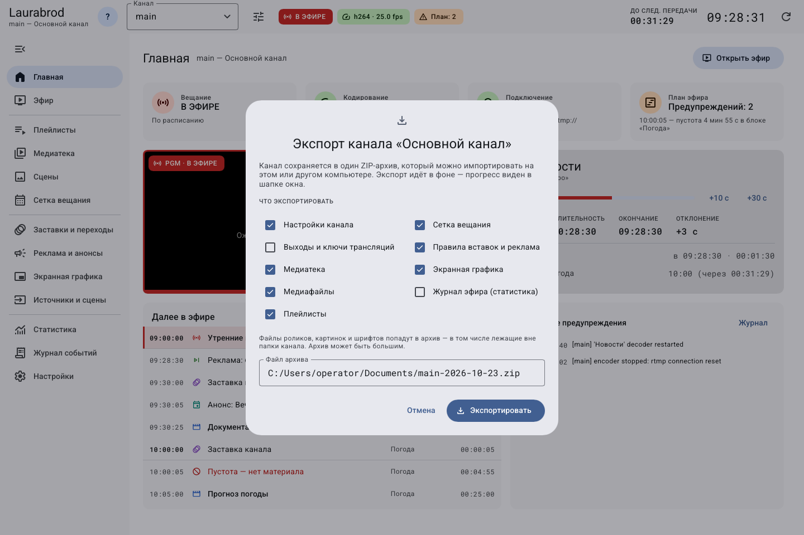
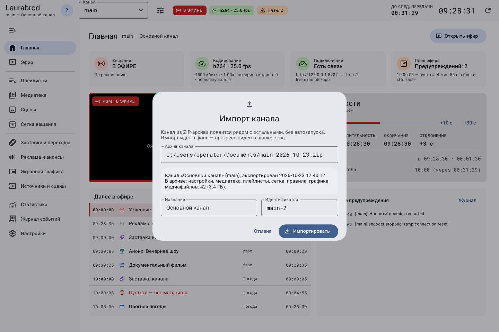

# Как экспортировать канал и перенести его на другой компьютер

> LauraBoard 0.1.0. Снимки показывают реальный интерфейс; демонстрационные состояния подписаны отдельно. Способы и пределы проверки перечислены в [отчёте](../verification.md).

**Потребуется:** роль admin, место для ZIP и доступ к файлам на сервере. Перед переносом сохраните все черновики редакторов.

## Как создать архив канала с материалами

1. Откройте **Каналы**, у нужной строки нажмите **Экспорт в архив ZIP**.
2. Выберите состав. Для самостоятельного переноса оставьте настройки, медиатеку, **Медиафайлы**, плейлисты, сетку, правила и графику.
3. Включите **Журнал эфира (статистика)**, если нужна история. Обычно она не включена автоматически.
4. **Выходы и ключи трансляций** включайте только для защищённой собственной копии. Для передачи другому человеку оставьте выключенным.
5. Задайте **Файл архива** на сервере и нажмите **Экспортировать**. Выберите новое имя: существующий файл может быть перезаписан.
6. Дождитесь успеха в [фоновых заданиях](jobs.md). Проверьте размер и возможность [импорта](#как-импортировать-архив).

**Иллюстрация выше — встроенное демонстрационное состояние реального диалога.** Указанные в нём путь и объём являются примерами. Фактический экспорт и импорт отдельно проверены через API. Архив с медиа может быть большим. Включение медиа собирает также доступные файлы, на которые канал ссылается вне своей папки.

## Как выбрать состав архива под свою задачу

| Флажки/данные | Когда нужны | Что будет без них |
|---|---|---|
| Медиатека и медиафайлы | Самостоятельный канал на другом компьютере | Записи каталога не заменяют недоступные исходные видео |
| Плейлисты, сетка, правила и графика | Сохранение подготовленного эфира | Придётся восстанавливать отсутствующие части и ссылки |
| Журнал эфира (статистика) | Перенос фактической истории | В новом канале не будет этой выбранной истории |
| Выходы и ключи трансляций | Собственная защищённая копия с реквизитами | Назначения нужно настроить отдельно; для передачи архива другим это обычно правильно |

Для первого переноса берите согласованный полный набор данных канала и медиа; не исключайте плейлисты, оставляя ссылающуюся на них сетку, ради небольшого уменьшения ZIP. Частичный экспорт требует понимания зависимостей.

1. Убедитесь, что архив создаётся на сервере: укажите путь, доступный ему для записи, и новое имя файла.
2. Дождитесь успешного задания. Только затем переносите ZIP на другой сервер.
3. При импорте сначала прочитайте состав, затем задайте свободный идентификатор. Новый канал не должен заменять существующий рабочий.
4. Проверьте материалы, прогноз, изображения и шрифты в новом канале. Подключайте внешние точки только после локального теста.

Экспорт и импорт не являются общей кнопкой отмены. Если пробный импорт не нужен, сначала убедитесь, что выбран именно импортированный канал и в нём нет новых нужных данных, затем удаляйте его штатной процедурой.

## Как импортировать архив

1. Скопируйте ZIP на компьютер нового сервера разрешённым способом.
2. Откройте **Каналы → Импорт из архива**. На пустом стартовом экране также есть **Импорт из архива**.
3. Выберите **Архив канала**, прочитайте сведения о составе.
4. Задайте свободный идентификатор и название. Нажмите **Импортировать**.
5. Дождитесь окончания задания, выберите новый канал, проверьте медиатеку, сетку, графику и выходы.
6. Автозапуск импортированного канала выключен. Запустите локальную проверку, затем настройте рабочие точки отдельно.

**Снимок импорта — встроенный демонстрационный пример реального диалога**, без утверждения, что показанный в нём архив существует. Инспекция вашего архива должна показать его состав до начала операции. Обычная ZIP-копия папки и архив команды `backup` не являются этим форматом.

## Что не заменяет экспорт

Архив не является полной копией установки: отдельно сохраняйте настройки интерфейса оператора, глобальную конфигурацию проекта, нужные записи и другие файлы вне выбранного состава. Без **Медиафайлы** вам потребуется обеспечить исходные пути самостоятельно.

Если импорт сообщает о существующем канале, выберите новый идентификатор. При **not a LauraBoard channel archive (no manifest.json)** выбран другой тип ZIP. При более новом формате архива используйте совместимую версию программы. Перед повтором проверьте состояние фонового задания и наличие частично созданных данных; не удаляйте их вслепую.

---

[Все гайды](index.md) · [Решение проблем](../troubleshooting/index.md) · [Главная](../index.md)
