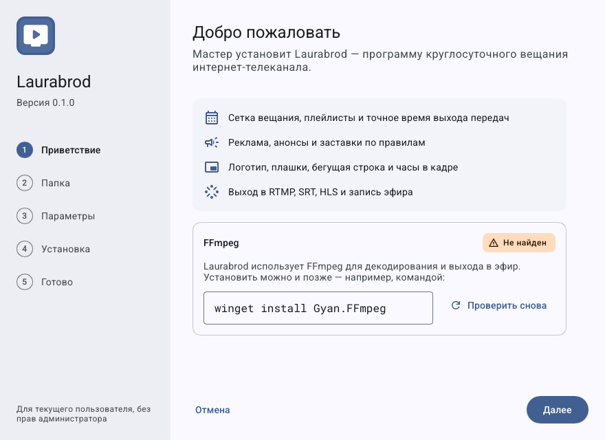
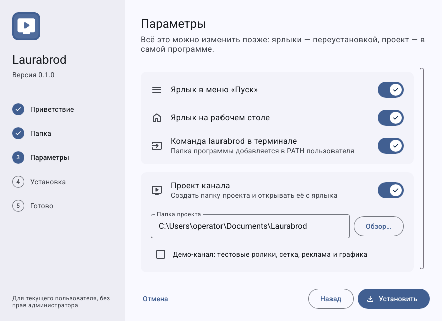
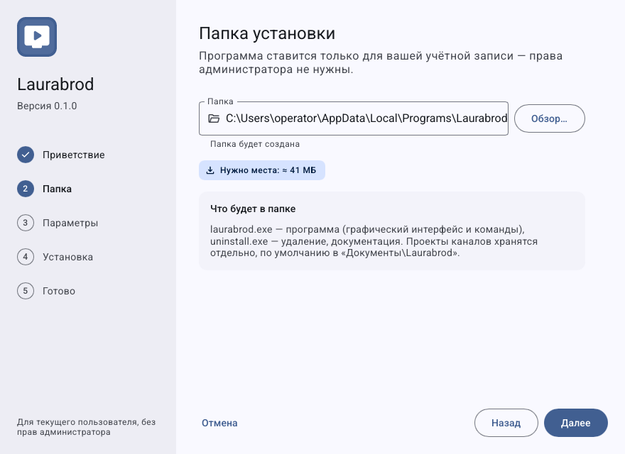
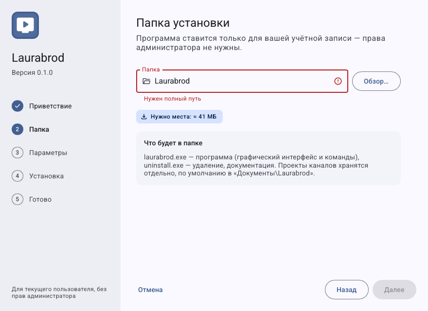
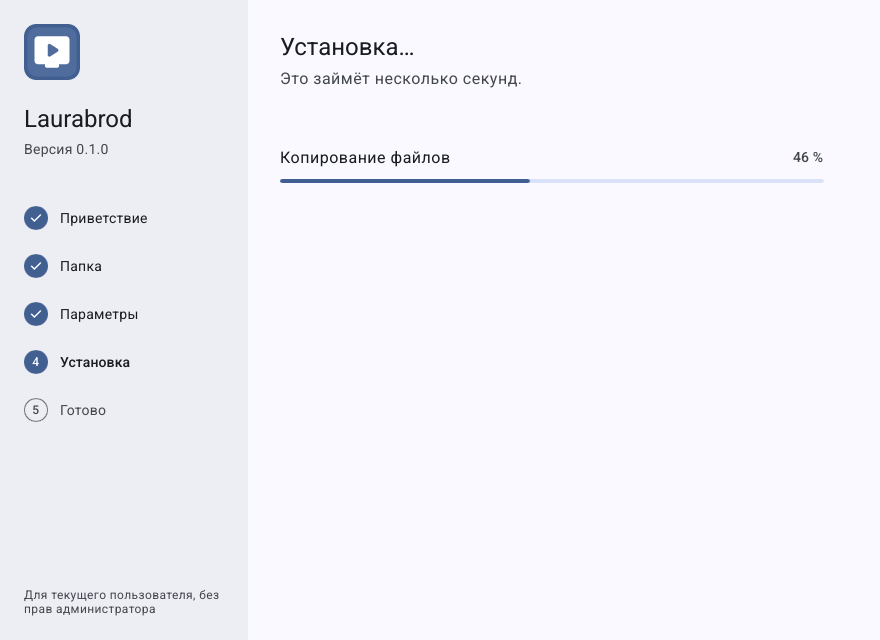
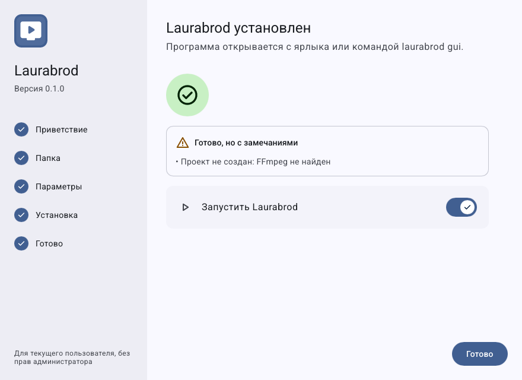
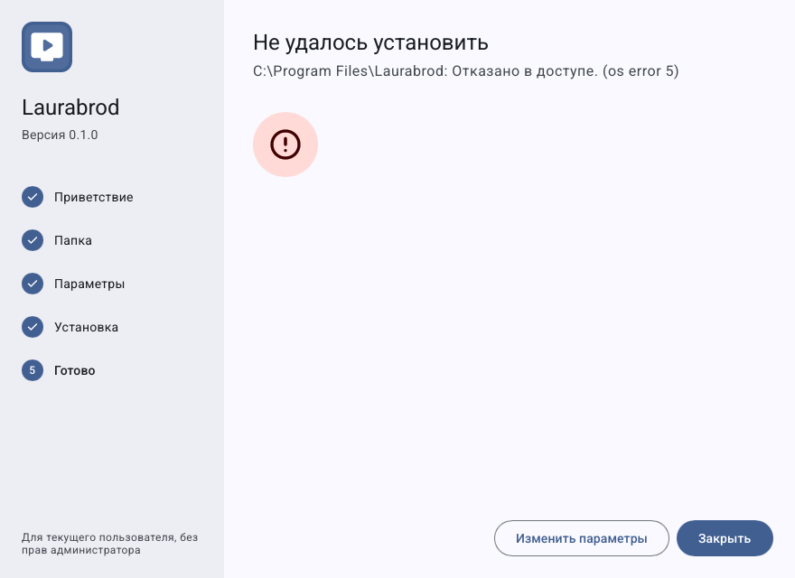
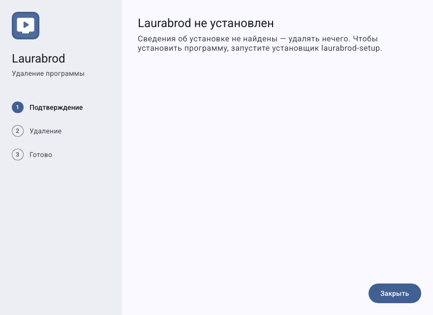

# Как установить LauraBoard и подготовить первый запуск

**Версия:** 0.1.0. Windows проверен в текущем окружении; установка в ОС и Linux практически не выполнялись. Минимальные CPU, RAM, конкретные версии ОС и требуемое место не подтверждены измерениями — см. [совместимость](compatibility.md).

## Что потребуется

- Компьютер Windows или Linux, подходящая сборка программы.
- FFmpeg и ffprobe. В проекте заявлен FFmpeg ≥ 6.1; фактические проверки выполнены на FFmpeg 9.0.2. Само число версии не заменяет проверку нужных кодеков.
- Доступная папка проекта и место под видео/запись. Пропускная способность сети должна покрывать ваши выходы.

## Как получить программу

Подтверждённая публичная страница загрузки и опубликованные контрольные суммы в проекте не указаны. Получите установщик у сопровождающего вашу поставку; не ищите «официальный» адрес по догадке. Название сборки имеет вид `lauraboard-<версия>-<os>-<arch>-setup`.

Если есть только исходники, администратор может собрать приложение и установщик по [технической инструкции](install.md). Новичку Rust для использования готовой программы не нужен.

## Как пройти установщик

1. Запустите полученный установщик. На **Приветствии** проверьте версию и результат поиска FFmpeg.
2. На шаге **Папка** выберите каталог. По умолчанию это установка для текущего пользователя, без требования прав администратора.
3. На **Параметрах** выберите ярлыки и команду в терминале, папку проекта, при желании демо-канал. Для демо нужен FFmpeg.
4. Запустите установку, дождитесь **Готово**, прочитайте предупреждения и откройте программу.
5. Проверьте версию в **Настройки → О программе**, затем [создайте свой канал](guides/create-channel.md).

Это встроенные демонстрационные снимки настоящего интерфейса установщика. Они иллюстрируют страницы, но не подтверждают выполненную установку на машине.

## Как выбрать папку и исправить ошибку пути

1. На шаге **Папка** выберите отдельный каталог установки. Папка программы и папка проекта с каналами задаются отдельно.
2. Используйте абсолютный путь к каталогу. Если указан относительный путь или существующий файл вместо папки, исправьте поле и дождитесь исчезновения ошибки.
3. Вернитесь к следующему шагу; не удаляйте рабочий проект для устранения ошибки пути.

Оба кадра — встроенные демонстрационные состояния установщика. Второй показывает ошибку валидации поля, а не отказ фактической установки.

## Как проверить ход установки и завершение

1. После выбора параметров начните установку и следите за текущим этапом и сообщениями.
2. Дождитесь конечного экрана. Не считайте появление окна прогресса подтверждением завершения.
3. На **Готово** прочитайте предупреждения, затем запустите программу и проверьте версию и проект.
4. Если показана ошибка, сохраните её текст. Проверьте права каталога, свободное место и доступность зависимостей до повторной попытки; данные каналов сохраняйте отдельно.

Эти снимки не подтверждают установку в текущей ОС. Фактическая установка, обновление и удаление здесь не выполнялись.

## Как проверить FFmpeg перед запуском

Если программа сообщает, что FFmpeg не найден, попросите администратора установить `ffmpeg` и `ffprobe` и обеспечить их доступность для процесса вещания. В терминале проверяются `ffmpeg -version` и `ffprobe -version`; после изменения PATH перезапустите приложение. Альтернатива — указать полные пути в `[ffmpeg]` глобального файла проекта.

При **Нужен полный путь** выберите абсолютный каталог; при **Это файл, а не папка** укажите каталог. Не удаляйте существующий проект ради исправления установщика. Другие проблемы — [запуск](troubleshooting/startup.md).

Далее: [первый запуск](first-launch.md), [обновление и удаление](update-and-uninstall.md).
