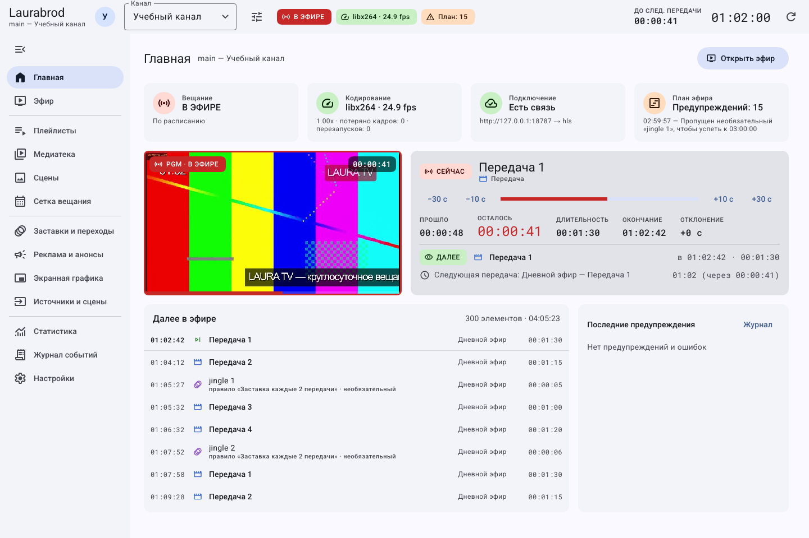

# Как ориентироваться в интерфейсе

Верхняя строка содержит канал, кнопку его менеджера, состояние эфира, кодировщика, предупреждения плана, время и обновление. Слева — разделы, в центре — выбранная задача. Панель может сворачиваться на узком экране; наведите указатель на значок, чтобы прочитать подсказку.

| Раздел | Что здесь делать |
|---|---|
| Главная | Проверять общее состояние, текущий и следующий материал |
| Эфир | Управлять показом, очередью, ручным режимом и графикой |
| Плейлисты | Собирать последовательности материалов |
| Медиатека | Добавлять файлы, искать и менять их свойства |
| Сцены | Собирать фон, музыку и оформление без монтажа видео |
| Сетка вещания | Назначать блоки и проверять прогноз |
| Заставки и переходы | Автоматизировать оформление границ материалов |
| Реклама и анонсы | Настраивать рекламные блоки, анонсы и политики |
| Экранная графика | Создавать оформление и правила показа |
| Источники и сцены | Настраивать выход, запись, входящие потоки и переключать расписания |
| Статистика | Смотреть факт показов и нагрузку сервера |
| Журнал событий | Искать ошибки и сохранять строки |
| Настройки | Настраивать GUI, уведомления и смотреть сведения подключения |

## Как понять, сохранены ли изменения

В редакторах плейлистов, сетки, правил, сцен и графики есть черновик: надпись **Не сохранено**, точка у раздела, кнопка **Сохранить**. Нажмите её и дождитесь результата. **Сбросить** возвращает сохранённую версию. Поля формы, создание каналов, свойства медиа и настройки интерфейса имеют собственные правила сохранения — они указаны в соответствующем гайде.

Переключение раздела не следует считать сохранением. Тексты всплывающих подсказок помогают найти значки без подписи. Диалог подтверждения надо читать до действия, особенно если он содержит отдельный флажок безвозвратного стирания.

[Каталог гайдов](guides/index.md) · [Клавиши](shortcuts.md) · [Настроить внешний вид](guides/appearance.md)
