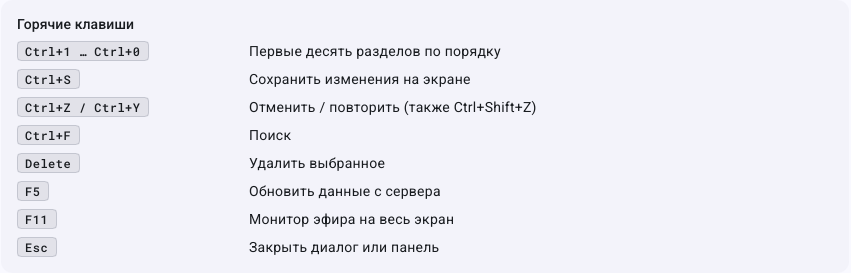

# Горячие клавиши

Сочетания проверены по обработчикам текущего интерфейса, а не по прежней таблице README. После добавления «Сцен» порядок изменился.
Сочетания с Ctrl работают при любой раскладке клавиатуры: на русской Ctrl+S — это та же клавиша, что и Ctrl+Ы. То же касается копирования и вставки в полях ввода.

| Клавиши | Действие |
|---|---|
| Ctrl+1 | Главная |
| Ctrl+2 | Эфир |
| Ctrl+3 | Плейлисты |
| Ctrl+4 | Медиатека |
| Ctrl+5 | Сцены |
| Ctrl+6 | Сетка вещания |
| Ctrl+7 | Заставки и переходы |
| Ctrl+8 | Реклама и анонсы |
| Ctrl+9 | Экранная графика |
| Ctrl+0 | Источники и сцены |
| Ctrl+S | Сохранение в поддерживающем это редакторе |
| Ctrl+Z | Отменить правку черновика |
| Ctrl+Y / Ctrl+Shift+Z | Повторить правку |
| Ctrl+F | Поиск в поддерживающем его разделе |
| Delete | Удалить выбранное; текстовое поле обрабатывает удаление текста самостоятельно |
| F5 | Обновить данные сервера |
| F11 | Монитор во весь экран |
| Esc | Выйти из полноэкранного режима; закрытие диалога/панели зависит от элемента |
| Ctrl+колесо | Масштаб таймлайна сетки |

Ctrl+S, отмена и Delete не являются глобальной транзакцией для любых действий. Для статистики, журнала и настроек нет отдельного цифрового сочетания в этом наборе; выбирайте их слева. При вводе текста фокус поля может перехватывать клавиши.

[Интерфейс](interface-overview.md) · [Главная](index.md)

