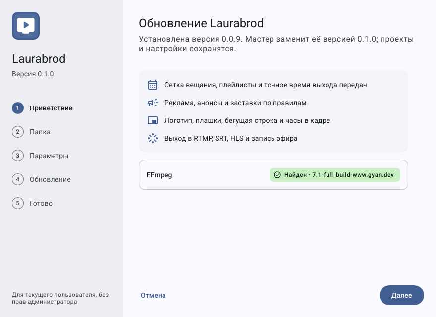
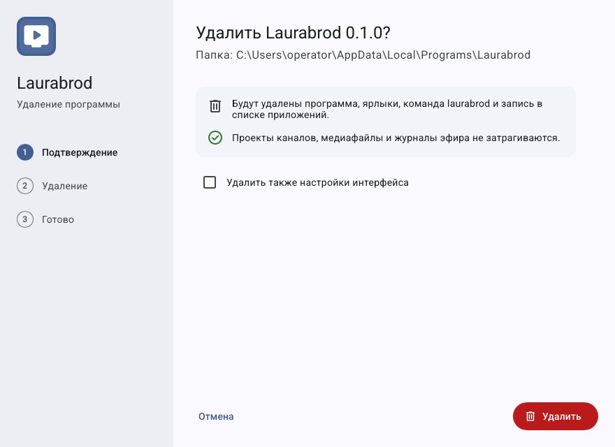

# Как обновить, переустановить и удалить программу

## Как обновить или переустановить

1. Зафиксируйте текущую версию в **Настройки → О программе** и версию сервера в **Подключение**.
2. Сохраните все черновики и создайте [резервные копии](guides/backup-restore.md).
3. Остановите эфир в согласованное время, завершите GUI и отдельный движок/службу, если она используется.
4. Запустите установщик нужной версии поверх существующей установки. Проверьте выбранный каталог и параметры проекта.
5. Прочитайте предупреждения, откройте прежний проект, выполните проверку файлов и прогноза, затем локального выхода.
6. Возвращайте рабочие выходы после проверки совместимости и данных.

Проверьте обнаруженную версию и путь, прежде чем продолжать; сохранность данных подтверждайте своей резервной копией.

Снимок — демонстрационная страница реального установщика. Обновление установленной программы в рамках проверки документации не выполнялось.

Не обещается совместимость любой старой версии с данными новой. Для отката сохраните прежний исполняемый файл и копию проекта **до** обновления. Автоматический загрузчик обновлений и отдельный мастер миграции в изученном пользовательском пути не обнаружены.

## Как удалить только программу

1. Сохраните нужные данные и завершите процессы Laurabrod.
2. На Windows откройте системный список приложений и выберите удаление Laurabrod. Альтернатива — `uninstall` в папке программы. На Linux используйте установленный деинсталлятор.
3. Не включайте удаление данных, если нужно оставить проекты.
4. После завершения проверьте, что нужные проекты, внешние материалы и архивы доступны.

Это демонстрационный снимок интерфейса. В зависимости от режима дополнительные флажки удаления отображаются на последующем шаге.

## Как удалить настройки и данные

> Сначала проверьте [состав каталогов](data-and-backup.md). Опция удаления данных может удалить собственные медиа и записи внутри папок каналов. Операция необратима без независимой копии.

В деинсталляторе отдельно выбираются настройки интерфейса и данные проекта; в CLI им соответствуют `--forget-settings` и `--remove-data` с `--uninstall`. Команда `--forget-settings` удаляет `gui.json` и `desktop.json`; не считайте её гарантией удаления всех архивов и локальных ресурсов.

Обычный деинсталлятор удаляет файлы по установленному списку `installation.json`, ярлыки и интеграцию. Занятые файлы могут удалиться позже; если осталось предупреждение, завершите приложение и прочитайте точный путь.

Служба Windows/systemd настраивается отдельно: удаление установки не следует считать подтверждённым снятием любой самостоятельно созданной службы. Поручите администратору её остановку и удаление по [справочнику](install.md).

[Главная](index.md) · [Неполадки данных](troubleshooting/data.md)
